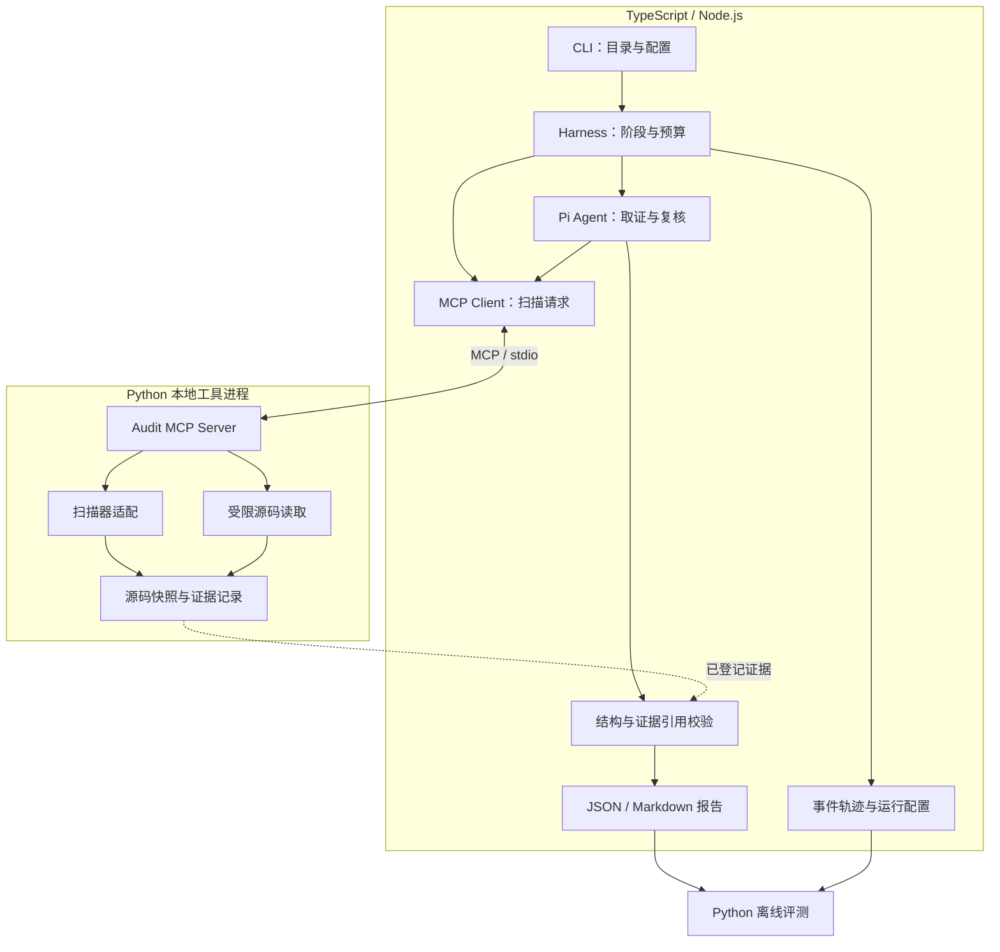

# Pi Audit Harness

基于 Pi、自定义 MCP 工具和静态分析的代码审计 Agent，面向 JavaScript / TypeScript 项目，探索如何生成可追溯、可复核的漏洞线索。

项目围绕三个问题展开：**结论是否有代码证据、上下文获取是否有效、任务执行是否可控。** 用固定测试集、对照实验和失败分析验证设计收益。

## 目标与范围

为开发者提供一个本地审计流程：输入源码目录与分析配置，输出包含输入来源、危险调用、传播依据和不确定性的结构化报告。

| 项目 | 第一版范围 |
| --- | --- |
| 被审计语言与框架 | JavaScript / TypeScript，优先 Express 小型项目 |
| 系统开发语言 | TypeScript：Pi 主程序；Python：审计工具服务与评测 |
| 问题类型 | 先实现命令注入分析，再扩展路径遍历 |
| 分析粒度 | 从函数内可验证样例开始；跨函数、跨文件分析单列支持范围 |
| 运行方式 | 本地 CLI + 本地 stdio MCP Server |
| 输出 | JSON 结果、Markdown 报告、事件轨迹、运行配置与评测摘要 |
| 结果定位 | 供人工复核的风险线索；静态候选和模型判断不直接等同于已证实漏洞 |

首版不包含自动利用漏洞、执行目标项目脚本、自动修复并提交代码、通用多语言污点引擎或分布式多租户平台。未发现目标问题不代表项目安全。

## 核心设计与待验证贡献

### 1. 将审计结论关联到具体代码证据

**问题：** 模型可能引用不存在的行号、忽略文件更新，或在缺少传播步骤时给出确定结论。

**设计：** 取证工具返回统一记录，包含运行编号、证据编号、仓库内相对路径、行号、文件内容哈希、代码片段、来源工具及截断状态。模型引用证据编号，程序检查其归属、位置和内容一致性。

分析前建立源码清单；文件变化使相关证据和缓存失效。一次运行不混用不同源码版本，发现变化后停止相关分析或重新创建快照。

**边界：** 引用有效性只说明引用与源码对应。传播关系是否成立、限制措施是否有效，仍需分析和人工标注验证。

**验证：** 统计无效引用率、过期证据拒绝情况、风险判断精确率及召回率，对比关闭校验时的结果。

### 2. 按分析需要逐步补充上下文

**问题：** 全量读取容易浪费上下文；只读取危险调用附近可能遗漏关键赋值或限制条件。

**设计：** 以候选位置为起点读取带行号的代码片段，按需扩展范围；后续接入符号定位后，再按函数边界和定义补充上下文。通过证据编号去重，限制返回长度、调用次数和总预算。定位失败、内容截断和预算耗尽必须显式进入结果。

初期使用确定的读取规则和单 Agent 分阶段分析。根据失败案例再决定是否增加复杂检索或规划机制。

**验证：** 在相同模型、测试集及预算下，与固定窗口读取、预算内全量读取比较准确性、完成率、token 和耗时。超出预算的基线样例计为不完整，不能悄悄排除。

### 3. 对候选问题执行反例检查

**问题：** 发现危险接口并不足以证明外部输入可到达该接口。

**设计：** 报告前检查覆盖赋值、常量参数、有效限制、安全接口差异及关键传播步骤。每条候选给出“风险线索 / 已排除 / 证据不足”的判断及依据。函数名包含 `sanitize` 或 `validate` 不构成净化有效的证明。

**验证：** 对比有无反例检查的误报、漏报和额外成本。结果字段完整不代表推理正确。

以上是待验证的工程设计，不宣称为已证明有效或研究意义上的首创方法。

## 项目侧重

| 参考设计 | 本项目的应用计划 | 验收依据 |
| --- | --- | --- |
| 统一工具结果 | MCP 工具统一返回状态、错误、耗时、证据引用与分析方式 | 参数与返回契约测试 |
| 结构化任务交接 | 单 Agent 分阶段传递候选、证据、待解决问题和剩余预算 | 交接记录可关联原始证据，不遗漏未解决问题 |
| 状态和调用关联 | 使用运行编号、候选编号、调用编号定位执行过程 | 能还原候选的取证、失败和复核过程 |
| 错误分类与重试测试 | 对临时错误有限重试，对永久错误及时结束 | 故障注入与预算耗尽测试 |

本项目重点验证证据一致性、按需获取上下文与复核流程的收益。MCP 复用能力与审计质量分开验证，避免将协议选型直接归因为效果提升。

第一版采用单 Agent 分阶段工作流。一次执行失败不能直接判定候选为误报。

## 系统架构（规划）



| 模块 | 实现语言 | 职责 |
| --- | --- | --- |
| Pi 集成与 Harness | TypeScript | 会话、阶段、预算、取消、模型事件和运行产物管理 |
| MCP Client | TypeScript | 连接工具服务、适配 Pi 工具调用、校验返回格式 |
| Audit MCP Server | Python | 注册工具、校验参数、限制访问与资源，返回结构化结果 |
| 审计核心与扫描适配 | Python | 读取源码、调用指定扫描器、整理候选和可用轨迹 |
| 证据生产与存储 | Python | 生成源码清单、哈希和证据编号，检测文件变化并记录失效 |
| 结果校验与报告 | TypeScript | 根据服务端证据记录检查模型引用，管理结论结构并生成报告 |
| 离线评测 | Python | 匹配人工标注、统计质量和成本、归因失败 |

## 自定义 MCP 工具（待定）

**Audit MCP Server 是本项目计划实现的审计工具程序名称，不是现成产品或模型。** 它在本机以 Python 子进程运行，由 TypeScript 主程序中的 MCP Client 连接。模型提出工具调用，主程序检查策略后发送请求，服务端执行读取或扫描并返回证据。

核心分析函数独立于 MCP 协议，便于单元测试；MCP 负责契约、调用适配及跨客户端复用。工具支持范围以实际依赖版本和兼容性测试为准。

| 工具 | 输入 | 输出 | 约束 |
| --- | --- | --- | --- |
| `scan_candidates` | 运行编号、已注册规则集编号 | 候选、规则编号、扫描状态、可用静态轨迹 | 不接受任意命令或任意扫描参数；限制时间和输出 |
| `read_evidence` | 运行编号、相对路径、起止行 | 证据编号、哈希、带行号片段、截断状态 | 限制目录、文件类型、大小和读取范围 |

`lookup_symbol` 作为后续可选能力，拟由 TypeScript Compiler API 实现，并先注册为 Pi 本地工具。它使用相同的源码范围和结果契约，不要求为此再启动一个 MCP 服务；跨语言复用确有需要时再增加协议适配。定位结果不等于完整调用图或污点传播证明。

服务启动时绑定允许访问的项目范围，模型不能通过工具参数任意替换根目录。服务端校验所有参数并限制资源消耗。

MCP 的收益通过独立客户端调用测试与 Pi 集成测试验证；审计质量收益通过工具设计与流程的消融实验验证，分别归因。

跨进程集成需覆盖服务启动失败、协议版本不兼容、断连、超时及退出清理。Python 服务的 stdout 专供 stdio 协议消息，诊断日志写入 stderr；取消时先尝试协议与工具协作取消，超出清理期限再回收进程，并保留未完成状态。

### 统一工具结果

以下字段属于本项目的业务结果契约，由 MCP 适配层承载，不替代协议自身的错误语义。

| 字段 | 用途 |
| --- | --- |
| `schema_version`、`run_id`、`call_id` | 标记结构版本并关联运行与调用 |
| `status` | `ok`、`partial` 或 `error`，描述本次工具执行完整性 |
| `data`、`evidence_ids` | 结构化结果及已登记的证据引用 |
| `analysis_method` | 例如源码读取、语法定位、静态扫描或模式匹配，标明结果来源 |
| `error` | 错误编号、脱敏说明及是否可重试；无错误时为空 |
| `duration_ms`、`truncated`、`limitations` | 耗时、截断及能力限制 |

`ok` 只表示工具完成约定操作，不代表“没有漏洞”。从更强分析方式回退到模式匹配时，必须标记方法变化和降级原因；由 harness 根据任务要求决定是否进入 `partial`，不能静默当作等价成功。截断结果应提供可继续读取的位置或明确说明无法继续。

### 分阶段交接

计划使用 `StageHandoff` 在扫描、分析与复核之间传递结构化信息，不直接复制全部对话历史。

| 字段组 | 内容 |
| --- | --- |
| 关联 | 运行编号、源码快照编号、上一阶段、下一阶段、候选编号 |
| 已完成工作 | 检查过的位置、动作与结果摘要 |
| 已有证据 | 证据编号；交接前检查其归属和源码版本 |
| 当前判断 | 候选结论及各步骤是工具报告、源码事实还是模型推断 |
| 未解决问题 | 尚未连接的传播步骤、定位歧义、缺失文件和失败调用 |
| 下一步 | 建议动作、停止条件和剩余预算 |

交接摘要不替代原始证据。下一阶段可以通过编号重新读取证据；存在关键缺口时保留 `needs_review`，不能因为摘要省略了问题就升级结论。

## 结果与证据模型

计划以版本化 JSON Schema 定义跨语言的业务契约，保存在 `contracts/`。TypeScript 在边界进行运行时校验，Python 使用 Pydantic 模型约束输入输出，并用同一组有效、无效样例验证两端与契约一致。协议 SDK 的类型检查不能替代业务结果校验。

首版先维护小规模、明确的契约与兼容性测试，不引入复杂代码生成流水线；字段变更需同步模型、测试和结构版本。

| 记录 | 关键字段 |
| --- | --- |
| Run | 运行编号、源码清单摘要、实际 provider/model、依赖/规则/提示词版本、预算、状态 |
| Evidence | 证据编号、运行编号、路径、行区间、文件哈希、片段、工具调用编号、截断状态 |
| Finding | 类型、候选编号、Source/Sink 引用、传播步骤、反例检查、结论、未解决问题 |
| ToolCall | 调用编号、工具、脱敏参数、起止时间、状态、错误分类 |
| StageHandoff | 阶段、源码快照、候选与证据引用、已完成工作、未解决问题、下一步和预算 |
| Evaluation | 数据集版本、匹配规则、指标、重复运行统计、失败分类 |

Source 是外部输入来源，Sink 是敏感使用点。传播步骤区分“静态工具报告”“源码中可核对的事实”和“模型推断”，不混为同等级证据。

Finding 结论为 `risk_candidate`、`dismissed` 或 `needs_review`。不把模型自报置信度当作统计概率。

运行状态与漏洞结论分开管理：

```text
created → scanning → analyzing → validating → completed
                    任一活动阶段 → partial / failed / cancelled
```

`completed` 表示预定流程完成，不代表漏洞判断均正确。预算耗尽、文件变化或工具缺失可能产生 `partial`；任务未完成时不能输出“未发现问题”作为完整扫描结论。即使候选全部排除，也保留扫描范围和排除依据。

## 可靠性与执行边界

- **有限重试：** 临时网络错误按策略重试，参数错误、拒绝访问等永久错误及时返回。记录 SDK 已执行的重试，避免多层重试放大调用量。
- **预算控制：** 限制总时长、模型轮次、工具调用数及输出量。调用前后检查预算；在途调用可能超出 token 预估，明确区分预估与实际用量。
- **取消传播：** 取消任务时通知模型运行和扫描子进程，保存部分结果，测试无遗留子进程。
- **文件访问：** 解析真实路径，检查链接跳转后的目标，只暴露允许的工具。`cwd` 和 MCP 都不是安全沙箱，路径检查不等于完整 OS 隔离。
- **输入可信度：** 目标仓库的 README、注释和 Agent 配置是待分析数据。控制 Pi 资源加载，避免自动执行目标项目中的扩展或指令。
- **数据保护：** 凭据不得进入日志、报告或提交。云模型会接收选入上下文的源码，运行前明确允许发送的范围。
- **轨迹复查：** 保存可观察事件、工具参数与结果，不依赖隐藏推理。保存模型和配置版本便于复查；重新调用模型不保证逐字复现。
- **缓存：** 首先只缓存工具结果，键包含源码哈希、参数、工具及规则版本。变化时失效，不默认跨版本复用模型结论。

静态扫描服务也需要资源与执行权限约束。首版不运行目标项目的安装钩子、测试或应用代码。

### 故障验收场景

| 场景 | 预期行为 |
| --- | --- |
| 临时网络失败后恢复 | 在重试次数和总预算内完成，记录每次尝试 |
| 非法参数或访问范围外路径 | 明确拒绝，不重复执行同一非法请求 |
| 工具结果截断或符号歧义 | 显示限制，补充读取或保留未解决问题 |
| 取证后源码发生变化 | 拒绝旧版本引用，重新取证或结束相关分析 |
| 模型超时或预算耗尽 | 保存部分结果，记录未完成范围 |
| 扫描器不可用 | 显式失败或标记降级，不输出完整扫描结论 |
| Python 服务启动失败、断连或异常退出 | 关联具体调用，保存部分结果，停止继续派发；重连策略受总预算限制 |
| 两端结构版本或字段类型不兼容 | 在调用边界拒绝并报告契约错误，不将畸形结果交给模型继续分析 |
| 用户取消 | 停止新增调用，传播取消并回收已启动的子进程 |
| 目标注释包含越权指令 | 不改变允许工具、目录和任务规则；记录行为测试结果 |


## 分阶段交付与验收

| 阶段 | 交付内容 | 完成标准 |
| --- | --- | --- |
| M0：可复现原型 | 整理已有 TypeScript Pi 脚本、锁文件与示例 | 协作者在新目录完成安装、分析和报告生成；先验证 Pi 调用链 |
| M1：双语言证据链 | Python 读取与证据核心、MCP 服务、TypeScript 客户端、共享契约 | 核心逻辑先通过测试；独立客户端与 Pi 均可调用；验证路径、行号、源码变化、截断与非法返回 |
| M2：审计闭环 | Python 扫描适配 + TypeScript 阶段交接、复核和报告 | 12 个冒烟样例有标签和可解释结果；阶段间保留证据与未解决问题；无效引用被拒绝或转人工复核 |
| M3：可靠运行 | 超时、预算、跨进程取消、显式降级、缓存与轨迹 | 故障可复现和归因；断连与退出可清理；未完成状态不被当作安全结论 |
| M4：效果验证 | Python 评测模块、保留测试集、对照、消融和失败分析 | 按统一协议发布质量、成本、波动和限制，不预设正向收益 |
| M5：展示与扩展 | 完整演示、真实案例、第二类漏洞 | 演示风险线索、候选排除、证据不足及异常处理，附运行记录 |

M4 后再判断是否增加代码变更范围审计、跨函数分析或服务端部署。每个扩展对应具体失败场景、测试与性能预算。

