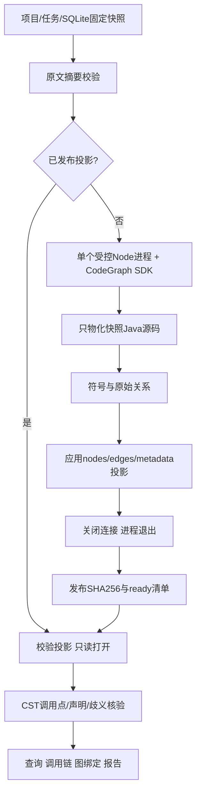

# 13 CodeGraph固定快照图与资源管理

更新于2026-11-05。当前实现，非原始提案。默认CodeGraph 1.6.2。JDT-LS产品接入已删除。schema v13新增不可改写的任务图绑定，历史1—12迁移SQL保持不变。

## 1. 架构

实现采用一次建图、导出应用自己的SQLite投影、建图进程退出。热查询不再启动上游SDK进程，比原提案的短空闲查询进程更直接。



java-parser3.0.1继续提供方法、参数与准确调用点；CodeGraph提供结构发现。Sink规则、传播核查、发送许可及结果验证保留原职责。没有给Pi开放任意CodeGraph目录或命令。

## 2. 固定制品与资源

| 项目 | 实际值 |
| --- | --- |
| npm | @colbymchenry/codegraph精确1.6.2，integrity见lockfile |
| 发布gitHead | 6560052a6f856855d3f71eee838fd66ccfa4285d |
| 适配协议 | snapshot-graph/1 |
| 运行资源 | 对应codegraph-<platform>-<arch>平台包自带Node/SDK/依赖 |
| 已验证 | Windows x64、Node24、Electron utilityProcess与解包资源 |

发布包与调研主分支不完全一致，1.6.2没有当时见到的getCallSites辅助API。实现使用公开getNodesInFile/getOutgoingEdges/getFiles提取原始关系，不直接查上游数据库SQL。

父进程检查主包/平台库版本均1.6.2。开发环境用node_modules；打包环境用resources/codegraph-packages，worker是应用自带resources/codegraph-worker.cjs。缺资源明确失败，不用CLI自动下载或用户目录中的缓存制品兜底。

## 3. 身份与投影发布

缓存key包含projectId、snapshotId、sourceStamp、引擎、adapter及所有文件文本摘要。同项目同材料可复用，不跨项目共享。

```text
<dataRoot>/query-index/<key>/
  <generation>/source/             固定Java副本
  projection-<generation>.sqlite3
  ready.json                       文件名/SHA256/图摘要/范围/资源统计
```

不复制原工程的.gitignore、构建文件或用户CodeGraph配置，不执行业务脚本。实际getFiles与快照manifest比较，上游过滤或解析失败会产生GRAPH_FILE_NOT_INDEXED/GRAPH_PARSE_INCOMPLETE。

投影自己的表为nodes(id,file,json)、edges(source,target,kind,json)、metadata(json)，有文件及边索引。只保留必要字段，去除更新时间、完整源码和任意上游文本。自己的schema避免绑定上游表布局。

发布依次经过SDK构图→投影SQLite事务→关闭SQLite/SDK→同步文件→子进程退出→父进程计算文件SHA→临时ready文件rename。complete消息不是完成判据，父进程仍等close。每次复用校验普通文件、大小、SHA及引擎身份，不能仅凭文件存在。

这不是文件/应用数据库的跨资源事务。崩溃可能留下未发布generation，读取忽略；当前不自动清理孤立文件。缓存目录、清单、投影链接会拒绝，但这是应用策略，不是对恶意本地进程的完整沙箱。

损坏缓存报QUERY_GRAPH_CORRUPT，旧任务不靠换最新版图修复历史。当前可保留诊断，创建独立项目/任务生成新key；自动缓存修复/清理UI尚未交付。

## 4. 精度与位置适配

公共v1仍使用candidate/semantic/source。CodeGraph结果为candidate、capabilities.semantic=false。内部facts保存candidate/verified-structural、provenance、resolvedBy、confidence、调用点和候选targets。

verified-structural表示图关系与CST唯一目标一致，不是类型绑定。历史confirmed结果保留原含义，新图不设置JavaCall.semantic=true。confidence不是漏洞概率。

真实制品验证出两个关键差异。

1. 上游同参数数量重载可能只选一个目标。应用按owner/name/arity恢复完整真实声明集合，保留GRAPH_AMBIGUOUS_TARGET，不选第一条冒充唯一类型结果。
2. 限定调用通常锚定receiver，无receiver调用锚定方法token。应用匹配准确CST位置，不能只按行号关联。同一行两次相同callee调用各保留callSite。

上游列0起始UTF-16，应用列1起始UTF-16；校验范围与原文，真实测试覆盖中文标识符、emoji、CRLF。definition定位准确调用token；references当前为方法调用引用，明确GRAPH_REFERENCES_PARTIAL；不会声称所有字段/类型引用完整。

泛型推导、装箱/null、接口多实现、继承动态分派、反射、生成代码及外部依赖不承诺完整覆盖。合成成员省略有缺口。调用关系正确也不证明污点传播或漏洞。

## 5. 资源与取消

| 项目 | 当前值 |
| --- | --- |
| 同时建图 | 每pool一个key，其他key为QUERY_RUNTIME_BUSY |
| 同key请求 | 共享构建Promise，取消一个只移除该等待者 |
| 最后等待者/服务关闭 | 取消工作并等待子进程结束 |
| 时间预算 | 默认90秒 |
| V8 old-space | 256MiB，不能解释成总RSS硬上限 |
| RSS软预算 | 512MiB，worker每100ms及结束采样 |
| 投影上限 | 64MiB；50000节点、150000关系 |
| 宿主轻缓存 | 最多1份定位视图，文本计费上限4MiB，不保存上游AST |
| 源码范围 | 沿用2000Java文件、单文件2MiB、总20MiB |

worker注入PARSE_WORKERS=1、RESOLVE_WORKERS=0、NO_PARALLEL_RESOLVE=1（均CODEGRAPH_前缀），以及CODEGRAPH_TELEMETRY=0、DO_NOT_TRACK=1、CODEGRAPH_NO_UPDATE_CHECK=1、CODEGRAPH_NO_DAEMON=1。2026-11-09增加运行环境白名单，仅保留系统路径、临时目录、语言与时区，不继承供应商密钥、Git/代理/Node预加载变量；cwd固定为本次source。路径/ADS/设备名、大小与重复名在物化前验证，详见[14 安全边界](14.安全边界与不可信输入防护.md)。只影响本应用子进程，不改全局环境。

不调用watch/serve/install，建图完成主动退出，释放SDK可能残留的worker/WASM堆。父进程断开时退出；取消、超时和超内存均不发布半成品。退出完成前名额仍占用。

同步计算可能延迟RSS消息，所以属于软监测，不是OS级硬隔离。宿主仍持有Node、java-parser与受限元数据，不能说整个应用空闲内存为0。大量缓存可能累积磁盘占用，当前未做自动LRU清理。

## 6. 图绑定、恢复与报告

schema13只追加run_graph_bindings一表和禁止update/delete触发器；当前32表、16个显式命名索引。字段为run/project、binding_json、binding_hash和created_at。

新任务固定engine、adapter、graphKey、graphDigest、gaps、facts。构图失败采用basic时，也固定basic身份及失败原因，不能后续悄悄升级。历史无绑定的任务保持null，不补造图来源。

RUN-02的材料绑定在存在该行时增加queryGraph；无该行时保持旧对象形状。Pi仍沿已保存路径取固定原文，恢复不依赖重新建图。删除旧后端后，历史confirmed路径和报告仍可读；原工具/材料符合原版本时按原流程恢复，而不重建旧路径。

图元数据损坏、图身份或backend变化明确拒绝。图只是加速缓存，不能拿最新源码替换原证据。HTML/JSON新增queryGraph，展示固定引擎、结构精度和缺口，同时保留机器/人工独立统计。

## 7. 资源实测

2026-11-05，同一Windows机器，3/200文件合成Java项目各5次冷启动，每次10次热查询，以下为中位数。旧后端先测量后删除。

| 文件数 | 后端 | 冷定义查询 | 热查询均值的中位数 | 重型进程RSS峰值观测 | 查询后 |
| --- | --- | --- | --- | --- | --- |
| 3 | 当前CodeGraph | 770ms | 0.82ms | 103MiB | 进程退出 |
| 3 | 删除前JDT-LS | 2158ms | 11.46ms | 654MiB | 进程驻留 |
| 200 | 当前CodeGraph | 1159ms | 12.19ms | 121MiB | 进程退出 |
| 200 | 删除前JDT-LS | 2208ms | 25.48ms | 686MiB | 进程驻留 |

CodeGraph投影约40KiB/492KiB。CodeGraph为worker采样高值，JVM为Windows PeakWorkingSet，不能当成精确同口径百分比。数据不含共享宿主基线，不是大型真实业务项目或漏洞准确率评测。

初版200文件热查询约49ms，因每次重新CST定位；受限单视图缓存后约12ms，原文及投影摘要仍逐次校验。该取舍以少量宿主元数据换速度，不能外推所有仓库收益。

## 8. 打包与验收

平台包内部lib/node_modules是bundle自带依赖，Electron默认依赖收集会漏掉。配置现完整复制codegraph-*目录到resources/codegraph-packages，worker单独复制；子进程直接使用其中的Node/SDK。只复制入口或node.exe不够。

验证分层为真实SDK专项、业务全量、实际Electron/utilityProcess/Pi停止恢复与queryGraph断言、Windows解包产物、用产物中的Node/SDK/WASM/worker实际生成投影。签名、多平台发布和安装升级另行验收。

查询专项14项；2026-11-09全量193项、0失败、0跳过，包含新增安全边界及实验脚本。删除的旧后端用例不计成新后端通过。构建包含Node/Web类型检查，lint为0warning。命令见[10 统一查询](10.统一代码查询与Java语义服务.md)。

核心入口中，query/codegraph-runtime.ts负责制品与进程，query/codegraph-engine.ts负责适配与精度，resources/codegraph-worker.cjs负责构图投影，storage/graph-repository.ts负责不可改写身份。详细原理和实操见本地学习文档38—42。

## 9. 下游适配核查

2026-11-05沿正式入口核对，桌面utilityProcess、CLI监督器及离线预处理均提供数据根目录，启用固定快照图。人工复核、报告和恢复继续围绕任务身份消费固定数据。

| 环节 | 适配与验证 |
| --- | --- |
| 自动预处理 | CST定位与CodeGraph跨文件候选结合，保存candidate/unresolved和固定图事实 |
| 手工风险点 | restoreCalls复用原facts，保留跨包同名类的入口、basic来源与原参数；原边与绑定保持可核对 |
| 源码和调用图 | 从任务快照与保存的caller/callee定位，结构候选以原DTO和虚线表达 |
| Pi/SSE | 按固定路径读取原文，传递保存的关系精度，继续执行证据和预算核验 |
| 人工复核 | 独立人工版本及机器基线，图来源由任务绑定提供 |
| HTML/JSON | 保存queryGraph和恢复信息，同快照筛选、预览与导出 |
| 会话恢复 | 新任务核对queryGraph，缺该行的历史任务保留原绑定形状 |
| 存储 | 追加schema13，旧迁移校验和与历史结果可继续验证 |
| Windows资源 | 平台Node/SDK/WASM和内部依赖随资源复制，worker完成后退出 |

本次修正了两个手工入口问题。CST单独重算会丢掉CodeGraph已消歧的跨包调用，现在恢复固定事实；方法名列与规则receiver起点不同，现在按同一次调用的范围匹配并复用参数。回归覆盖codegraph/basic、损坏缓存、旧任务无图绑定及原证据。历史需求原文保留归档背景，当前操作以本文和统一查询规格为准。
