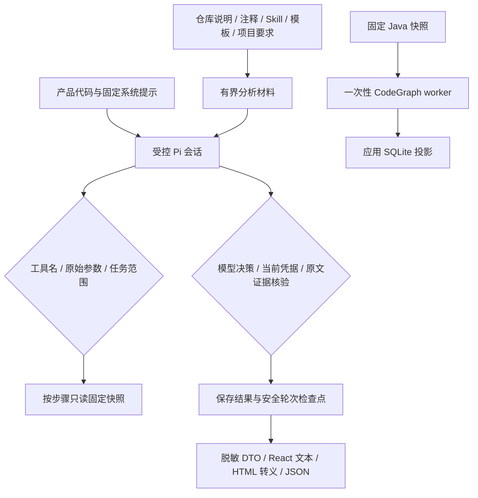

# 14 安全边界与不可信输入防护

更新：2026-11-09。对应 SEC-01、SEC-02、SEC-03。适用当前 Windows x64 桌面、Pi SDK 1.2.0 和 CodeGraph 1.6.2 实现。

## 1. 交付范围

| 需求 | 实现与验收 |
| --- | --- |
| SEC-01 目标源码与运行指令隔离 | 仅代码注册的应用扩展；关闭仓库/全局资源发现及附加系统提示；Skill 导入为文档；注入材料不获得工具权限，伪造结论仍需证据校验 |
| SEC-02 受控工具与执行边界 | 工具名和原始参数检查、固定路径步骤取证、快照路径及大小校验、独立 CodeGraph 输入、最少环境变量、不运行目标项目脚本 |
| SEC-03 凭据、日志与渲染 | 沿用系统凭据库和安全 DTO，统一脱敏；拒绝当前凭据回显的分析回复；内存恢复；固定 IPC/主窗口来源、隔离页面、文本转义和报告 CSP |

应用会写自身数据库、图缓存、检查点和报告；“不改用户源码”指目标项目，不表示应用完全没有写盘行为。这些措施是应用访问控制，不是操作系统级沙箱。

## 2. 信任边界



数据里即使出现“system”“管理员授权”“忽略之前的规则”，也不会改变程序提供的资源和工具。提示词说明负责指导模型；真正的执行能力由宿主代码限制。模型仍可能误读材料，因此最终必须通过既有引用和传播校验；注入测试不能解释为所有模型始终遵守指令的证明。

## 3. SEC-01：资源加载与文档导入

入口为 `desktop/src/service/pi-resources.ts`。每次创建资源均使用内存 SettingsManager，显式设置：

| 设置 | 当前值及目的 |
| --- | --- |
| noExtensions / noSkills | true；不从目录自动加载扩展和 Skills |
| noPromptTemplates / noThemes / noContextFiles | true；不采用仓库或全局提示模板、主题及 AGENTS 等上下文文件 |
| extensionFactories | 由产品代码传入的内联 factory；不接受目标项目传入的模块路径 |
| systemPrompt | 产品管理的固定文本，明确源码、规则、模板、项目要求和工具输出均为不可信分析材料 |
| appendSystemPrompt | 显式空数组；禁止 SDK 另行发现 APPEND_SYSTEM.md |

SDK 的 `noContextFiles` 不涵盖附加系统提示发现。本次已用真实 SDK 复现 agentDir 中的 APPEND_SYSTEM.md 被读取，再通过空数组关闭该路径。reload 后还核对资源集合：Skills、提示模板、AGENTS 和附加提示为空，系统提示一致，扩展数量与 `<inline:名称>` 路径属于本次代码注册集合；不符合则 `PI_RESOURCE_SCOPE`。

Skill 导入继续复用 `rules/template-import.ts`：只读所选 Markdown 或目录下直接的 SKILL.md。文件最多 32KiB、正文最多 16KiB；只提取已识别的前置信息标量，不解释复杂 YAML，不递归读取 references，不执行 scripts，不安装包，不访问正文链接。保存成普通模板、标记未验证，只有用户选择并创建任务后才作为固定审查材料使用。

## 4. SEC-02：工具和参数

`pi-session-factory.ts` 只允许应用创建 `audit_read_step`、运行时样例的 `audit_read_evidence` 或无工具会话。显式 `noTools: 'all'`，并检查实际激活的工具名与本次列表完全一致。正式分析每次进入供应商传输前再次核对工具集。

正式工具唯一参数是整数 stepIndex，不接受文件路径、命令、URL、SQL 或任意源码。执行前核对当前路径中存在该步骤；目标文件和范围由宿主通过已保存的调用边确定。读取仍核对 projectId/runId、固定快照身份及原文摘要。

SDK 的参数校验可能把字符串数字转换成数值。本次在 assistant `message_end` 检查原始 toolCall，先拒绝字符串索引、负数、小数、多余字段和未知工具；工具执行函数继续检查，避免仅依赖模型 JSON Schema。无效请求保持失败/风险未知，不提交安全结论。

已有工具次数、请求次数、轮次、证据总量和无进展预算继续生效。权限和预算分别回答“能做什么”和“最多做多少”，不能相互代替。

## 5. SEC-02：CodeGraph 和文件范围

`shared/snapshot-path.ts` 供公共查询和图物化共同使用。公共接口要求便携的相对路径，保留中性语言契约；实际读取仍受任务manifest约束，未交付语言由能力路由明确返回unsupported。CodeGraph物化另外限定Java扩展名。两者拒绝绝对路径、`..`/`.`/空路径段、反斜杠、冒号及 Windows ADS、控制字符、设备名、尾部点/空格，以及任意大小写的 `.codegraph` 路径段。图物化额外拒绝大小写冲突的重复路径，并在创建目录前校验最多 2000 文件、单文件 2MiB、合计 20MiB。

图输入只来自数据库中的固定 Java 文本；独占创建新 generation，工作目录设置为该 generation 的 source。不会复制原项目 README、AGENTS、Skills、package.json、mvnw、CodeGraph 配置和构建文件。SDK 只调用 `CodeGraph.init(root, {index:false})`、`indexAll()` 和结构导出，不调用 CLI 安装、watch、serve、编译或项目启动命令。

`query/graph-environment.ts` 仅保留 PATH、PATHEXT、SystemRoot、WINDIR、TEMP/TMP/TMPDIR、LANG、LC_ALL、TZ，额外注入固定 CodeGraph 单 worker/关闭遥测、更新检查和 daemon 的配置。不继承模型密钥、Git 配置、代理、NODE_OPTIONS 或 NODE_PATH；影响范围仅为本应用图子进程。

worker 是应用自带文件，Node/SDK 来自锁定平台制品；输出为应用管理的投影。只读查询、摘要发布、取消、软内存预算和制品打包见[13 图资源管理](13.CodeGraph固定快照图与资源管理.md)。PATH 等运行环境仍属于本机信任基础，SDK 和宿主进程仍具有其操作系统用户权限，不能宣称实现 OS 隔离。

## 6. SEC-03：凭据和普通输出

API Key 经固定 IPC 和认证本地 HTTP 保存，实际值由 WindowsCredentialStore 通过固定脚本、隐藏进程、私有 stdin 管道写入 Windows 凭据管理器。SQLite 保存 secret_ref；页面仅获得 credentialState 等白名单 DTO，不读取或回填真实 Key。模型调用时按已选择配置取凭据，不把 Key 加进审计任务提示或报告数据。

新增 `shared/redaction.ts`，日志、界面、备注和报告展示复用同一规则：当前已知密钥的完整匹配（含常见 JSON 转义和 URL 编码形式），以及 Bearer、含用户信息的 URL、sk- 前缀、api_key/password/authorization/secret/token 等常见模式。修正普通日志未覆盖引号 JSON 字段的问题。

分析事件额外对当前工具 ID、工具名和状态脱敏；summary/payload 继续采用有界日志：最大深度 5、数组 20 项、对象 30 字段、单字符串约 2KiB、整体 8KiB，并记录截断。事件记录不保存完整请求提示和隐藏推理。

ping 等运行时 DTO 返回前按当前实际 Key 脱敏。正式 Agent 的回复、工具调用和解析后的决策若包含当前 Key，返回 `MODEL_SECRET_EXPOSED`，不发布该回复的结论或检查点；错误信息不复述密钥，路径保留失败与风险未知。拒绝而非替换结果引用，避免把修改后的文字冒充原文证据。

模式脱敏不是通用秘密识别器，不保证识别任意编码、拆分、未知格式或历史未知凭据。原始源码快照本身是授权取证材料，可能含业务敏感信息，应按源码权限保管；此功能不等于把整库源码变成脱敏副本。

## 7. SEC-03：恢复上下文的落盘边界

本次将恢复后的会话也改为内存 manager。校验检查点大小、SHA、原生 header、leaf、消息树、宿主状态和取证回执后，直接把已验证的原生 entries 传入 `SessionManager.inMemory(cwd, undefined, entries)`；保留会话 ID、分支和工具消息，仍使用 Pi 原生上下文语义。

不再复制活动 JSONL 供 SDK 自动追加，以免模型回复在宿主检查前先进入磁盘。完整安全轮次由 Harness 统一导出原生 JSONL、检查宿主状态并去除当前已知凭据，然后 fsync、rename、计算 SHA，登记不可变检查点。`path_recovery.session_file` 对新执行为 NULL；沿用 schema v13，无需数据库迁移，不改写历史检查点或历史迁移校验和。

当前进程中的会话仍包含分析材料，内存运行不意味着数据不占内存或能抵挡有权限的本地进程。异常终止后仍回到最近已发布安全轮次，或按回执重建；原累计预算和幂等边界不变。流程见[12 停止与恢复](12.任务停止与可验证会话恢复.md)。

## 8. SEC-03：IPC、页面与报告

正式窗口保持 contextIsolation=true、nodeIntegration=false、sandbox=true。这里的 Electron renderer sandbox 是 Chromium 渲染进程机制，不代表业务 utilityProcess 或 CodeGraph 子进程被 OS 沙箱隔离。

preload 仅公开固定的 window.audit 方法，不公开通用 invoke、文件读写或命令执行。主进程通过 `window-security.ts` 检查发送者是当前主窗口，且 senderFrame 为 mainFrame；动作白名单与严格业务输入/输出 DTO 继续在后续层校验。独立窗口不能因为加载相同页面就获得主窗口权限。

主窗口拒绝新开窗口、页面导航、重定向和 webview 附着，权限请求与权限检查默认拒绝。允许的外部帮助链接仍通过固定 helpLinks 标识主动打开，报告仍经过登记与摘要核验后由既有原生流程打开。

源码、模板、模型文字、项目名、备注通过 React 文本插值或 textarea value 显示；不把不可信字符串交给 dangerouslySetInnerHTML。独立 HTML 报告逐字段 escapeHtml，CSP 禁止脚本/外部资源，禁止 base 与表单。JSON 保持数据结构并转义 `< > &` 及特殊分隔符。HTML 转义负责阻止标记被执行；凭据脱敏负责隐藏秘密，两者分别实施。

保存结果报告的 Pi 会话无工具、无审计凭据；本次在真实 streamFunction 边界直接拒绝模型传输。扩展事件抛错本身不作为可靠的传输阻断依据。

## 9. 错误语义

| 错误码 | 行为 |
| --- | --- |
| PI_RESOURCE_SCOPE | 加载资源超出应用注册范围，不创建可用审计会话 |
| INVALID_TOOL_SET | 工具选项或实际激活工具不符合当前会话要求 |
| AGENT_TOOL_SCOPE | 原始工具名/参数或步骤范围不合法，停止本路径 |
| QUERY_INVALID_INPUT | 公共查询字段或相对 Java 路径非法 |
| QUERY_GRAPH_SCOPE | 图物化路径、重复文件或大小范围非法，拒绝建图 |
| MODEL_SECRET_EXPOSED | 模型回复/检查点包含当前凭据，不保存为分析结果 |
| REPORT_MODEL_FORBIDDEN | 报告命令意外走到模型传输边界，直接拒绝 |

失败不得改成 safe。SSE 补发、恢复和报告继续使用保存的状态，不把拒绝行为解释成完成审计。

## 10. 验证与操作入口

在 desktop 目录执行：

```powershell
npm run test:security
node --disable-warning=MODULE_TYPELESS_PACKAGE_JSON --test tests/*.test.mjs
npm run build
npm run lint -- --max-warnings=0
```

安全专项包含 12 项边界测试与 1 项实验脚本回归；使用真实 Pi SDK、真实 CodeGraph 和本机模型协议替身。样例目录 `tests/fixtures/security/prompt-injections.json` 覆盖仓库伪授权、附加提示、Skill 脚本、注释/角色伪造、模板/项目要求和 HTML 注入形式。另有真实 Electron/React/utilityProcess 联调：页面无 Node、桥接无通用 invoke、外窗口 IPC 拒绝、导航/弹窗拒绝、源码/人工备注/报告文本转义，回环 HTTP 探针请求为 0。有限样例验证宿主能力边界，不代表对全部提示词攻击或模型准确率作穷尽证明。

实验脚本无需真实 Key：

```powershell
$raw = node --disable-warning=MODULE_TYPELESS_PACKAGE_JSON scripts/security-lab.mjs init | Out-String
if ($LASTEXITCODE -ne 0) { throw '安全实验初始化失败，请先查看上方错误' }
$sec = $raw | ConvertFrom-Json -ErrorAction Stop
$sec | Format-List root, source, skill, labFile
node --disable-warning=MODULE_TYPELESS_PACKAGE_JSON scripts/security-lab.mjs check $sec.labFile
Test-Path $sec.marker
```

预期检查返回 ok=true、backend=codegraph、sourceUnchanged=true、projectScriptExecuted=false、modelRequests=0；最后 Test-Path 为 False。init 每次创建独立 `.local/security-lab/lab-*`，源码、Skill、快照库、检查记录和 HTML/JSON 均留在其中；stdout 为兼容 PowerShell 代码页的 ASCII 安全 JSON，磁盘文档仍为 UTF-8。

可将输出的 source 导入桌面，将 skill 通过“导入 Skill 目录”读取后保存，选择模板并新建任务，点选 Sink 调用查看注释文本，填写恶意 HTML 人工备注，再预览/导出阶段报告。桌面使用自身数据库，因此脚本创建的任务不会自动出现在桌面列表。完整知识点、每步预期、无需付费模型的攻击实验及排错见本地学习文档 43—46；这些个人学习资料不进入线上技术索引。
