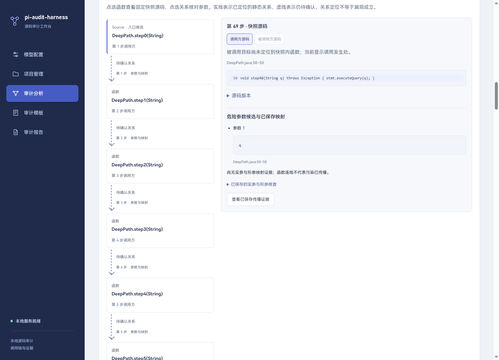

# 15 质量验收、性能基线与交付

更新：2026-11-09。对应 QA-01、QA-02、QA-03。验收把源码标注、候选发现、调用关系、模型分类、原文证据、界面性能和安装交付分别记录，不以任务完成代替判断正确。

## 1. QA-01：固定验收集与开发集分离

验收源代码在 `fixtures/acceptance`，版本 `qa-java-2026.11.09.1`；18 个独立样例与 manifest 保存 ID、分类、参考结论、理由和源码 SHA256。SQL 注入、命令注入、路径遍历各 2 个成立、2 个阻断，另 6 个未知覆盖外部策略/依赖缺失、递归、来源不足和重载歧义。代码由本项目独立编写，不复制第三方漏洞库。

`scripts/qa-corpus.mjs verify` 核对文件摘要、类别数量和开发 Java fixtures 的内容摘要，禁止同内容混入两个集合。参考标注是可复核的工程基线，不冒称项目负责人已经人工签字；更改标注需修改版本、理由和摘要，不根据模型回答反向改标签。

### 1.1 工程回归与模型质量分开

`scripts/qa-acceptance.mjs` 对每例创建固定任务，重复三次，共 54 次。使用真实 CodeGraph 和 Pi SDK、本机确定性协议替身，验证 Sink 命中、路径来源、原文位置、结构/传播校验、SQLite 保存和 HTML/JSON 一致性。替身按测试目标返回结果，只证明宿主工程链路，不能计作模型准确率。

三次使用同一源码版本；每次任务 ID 独立，规则和图后端固定，输出记录 scope/pathId、候选数、覆盖缺口、耗时和结果。报告示例明确标注来自协议替身。

### 1.2 真实参考模型与预算

用户授权的配置为 DeepSeek-Flash / deepseek-flash，configId `6d58b649-93c6-4447-a922-fbbbb0db4ca7`、revision 1、目标 `https://api.deepseek.com/v1`。脚本只读原配置并从系统凭据库读取这一条引用，不打印 Key、不修改原配置、不访问其他凭据；仅向供应商发送新建验收源码。

revision指应用配置版本，不是供应商权重版本。接口未提供独立权重修订号；保留请求日期、模型别名和原始usage，不承诺该模型别名永久对应相同服务实现。

真实请求需显式 `--live`，共享预算账本，记录每次供应商 usage（含缓存和 reasoning），不按输入/输出合计再次叠加 reasoning。默认总预算约 30000 Tokens；已完成 9 个校准请求，总计 **27239 Tokens**，之后停止付费调用。真实运行记录与初始失败均保留，不自动无限重试。

初次自由文本引用评测存在截断、格式不合规和伪引用，未计作通过。其中一个可解析轮次的分类方向均匹配，但只有 14/18 的自由引用逐字有效。这说明“分类看似正确”仍不能绕过原文校验。

校准改为证据卡协议：输入每个样例的固定源码卡与覆盖信息，模型选择结论和已登记卡 ID，宿主用对应任务快照与 SHA 解析原文。卡 ID 只接受 `body` 或当前样例 ID，拒绝其他样例 ID 和任意字符串。实际回复采用同样例 ID；本地严格解码后，三轮均为 18/18 与参考标注一致，证据卡均能定位原快照。重解码只处理已保存的真实可见回复，没有新请求、没有修改标签，也不把原自由引用失败抹掉。

这是小型受支持样例的参考分类结果，区别于每条路径完整工具循环的模型评测；不得对外宣传为通用漏洞准确率、全仓库覆盖或 54 条真实工具循环全部正确。完整路径工具循环由工程回归和安装后实际运行另行验证。

### 1.3 DeepSeek 兼容修正

真实测试发现：供应商默认开启 thinking，而 Pi 的本地 thinkingLevel=off 不会自动发送该供应商开关。`provider-compat.ts` 仅对官方 HTTPS api.deepseek.com，在发送前设置 `thinking.type=disabled` 并移除冲突的 reasoning_effort；保留其他供应商、原对象和原扩展钩子。后续真实 usage 的 reasoning 为 0。

依据：[DeepSeek 思考模式](https://api-docs.deepseek.com/guides/thinking_mode/)、[Chat Completions 参数](https://api-docs.deepseek.com/api/create-chat-completion/)。该改动兑现产品原先的非思考会话设置，不改变用户模型身份或把隐藏推理保存为日志。

## 2. 真实项目复核

固定 WebGoat 提交 `4e98f1cbbf896fdd06edcc9930515ebe0ade7c69`，取原文件：

```text
src/main/java/org/owasp/webgoat/lessons/sqlinjection/introduction/SqlInjectionLesson5.java
SHA256 455007672e023cd419069b2dcf3dee21c1f4c222ea58e3487073b1657d1a3b15
```

原字节下载到 `.local/qa`，不启动项目、不安装其业务依赖。真实 CodeGraph 找到 completed → injectableQuery → Statement.executeQuery 的路径；Pi 工具取得原文，保存 unknown，生成报告。独立源码复核记录第 55/57 行入口与传参、第 60/65 行被调方法与 SQL Sink：该教学入口支持直接外部 SQL 注入判断，流内没有参数绑定/输入验证。

复核与机器结果分开：本机协议替身故意返回 unknown，不伪造人工 UI 确认，也不把单文件复核宣称为 WebGoat 全仓库审计。该文件上游为 GPL-2.0-or-later，仅本地验证，不纳入产品 MIT 源码或安装包；交付文档保留固定链接和范围说明。[固定上游源码](https://github.com/WebGoat/WebGoat/blob/4e98f1cbbf896fdd06edcc9930515ebe0ade7c69/src/main/java/org/owasp/webgoat/lessons/sqlinjection/introduction/SqlInjectionLesson5.java)。

## 3. QA-02：规模与界面

`qa/scale.mjs` 生成 10000/50000 物理行、100 Java 文件、100 候选点。填充是明确的重复赋值，不当作真实业务复杂度；真实项目与合成规模试验分开。

真实 Electron/React/utilityProcess 验证候选分页、50 节点图与固定源码定位。为补齐当前仅 33 节点的上限，公共展开/存储/DTO 最大边数统一为 49，得到最多 50 节点；默认深度仍为 16。单条模型调查仍限制 16 步，超长图明确拒绝分析，不扩大恢复表/工具预算。节点展示规模与一次模型任务证据预算不是同一概念。

最终补丁运行时结果：1 万行预处理约 1.60 秒；5 万行约 3.37 秒；100 路径列表准备约 74 毫秒；四次分页约 76/62/62/62 毫秒；50 节点图约 74 毫秒，源码联动约 64 毫秒。分页计时等待新页第一条真实 pathId 更新，不能只看页码文字提前变化。数值只反映本机合成场景。

停止操作从真实按钮点击计时，界面确认约 66 毫秒，进入停止约 73 毫秒；符合 2 秒目标。停止后连续观察 5 秒，模型服务器收到的请求数不增加。实际在途请求可快速取消，不能据此推断远端已经停止计费。随后换 utilityProcess PID 13776→53500，确认主动恢复前不请求模型、原 CRLF 快照不漂移、native 恢复和阶段 JSON 一致。

补丁运行时回归发现 Windows 深目录下 SQLite 无法打开 CodeGraph 的附加数据库文件；原实现会显式 basic 降级。现在保留完整快照哈希与缓存身份，缩短一次性 generation/src 目录，为 SQLite WAL 文件名留出空间；深 profile 的真实 CodeGraph 回归和原安全输入检查均覆盖新布局。极深路径仍受 Windows/SQLite 路径限制，失败时保留缺口，不承诺任意路径长度。

可分享的本机汇总见 [QA验收数据](assets/qa-2026-11-09.json)；原始数据库、会话和个人运行时留在 `.local`。截图为实际50节点界面：



## 4. 一小时连续运行

`scripts/qa-soak.mjs` 使用单调时间，实际连续 **3600005 毫秒**，即一小时；完成 3510 个周期，0 个记录失败。每周期真实 CodeGraph 热查询和路径列表，每 10 周期生成 100 路径 JSON 快照并检查数据库。使用固定 5 万行/100 候选材料，不调用付费模型。

首次预处理约 5.35 秒；宿主观测 RSS 峰值约 475MiB，采样后段约 255MiB；热查询最大约 18.73 毫秒；定时器超额延迟最大约 16.09 毫秒。报告序列化单独增加周期耗时，不能把完整采样周期耗时都称为查询耗时。

范围是业务查询/SQLite/快照导出连续运行；真实 Electron 界面性能、Pi 停止和跨进程恢复是另一个联调，不宣称 Electron 窗口或付费模型连续运行了一小时。中断恢复按实际不同 PID 与保存事实核对，不能用模拟时钟/缩短等待充当一小时。

## 5. QA-03：交付材料

项目本地交付许可证草稿采用 MIT；上游依赖仍保留各自许可，不因项目许可证改变。当前未推送、未发布。`qa-compliance.mjs` 枚举锁定运行依赖与 CodeGraph 平台包内部依赖，生成 inventory.json 和第三方说明，保留原许可证文件；最终补丁依赖清单为 165 个组件、148 份原文，未声明许可证的组件为 0。

随安装包 `resources` 提供：

- delivery：README、项目 LICENSE、desktop依赖声明与锁文件、技术文档、查询 Skill 文档、内置规则目录、18 个原创验收样例、明确标注的 HTML/JSON 示例。
- compliance：运行依赖清单、原许可证文本、单独的 CodeGraph 内嵌 Node 24.16.0 LICENSE；Electron/Chromium 自带 notices 保留。
- codegraph-packages 与应用 worker：锁定平台 Node/SDK/WASM 和依赖，不要求用户安装 JDK。

不打包 Key、个人数据库、Pi 会话、`.local` 学习资料或 WebGoat 原文件。Skill 是使用说明，随包提供不代表自动执行。

实际制品检查发现脚手架的排除规则会遗漏 `.agent-learning` 等本机测试目录。已改为应用 `out/**`、package.json 与锁定运行模块的允许清单，离线材料仅从指定 extraResources 加入。`qa-package-check.mjs`检查最终app.asar的根目录及离线资源，拒绝业务数据库、会话和环境文件进入应用区；开发目录内容不能仅靠.gitignore保证不会打包。

生成未签名 Windows x64 NSIS 安装包，产品标识从脚手架占位改为 pi-audit-harness，删除 example.com 自动更新占位，不自动发布。安装验证与解包验证分别记录；不能仅凭生成 exe 就标为安装成功。

本机实际安装至任务自有目录，使用独立 `--user-data-dir`，确认日志后才写入测试数据；安装后的Electron44.9.1/内嵌Node24.22.0启动服务、导入原创样例、真实CodeGraph构图、通过正式IPC执行Pi工具循环、保存原文证据并生成HTML/JSON均已验证。模型为本机协议替身，未新增付费请求。退出后卸载测试实例，清理并读取确认测试假凭据已删除；个人配置和旧开发窗口不操作。安装结果及进程日志保留在 `.local/qa/installed`。

依赖审计发现并修补 Electron 44.9.0 和 Pi 的 minimatch/undici 间接依赖告警：Electron 固定 44.9.1，Pi 仍锁 1.2.0，通过定向 overrides 使用 minimatch 11.0.1、undici 8.12.2，不为消除告警直接升级会话 SDK。独立安装环境的 `npm audit --omit=dev` 为 0 告警；开发工具链剩余告警单列，不宣称全部依赖零风险。

## 6. 兼容矩阵与边界

| 项目 | 当前记录 |
| --- | --- |
| 实测系统 | Windows 10 x64，build 19045；当前机器，非全新 VM |
| 宿主 Node | 24.21.0 |
| 最终 Electron | 44.9.1；原运行中开发窗口仍可能使用旧版本，需退出后重新安装依赖 |
| 安装版内嵌 Node | 24.22.0，与宿主命令行Node分开记录 |
| Pi / CodeGraph | 1.2.0 / 1.6.2 |
| CodeGraph 内嵌 Node | 24.16.0 |
| 凭据 | Windows Credential Manager |
| 真实供应商 | DeepSeek 官方 Chat Completions，deepseek-flash，revision 1 |
| 未实测 | Windows 11、其他 CPU/内存档、macOS/Linux 安装、多供应商审计质量 |
| 范围限制 | 固定 Java、结构候选非类型绑定；50 节点可展示，模型单路径16步；免费模型兼容性不自动推断 |

当前安装和接口验证不等同于干净系统的全兼容声明；签名、企业分发、全新 VM 和更大语料仍需分别验收。

## 7. 复现命令

在 desktop 目录：

```powershell
node scripts/qa-corpus.mjs verify
node --disable-warning=MODULE_TYPELESS_PACKAGE_JSON scripts/qa-acceptance.mjs
node --disable-warning=MODULE_TYPELESS_PACKAGE_JSON scripts/qa-real-project.mjs
.\node_modules\.bin\electron-vite.cmd build --config electron.qa-test.config.ts
node tests/run-qa-electron.mjs
node --disable-warning=MODULE_TYPELESS_PACKAGE_JSON scripts/qa-soak.mjs --duration-ms 3600000
```

最后一条实际运行一小时，不使用真实模型。产物各自保存在 `.local/qa` 或 `.qa-test-data`；结果 JSON、截图、源码/锁文件摘要和环境信息应一同保留。

真实调用必须另行主动执行，以下会消耗所选配置额度，切勿把它并入普通回归：

```powershell
node --disable-warning=MODULE_TYPELESS_PACKAGE_JSON scripts/qa-reference-model.mjs --live --evidence-cards --config-id 6d58b649-93c6-4447-a922-fbbbb0db4ca7 --token-budget 30000
```

共享账本已累计本次 27239 Tokens；脚本不会为了重跑自动重置。只想复核现有模型输出时，用 `qa-reference-replay.mjs <本次reference-model目录>`，不需要 Key，也不产生新请求。

最终全量验证与打包：

```powershell
node --disable-warning=MODULE_TYPELESS_PACKAGE_JSON --test tests/*.test.mjs
npm run build
npm run lint -- --max-warnings=0
node scripts/qa-compliance.mjs
node --disable-warning=MODULE_TYPELESS_PACKAGE_JSON scripts/qa-release-assets.mjs <本次acceptance产物目录>
.\node_modules\.bin\electron-builder.cmd --win nsis --x64 --publish never
node scripts/qa-package-check.mjs dist/win-unpacked
$installer = Get-ChildItem dist -Filter '*win-x64-setup.exe' | Sort-Object LastWriteTime -Descending | Select-Object -First 1
if (-not $installer) { throw '找不到本次安装包' }
node --disable-warning=MODULE_TYPELESS_PACKAGE_JSON scripts/qa-installed-smoke.mjs $installer.FullName
```

本地详细学习与亲手复现见 48—51 篇，初始失败、真实用量和范围限制均保留；当前没有远端发布或推送。
