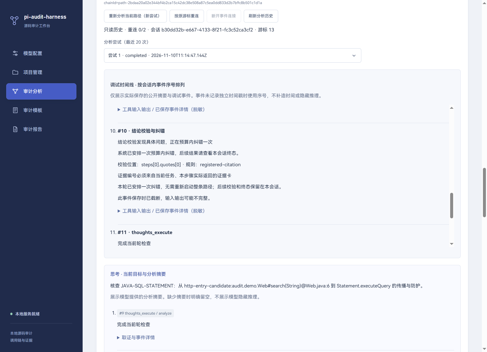

# 16 真实模型输出可靠性与工程纠错

更新：2026-11-10，修复版本1.0.1。针对真实DeepSeek完整路径调查频繁出现ANALYSIS_EVIDENCE_INVALID、ANALYSIS_TAINT_INVALID和AGENT_DECISION_INVALID的问题。此文记录当前实现与真实验证，历史QA-01证据卡分类结果不替代完整工具循环验证。

## 1. 问题与实际复现

用户会话中三个audit_read_step都成功，但最终finish提交被拒。旧记录仅保存错误码，未保存具体字段，不能事后补造被拒绝的模型答案。新诊断只对更新后的新尝试生效。

本次在独立数据库、真实CodeGraph、正式Pi SDK和原用户DeepSeek-Flash配置上复现。同一多文件路径的最初三次对照中两次传播格式失败、一次完成；另两次诊断对照出现JSON格式错误。原失败、各次用量和中间方案均保留。

进一步读取新测试的公开模型提交，发现三个实质问题：

1. 多层JSON有时缺少闭合括号；仅增加一次模型重试仍不稳定。
2. 模型把“防护缺失”理解为defense=blocked，但旧协议用blocked表示“攻击被有效防护阻断”。
3. 旧规则要求所有safe步骤都必须有阻断防护，误拒绝了固定程序参数、固定文件路径这类“危险参数不受外部控制”的合理结论。

界面与数据库现可记录具体校验字段、规则、受限的公开结构化提交预览和纠错结果。旧尝试、原机器结论和人工复核版本均不改写。

## 2. 源码引用与输出结构

### 2.1 固定证据编号

audit_read_step输入仍只有stepIndex。宿主从本任务固定Java快照读取调用方/被调用方原文，并生成citations，每张卡包含id、filePath、行号和原文行。编号绑定projectId、runId、pathId、步骤、范围及源码内容摘要；空行和过长单行不生成卡，原始ranges仍保留。

模型的quotes优先提交这些ID，宿主在验证前还原原文。输出里原有逐字字符串仍兼容。ID必须已经由本任务实际读取的证据登记；其他任务、未读取步骤和捏造ID拒绝。相邻步骤共享函数时，可以使用已读卡，但还原后的原文仍必须逐字存在于当前步骤ranges。

SQLite与报告继续保存普通原文字符串及位置，传输ID不替代证据正文，无需数据库迁移。新读取结果的外层位置统一指向第一个实际范围，多文件源码仍按ranges区分；不再把旧调用点窗口行号与新函数原文混为一处位置。

### 2.2 JSON约束与有限结构修复

官方DeepSeek审计会话在发送前加入response_format=json_object、temperature=0，并继续明确关闭thinking；其他供应商不自动接收这些专用字段。已通过实际请求元数据验证上述字段进入传输。依据：[DeepSeek JSON Output](https://api-docs.deepseek.com/guides/json_mode/)。该接口也可能返回空白内容，应用仍执行本地解析与预算内纠错。

真实SDK可见文本中仍观测到闭合符号缺失，因此parseDecision只进行以下确定性结构处理：

- 识别字符串与转义，忽略字符串内部的花括号和方括号。
- 最多补8个缺失的闭合符号，保存原始位置和插入符号。
- 不修改文本、标识符、数值、字段或逗号，不补造引用或缺失业务内容。
- 重复对象字段、未闭合字符串、多余闭合符号、其他语法错误继续拒绝。
- 供应商明确以length结束时拒绝采纳，转入一次受限纠错。

补括号只得到待校验对象；仍须通过全部结构、步骤、原文和传播检查。该过程不会直接判定safe或dangerous。事件validation_syntax_repaired明确记录修复动作。

### 2.3 防护状态与固定输入

模型侧defense.status使用effective/absent/unknown/not_applicable。effective表示攻击被有效防护阻断，宿主规范为原有blocked；absent表示未发现有效防护，规范为not_applicable，不能据此把路径判安全。原blocked形式继续兼容。

constantRiskArguments是范围受限的宿主事实：检查内置规则对应Sink参数，要求参数表达式在固定源码的准确行列处逐字匹配，且属于直接字符串常量或限定的Path.of/Paths.get常量参数形式。命令参数规则要求全部参数满足条件；变量、拼接、调用结果、缺失参数、伪造坐标和不支持表达式不能获得此事实。

只有宿主核验常量事实、模型明确dangerous=0、污染输入输出均为空、参数映射检查非unknown时，才接受“无外部污染到达、无需净化器”的safe步骤。宿主不会自动把unknown改safe。该事实不证明整个方法/业务安全，不提供完整类型绑定、符号链接或授权证明。

## 3. 有限纠错、瞬态失败与停止

| 机制 | 上限与边界 |
| --- | --- |
| 结构/原文/传播纠错 | 同一尝试最多一次，给出具体field/rule/message和当前已读证据卡 |
| 瞬态请求重试 | HTTP服务失败、连接异常、请求超时最多一次，短暂退避；鉴权、模型配置、额度/限流和越界不自动重试 |
| 请求预算 | 原maxRequests=28、maxRounds=4、maxToolCalls=24及110秒总时限保持 |
| SDK隐藏重试 | 传输显式maxRetries=0，应用负责可见的有限重试 |
| 输出预算 | 声明contextWindow=65536；maxTokens按步骤数在4096至16384内增长，不代表供应商必然具有相同上限 |
| 结果发布 | 校验通过后才写机器结论；失败保留unknown，余下pending不自动消耗 |
| 用户停止 | 退避与下一次请求前检查取消信号；停止期间不继续派发新请求 |

失败反馈不要求模型为了通过而改成safe。证据不足可以合法完成unknown；这与failed不同。关闭页面或按游标重连不触发新的模型尝试。

## 4. 诊断与恢复一致性

ResultValidationError包含固定字段位置、规则与说明；不把任意被拒字符串拼入错误消息。publicSubmission只投影允许的公开结果字段，限制步骤/引用数量和文本长度，超过3KiB时只保留形状摘要，保证预览不会挤掉关键字段诊断；不保存任意供应商字段或隐藏推理。事件层再做当前Key检测、脱敏、8KiB上限和截断标识。

新增SSE事件validation_info与request_info，经原认证HTTP、固定IPC和主进程DTO进入界面，显示“结论校验与纠错”“模型请求重试”。日志能区分具体字段错误、一次纠错成功、持续失败和供应商用量不确定。

可自动处理的中间反馈以状态提示显示，持续失败才显示错误提示；保留原有主题配色。实际窗口中的字段反馈：



检查点保存repairs/networkRetries计数，均限定0至1；旧检查点缺字段时视为0。新增citations必须按原取证回执重新计算并核对，不能因附加元数据而跳过原文摘要校验。旧工具输出没有卡时仍按旧回执校验。

瞬态失败的旧请求明确保存uncertain。重试前仅将未完成的assistant从SDK内存活动分支移除，完整工具上下文保留，失败事实仍在SQLite；已发布的旧检查点不修改。回归验证：瞬态失败后发布finish检查点，再在结果提交前中断，仍能native恢复，且不重复请求已经完成的模型答案。

## 5. 真实测试与范围

参考配置仍为DeepSeek-Flash/deepseek-flash，应用配置revision=1。只读取这一条配置与系统凭据，个人数据库只读；新任务、源码副本和会话全部写入.local/reliability/2026-11-10。

| 验证 | 实际结果 |
| --- | --- |
| 新增可靠性基础测试 | 12项，含严格引用、结构修复、字段诊断、常量参数、有限纠错、服务重试、停止和原生恢复 |
| 最终18例三轮 | 54/54完整工具循环提交完成，原文可定位，数据库与JSON报告一致 |
| 原标签对照 | 52/54一致；另2条来自递归样例未截断直达分支，详见下文 |
| 递归截断分支补测 | 3/3完成并保留unknown |
| 用户报错项目复现 | 原实验源码的两条三步路径，各三轮，6/6完成并给出有证据的dangerous |
| Electron联调 | 真实React/utilityProcess/Pi；一次纠错成功、持续失败保持未知、具体字段和历史显示、假凭据清理 |
| 安装版 | 未签名Windows x64；实际安装到独立profile，同一尝试错误引用→纠错→证据保存→HTML/JSON→卸载与假凭据清理 |
| 支付测试总量 | 供应商已报告776699 Tokens；另37076按两次无usage请求的完整预留上界保守计入；预算占用813775/1000000，未决预留0 |

上述统计包含本次所有初始失败、中间方案与最终验证，付费测试已停止。不是“总共只花54条路径的用量”。请求计量、实际传输非敏感元数据、公开输出和每轮结果都在本地账本/收据中。

递归样例的源码允许n<=0时直接执行外部SQL；其原unknown标签用于递归覆盖不足场景，但最初脚本只选每个任务第一条路径，有时选到未截断直达分支。本次不修改标签或删除差异；原54条结果全部保留，另外用结构条件truncated选择递归分支并实测三次。该结果不能宣传为通用准确率100%。

汇总数据见[可靠性验收数据](assets/reliability-2026-11-10.json)。当前范围仍是固定Java快照、结构候选与受控工具；其他供应商、复杂真实业务与更大规模仍需专项验证。

## 6. 开发验证与无付费实验

从desktop执行：

```powershell
npm run test:reliability
node --disable-warning=MODULE_TYPELESS_PACKAGE_JSON --test tests/*.test.mjs
npm run build
npm run lint -- --max-warnings=0
```

test:reliability不读真实Key，运行真实SDK和独立窗口。截图/结果在desktop/.reliability-test-data。亲手在客户端制造错误与纠错：

```powershell
node scripts/reliability-lab.mjs 18767
```

保存并应用本机模型：Base URL为http://127.0.0.1:18767/v1，模型fixture，假Key为local-fixture-key；选择实验源码、预处理、确认本机发送范围并主动分析。badonce产生一次错误后允许纠正；bad持续提交错误；normal正常返回unknown。status查看计数，quit关闭替身。这些是替身命令，运行时输入在该终端中。

真实评测需显式--live，脚本qa-live-agent.mjs使用独立锁、单请求保守预留及共享账本，禁止并发、归零和超过100万预算。没有usage的请求不会按0计算。当前已完成真实验证，日常实验优先使用本机替身。

更新后先正常退出旧客户端，再启动新构建。对旧失败路径点击“重新分析当前路径（新尝试）”；刷新历史和重连仍只读旧事件。旧失败不会被伪装成已修复的成功尝试。

详细学习与实操保留在本地学习52—53。当前未提交、推送或远端发布。
