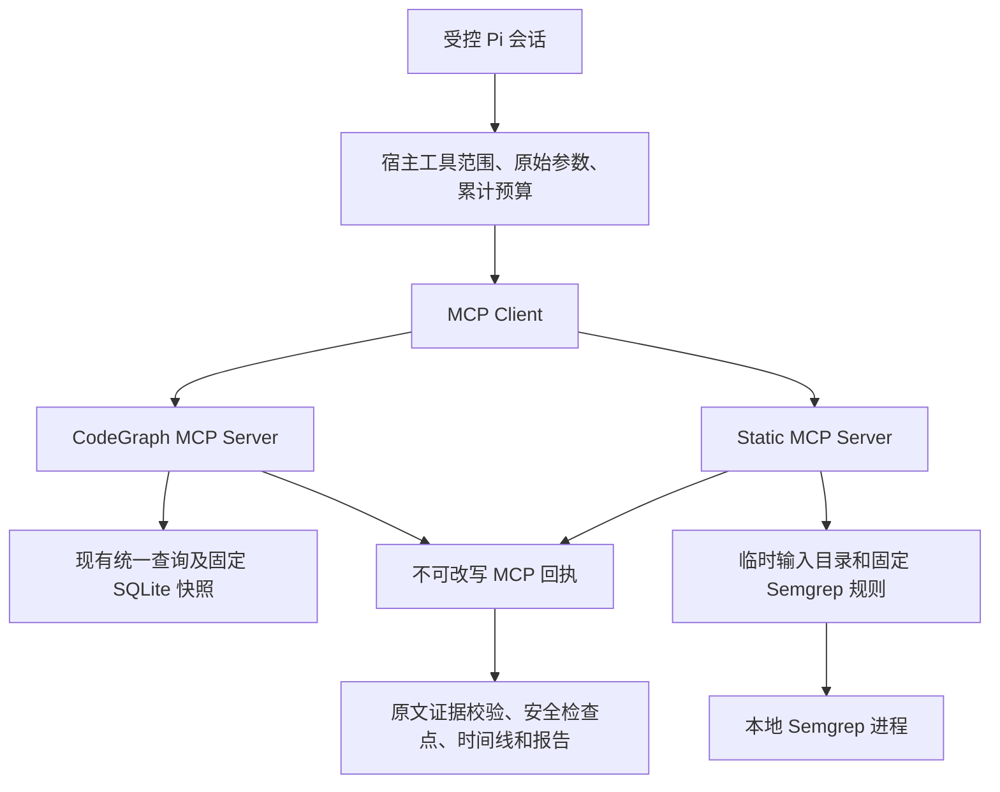
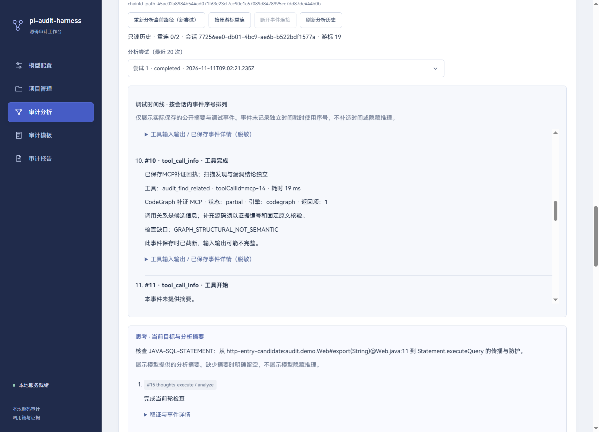

# 17 CodeGraph补证与静态扫描MCP

更新：2026-11-12。生产传输与配置管理已升级为[Python本地MCP服务](20.Python本地MCP服务与客户端管理.md)。交付两个内置 MCP 服务、正式 Pi 工具桥接、固定快照补证、Semgrep 适配器、回执恢复、时间线和报告。MCP最初由v14引入；当前v15回执已统一至tool_receipts，见[19表合并](19.数据库表合并与工程简化.md)。无需付费模型的复现实验见本文第 8 节及本地学习文稿 54、55。

## 1. 问题与行为

原分析会话只能用 `audit_read_step` 读取路径中已确定的调用方、被调用方。遇到同一个方法内额外调用的辅助函数，模型缺少查定义及补读入口。现在新调查可以查询当前步骤的一层关联方法，再按宿主返回的定位编号读取原快照源码；同时可以请求一次本地静态规则扫描，形成独立候选发现。

MCP 负责标准工具接口；CodeGraph 负责结构关系；Semgrep 负责规则匹配；最终漏洞结论仍由原文引用、传播、防护及范围校验共同约束。三者职责不同。扫描零命中、运行失败、未安装或 CodeGraph 查询无结果都不能产生安全结论。

正式工具处理已迁到 Python。Node 继续提供经过验证的 CodeGraph/CST 投影及固定源码，并核验工具结果。早期 JS/TS 取证原型保持原用途；当前 Java 服务使用新的 audit_mcp 模块。

## 2. 结构与协议



依赖固定 `@modelcontextprotocol/sdk@1.32.2`，使用其正式 Client、Server、initialize、tools/list、tools/call 和结构化返回。该 SDK 当前协商的最新协议是 `2025-11-25`；本文不把它描述为整个 MCP 生态的最新协议版本。

桌面正式服务由一个按需启动的 Python 进程承载两个 Streamable HTTP MCP 端点，使用官方 Python SDK 1.30.0。Node Client 初始化、发现并调用真实 Python 服务；不再使用 InMemoryTransport。实验 CLI 的 stdio 门面也转发到同一 Python 后端。客户端“扩展服务”页管理本地服务、JSON导入、工具启用和连接测试，不自动安装 GitHub 项目。

客户端连接两个服务后分别核对完整工具定义，包括名称、输入输出结构及 annotations。`readOnlyHint` 仅为声明；真正的范围限制由代码检查，不依赖声明建立权限。

| 服务 | 正式工具 | 参数 |
| --- | --- | --- |
| audit-codegraph | audit_find_related | stepIndex；direction=definition/incoming/outgoing |
| audit-codegraph | audit_read_related | stepIndex；先前查询返回的 targetId |
| audit-static | audit_static_scan | stepIndex |

加上原有 `audit_read_step`，默认新调查最多开放四个工具，可按服务/工具配置停用；运行时样例 `audit_read_evidence` 保持原接口。

## 3. CodeGraph 补证

`AuditMcpBackend` 在构造时绑定 projectId、runId、pathId、snapshotId 和 sourceStamp。模型不能传入这些范围字段，也不能传入文件路径、URL、SQL 或命令。原始参数检查拒绝字符串形式的步骤编号、额外字段、无效方向及越界步骤，避免 SDK 数值转换扩大权限。

查询以当前步骤实际调用位置为锚点；宿主导出已核验 CodeGraph/CST 投影，Python 实现一层关联筛选。definition 查该调用的定义候选；incoming 查询被调用方法的调用者；outgoing 查询包含当前调用的方法所调用的其他方法。锚点始终来自原步骤，不允许用新目标递归扩展。

每次最多返回 8 个候选。targetId 的摘要包含任务、路径、快照、步骤、方向及查询项；它属于当前调查。读取必须先在当前服务上下文中登记过此编号，并且步骤一致。复制其他步骤、任务或从未返回的编号不能获得读权限。

Python读取宿主从 SQLite 固定快照校验后注册的内存上下文，不读当前磁盘工作树；返回后宿主复核原文和身份。单次最多 80 行、12,000 字节；超出字节限制返回 partial 与缺口，不伪造完整源码。返回的 citations 沿用 `ev-` 证据编号，绑定原文内容和任务范围。

补充原文保存在独立 MCP 回执中；基础步骤取证保持原结构，避免破坏已有证据摘要和旧检查点。最终引用核验、传播核验和结果保存时，通过 `combinedEvidence` 合并该步骤实际取得的补充源码。图候选编号 `rel-` 和扫描发现编号 `finding-` 都不能作为源码证据编号。

CodeGraph 仍是结构查询，不是编译器完整类型证明。歧义、缺少外部依赖、截断或部分结果继续显示在 gaps/truncated 中，补证不会消除原路径的覆盖不足标记。

## 4. 静态扫描

静态服务固定调用 `Semgrep 1.185.0`。本机已在独立环境验证 Windows beta CLI；生产安装包不自动捆绑 Python/Semgrep。可信启动方用绝对路径环境变量 `PI_AUDIT_SEMGREP_PATH` 配置可执行文件。缺少配置时返回 unavailable/SEMGREP_NOT_CONFIGURED，主流程仍可按原文核查。

扫描器先检查文件与实际版本。未配置、路径不可用、版本不匹配、超时、解析异常均保留明确状态。不会联网安装扫描器，也不调用 `semgrep ci/login`。

输入仅为当前步骤调用方和被调用方涉及的最多两个固定 Java 文件，单文件最多 256KiB。宿主从 SQLite 读取后，以 Input0.java/Input1.java 写入本次临时目录；目标仓库的 `.git`、`.semgrep.yml`、忽略文件、脚本、配置和凭据不进入目录。输出位置经固定映射还原为原快照相对路径。

固定规则内容见 `static-scanner.ts`，以 JSON 形式写入临时配置；Semgrep 支持该规则结构。当前包含四类候选：

| 规则 | 主要模式 | 限制 |
| --- | --- | --- |
| audit-java-sql-concat | executeQuery/executeUpdate/execute 的字符串相加参数 | 不覆盖所有间接 SQL 构造 |
| audit-java-runtime-exec | Runtime.getRuntime().exec | 不判断参数可控性 |
| audit-java-process-builder | new ProcessBuilder | 常量参数也可能命中 |
| audit-java-path | Paths.get / new File | 需另查根目录、规范化及实际用途 |

这些是产品自有的小规则集，不代表 Semgrep 全部 Java 规则或完整漏洞覆盖。

进程参数数组调用、shell 关闭、窗口隐藏；只传必要系统路径与运行变量，设置独立 HOME/USERPROFILE/APPDATA/TEMP，关闭 metrics 和版本检查，不传模型 Key、Semgrep 登录凭据或项目环境变量。进程只运行本地规则，不执行目标工程构建。以上是应用控制，不能替代 OS 沙箱。

限制包括 jobs=1、单规则超时 5 秒、max-memory=256、扫描进程总超时 20 秒、版本探测 10 秒、MCP 请求超时 25 秒、命令输出上限 1MiB、返回最多 12 条发现。max-memory 是扫描器参数，不应解释为整个进程树的硬内存隔离。

命中 ID 以 `finding-` 开头，包含规则摘要与位置；返回 `classification=static-finding`、`confirmedVulnerability=false`。扫描器消息由宿主固定规则提供，不把任意工具消息变成权威结论。取消会传递到扫描进程，清理宿主持有的临时目录。

## 5. 预算、证据和恢复

所有 MCP 调用继续消耗原工具预算：24 次工具、28 次模型请求、4 个决策轮次、110 秒任务时限；重新连接不会刷新额度。补充回执输出与基础证据合计受原 65,536 字节预算限制。重复同参数调用复用回执，但仍计一次工具调用；连续重复无新增材料会触发原无进展停止。

历史 v14 只追加 MCP 回执，不修改 v1—v13。当前 v15 使用统一 `tool_receipts` 及不可改写触发器，保留 v1—v14 校验和。记录 journey、路径范围、绑定摘要、规范化请求键、输出及 SHA-256。首次调用结果落库后才能登记为可复用材料。

新调查 binding 增加 `mcpProfile` 和固定扫描规则摘要；检查点增加可选 mcpKeys。恢复校验工具调用与结果成对、结果与回执一致、源码片段与快照一致、证据卡一致，再恢复原生 Pi 分支。缺少完整检查点时，把已核验的回执随已核验基础证据重建上下文，明确保留累计消耗和不确定用量。

旧 binding 没有 mcpProfile 时，仍只开放原 `audit_read_step`；恢复旧会话不会自动获得新权限。新建调查才启用当前工具配置。原模型、快照、审查材料或工具规则绑定改变时，不允许静默续跑。

## 6. 页面和报告

时间线显示工具输入输出、耗时、是否复用回执，以及 CodeGraph/静态扫描状态、引擎、返回项数和缺口。保留原页面配色。

HTML/JSON 报告新增 mcp 摘要：仅选择当前筛选路径、当前调查 journey 的回执，保留尝试编号、步骤、引擎、规则摘要、缺口、源码范围及静态发现。最多 500 条摘要，超过则明确 truncated；不计入危险路径/风险点统计。补充原文引用仍保存为普通源码证据。导出从本地库读取，不调用模型。历史报告没有 mcp 字段时按空清单显示。

## 7. 主要文件

| 文件 | 职责 |
| --- | --- |
| desktop/src/service/mcp/contracts.ts | 工具结构、原始参数、输出上限及配置版本 |
| desktop/src/service/mcp/backend.ts | 当前路径绑定、上下文导出、Python结果与原文核验 |
| desktop/src/service/mcp/gateway.ts | Python HTTP MCP Client 与 CLI stdio 兼容门面 |
| desktop/src/service/mcp/static-scanner.ts | 固定规则与兼容扫描测试入口；生产扫描由 Python tools.py 执行 |
| desktop/src/service/chains/agent-loop.ts | Pi 桥接、预算、时间线及回执采用 |
| desktop/src/service/chains/evidence-citations.ts | 补充证据卡和最终范围合并 |
| desktop/src/service/chains/recovery.ts | 旧工具集兼容与回执恢复 |
| desktop/src/service/storage/mcp-migration.ts | v14 追加迁移 |
| desktop/src/service/storage/consolidation-migration.ts | v15 合并基础与 MCP 工具回执到 tool_receipts |
| desktop/scripts/mcp-lab.mjs | 零付费实验与标准 stdio 服务 |

当前 Python 服务、配置管理和手动测试步骤见[20 技术文档](20.Python本地MCP服务与客户端管理.md)及本地学习 61、62。下列 CLI 已适配 Python 后端。

## 8. 可复现实验

在仓库 desktop 目录，安装锁定依赖后执行：

```powershell
npm ci
$lab = node --disable-warning=MODULE_TYPELESS_PACKAGE_JSON scripts/mcp-lab.mjs init |
  Out-String | ConvertFrom-Json -ErrorAction Stop
$lab | Format-List
node --disable-warning=MODULE_TYPELESS_PACKAGE_JSON scripts/mcp-lab.mjs demo $lab.labFile
```

预期：Helper.java 原文、ev- 编号、CodeGraph 候选和静态状态；未配置扫描器显示 unavailable。实验创建自己的 Java 工程和数据库，paidModelRequests=0。

Windows 配置扫描器，在仓库根目录执行：

```powershell
python -m venv .local/tools/semgrep
& ./.local/tools/semgrep/Scripts/python.exe -m pip install semgrep==1.185.0
Set-Location ./desktop
$env:PI_AUDIT_SEMGREP_PATH = (Resolve-Path ../.local/tools/semgrep/Scripts/semgrep.exe).Path
node --disable-warning=MODULE_TYPELESS_PACKAGE_JSON scripts/mcp-lab.mjs demo $lab.labFile
```

切换 PowerShell 窗口后可以自动寻找最近实验，避免把说明占位符当作路径：

```powershell
$labFile = Get-ChildItem ../.local/mcp-lab -Filter lab.json -Recurse -File |
  Sort-Object LastWriteTime -Descending | Select-Object -First 1
if (-not $labFile) { throw '请先执行 mcp-lab init' }
$lab = Get-Content -LiteralPath $labFile.FullName -Raw -Encoding UTF8 | ConvertFrom-Json -ErrorAction Stop
node --disable-warning=MODULE_TYPELESS_PACKAGE_JSON scripts/mcp-lab.mjs interactive $lab.labFile
```

交互程序内输入 outgoing 1、scan、bad、quit；也可输入完整工具 JSON。JSON 应输入这个 Node 程序，不能直接作为 PowerShell 表达式执行。demo 自动选择真正包含 Helper 的步骤，不依赖手写定位编号。

```powershell
npm run test:mcp
npm run test:reliability
npm run build
npm run lint -- --max-warnings=0
```

未配置扫描器时，真实 Semgrep 专项明确 skip，其余协议、CodeGraph、预算、恢复测试仍执行。本机最终验证配置了真实扫描器；最新验收数见 [07 实现进度](07.实现进度与验收.md)。测试用真实 Pi SDK 和本机协议模型替身，不能解释为付费模型准确率测试。

本次全量 Node 221/221、0失败、0跳过；生产构建/类型检查及 ESLint 通过。真实 Semgrep 正负样例、标准 stdio、Pi预算/原生恢复/重建、v13升级、HTML/JSON回执摘要均有测试。`npm audit --omit=dev` 当次运行时依赖结果为0项，不涵盖整个开发工具链或未来新公告。[脱敏验收摘要](assets/mcp-2026-11-11.json)保留范围与限制。



## 9. 限制与来源

当前仅支持固定 Java 快照和原步骤的一层关系；不递归全仓搜索，不编译业务，不动态利用验证，不自动修改源码，不安装任意远程 MCP。扫描器版本变化需要更新固定版本、规则/输出适配并重新验收。MCP 接口本身不会消除模型误判。

参考：[MCP SDK v1 源码](https://github.com/modelcontextprotocol/typescript-sdk/tree/v1.x)、[MCP 2025-11-25 工具规范](https://modelcontextprotocol.io/specification/2025-11-25/server/tools)、[Semgrep 本地规则](https://docs.semgrep.dev/running-rules)、[Semgrep 安装说明](https://docs.semgrep.dev/getting-started/quickstart)。
