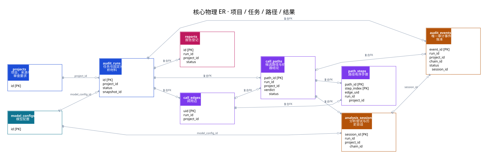
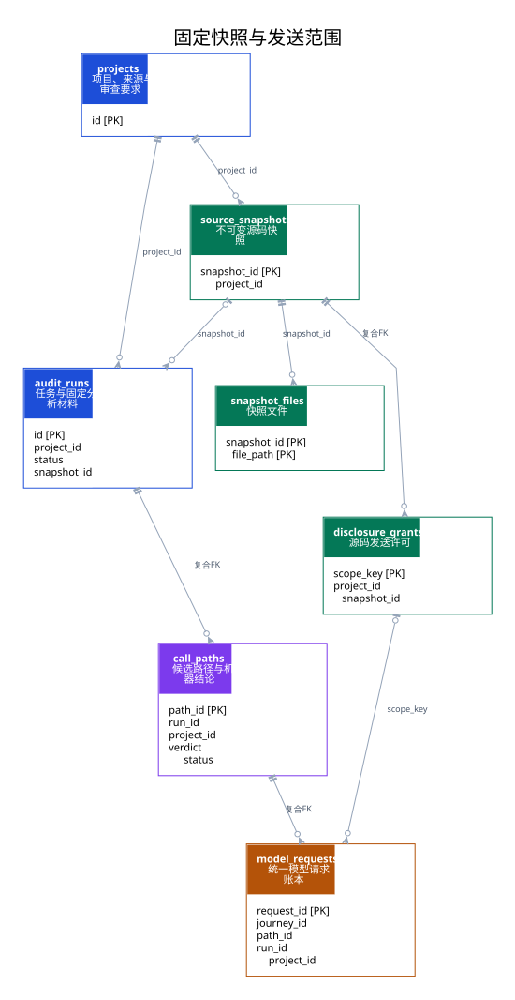
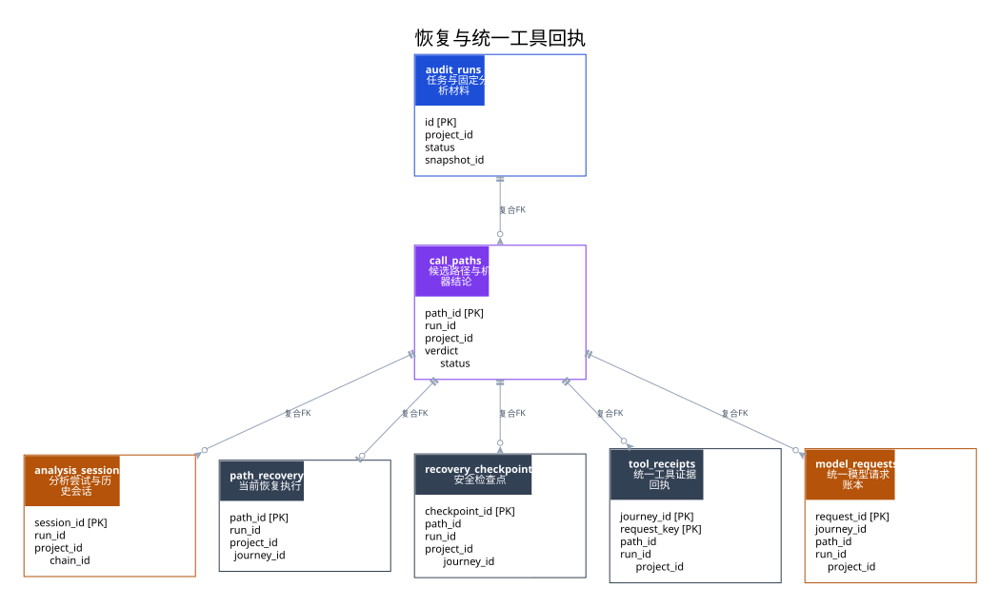
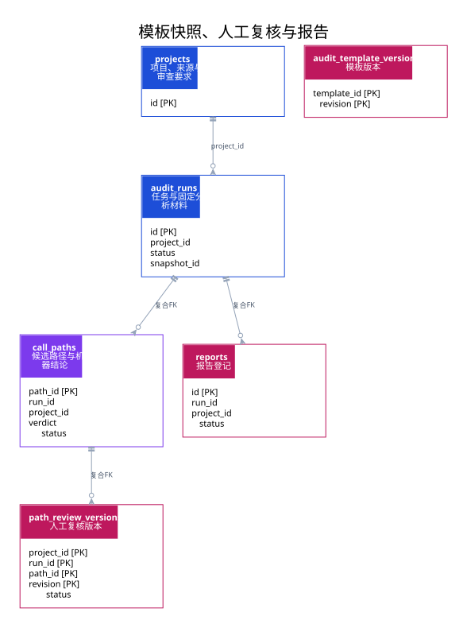

# 18 数据库表设计与 ER 图汇报

更新：2026-11-12。当前工作代码 SQLite **v15，21 表**。结构由独立空库执行实际迁移后提取；不含个人数据。v14 的 33 表已合并，方案见 [19 表合并](19.数据库表合并与工程简化.md)。

## 1. 一分钟讲清项目的数据设计

本地 Java 审计工作台使用 SQLite 保存项目、固定源码、候选调用路径、证据与人工复核。Pi 只能通过受控工具取证，CodeGraph 提供结构补证，Semgrep 提供固定静态规则发现。最终结果可复核、可导出，任务支持停止与核验后恢复。

21 张表保存在一个业务数据库中；不是 21 个文件或服务。Java 原始字节在快照 BLOB 中，检查点与报告正文在应用管理文件中；供应商 Key 位于系统凭据库，主库只存不透明引用。

## 2. 当前实际规模

| 项目 | 数量 | 含义 |
| --- | --- | --- |
| 应用表 | 21 | 含迁移账本；较 v14 减少 12 表 |
| 字段 | 244 | 较 v14 减少 51 字段 |
| 外键 | 24 组 | 复合外键计一组 |
| 显式索引 | 16 | 不含 PK/UNIQUE 自动索引 |
| 触发器 | 19 | 冻结材料、版本历史与来源约束 |
| 迁移版本 | 15 | v1—v14 校验和保持原样 |

## 3. 三张图的汇报顺序

### 核心实体：从项目到可复核结果



一个项目包含多次任务；任务拥有候选调用边和路径；路径通过有序步骤引用共享边，并产生多个尝试。事件只保存一份，同时为公开日志和 SSE 重连服务。报告属于任务，筛选规则和生成时摘要保存在报告登记中。

### 固定源码与发送授权



任务通过 snapshot_id 引用一份项目快照；多个任务可以复用同一快照。快照按文件保存原始字节与摘要。disclosure_grants 保存用户确认范围，model_requests 保存实际目标、发送登记与执行用量。授权登记不证明送达，静态命中不等于确认漏洞。

### 停止、恢复与工具回执



audit_runs 内保存控制状态；path_recovery 表达当前连续调查、执行世代与累计预算。analysis_sessions 保存每次分析尝试。安全检查点和工具回执保留独立历史，恢复时核对原快照、请求预算和分支边界，不从当前磁盘源码拼接一个假会话。

## 4. 审查材料与人工复核



模板版本是独立历史。创建任务时，把选中的模板和项目要求冻结到 audit_runs.review_json，不通过新模板覆盖旧任务。人工复核在 path_review_versions 追加版本，保存当时机器基线，不改机器证据或源码。模板表与任务之间采用内容复制，没有物理模板 FK；图只画真实外键。

## 5. 一次审计的落库过程

| 动作 | 写入位置 | 业务意义 |
| --- | --- | --- |
| 导入项目 | projects | 登记来源、指纹、文件统计 |
| 创建任务 | audit_runs、source_snapshots、snapshot_files | 冻结材料、模板要求与图身份 |
| 预处理 | audit_runs、call_edges、call_paths、path_steps | 记录候选、覆盖缺口与有序路径 |
| 发送确认 | disclosure_grants | 绑定具体快照、目标服务与模型 |
| 领取分析 | analysis_sessions、path_recovery、audit_events | 独立尝试、执行预算与 queued/analyzing |
| 取证与请求 | tool_receipts、model_requests、audit_events | 保存真实回执、用量与公开过程 |
| 完成提交 | call_paths、path_steps、audit_runs、analysis_sessions、audit_events | 结果、证据与终态原子落库 |
| 复核与导出 | path_review_versions、reports | 保留人工版本及独立报告制品 |

## 6. 工程取舍

一对一配置归所属实体；事件、尝试、请求和回执只维护一份真相。保留独立的历史和一对多明细，使关键 SQL 直接可读。参数绑定、作用域外键、风险三态、事务、原文校验和停止屏障继续保留；确定数据库错误不再盲目重试。

## 7. 当前边界

audit_events.seq 是任务日志序号，session_seq 是会话重连游标，不能互换。SSE 过期只关闭重放窗口，不清理共用审计记录。旧双请求账本没有统一 ID，迁移保留事实不猜配对，跨版本付费次数不能用总行数估算。手工点数组完整迁移，UI 继续显示首个点。

## 8. 验证来源

空库 foreign_key_check 无违规、quick_check=ok。专项测试覆盖含数据 v14 升级、原 SSE frame/游标、旧人工基线、回执、失败回滚和新循环的一次保存；真实 Electron 测试验证工具循环、补证时间线和历史展示。测试使用本机协议替身，不消耗付费 tokens，也不据此宣称模型审计准确率。

## 9. 全部表清单与字段字典

以下主键、列、索引与外键来自实际迁移。PK 是主键，FK 是物理外键。JSON 字段内部的业务引用由存储入口验证，不伪装成数据库外键。

### 项目与任务

| 表 | 中文职责 | 主键 | 字段数 |
| --- | --- | --- | --- |
| [projects](#projects) | 项目、来源与审查要求 | id | 16 |
| [audit_runs](#audit_runs) | 任务与固定分析材料 | id | 30 |

<a id="projects"></a>
#### projects · 项目、来源与审查要求

项目身份、源码登记统计、Git元数据和当前项目要求。

| 字段 | 类型 | 非空/主键 | 默认值 | 说明 |
| --- | --- | --- | --- | --- |
| id | TEXT | PK1 / NOT NULL | — | 本表主身份；具体含义见表职责 |
| name | TEXT | NOT NULL | — | 显示名称 |
| path | TEXT | NOT NULL | — | 项目登记位置 |
| source_type | TEXT | NOT NULL | — | 来源类型local/git |
| created_at | TEXT | NOT NULL | — | 记录创建时间，应用写入ISO8601文本 |
| updated_at | TEXT | NOT NULL | — | 最近更新时间 |
| git_url | TEXT | NULL | — | Git来源仓库地址 |
| git_commit | TEXT | NULL | — | 登记时的Git提交标识 |
| git_dirty | INTEGER | NULL | — | 登记时工作树是否有未提交修改 |
| revision | INTEGER | NOT NULL | 1 | 记录版本号，用于乐观并发或追加版本 |
| source_key | TEXT | NULL | — | 用于识别来源的规范化身份 |
| source_stamp | TEXT | NULL | — | Java源码范围的内容指纹 |
| file_count | INTEGER | NULL | — | 登记的源码文件数 |
| total_bytes | INTEGER | NULL | — | 登记的Java字节总量 |
| registered_at | TEXT | NULL | — | 源码登记时间 |
| review_json | TEXT | NULL | — | projects中是当前项目要求；audit_runs中是冻结的任务审查全文（JSON） |

- INDEX idx_projects_source (source_key, registered_at)；部分索引，条件见DDL。
- 触发器：validate_git_project_insert, validate_git_project_update。

<details><summary>当前实际建表DDL与触发器</summary>

```sql
CREATE TABLE projects (
  id TEXT PRIMARY KEY, name TEXT NOT NULL CHECK(length(trim(name)) > 0),
  path TEXT NOT NULL, source_type TEXT NOT NULL CHECK(source_type IN ('local','git')),
  created_at TEXT NOT NULL, updated_at TEXT NOT NULL
, git_url TEXT, git_commit TEXT, git_dirty INTEGER CHECK(git_dirty IN (0,1)), revision INTEGER NOT NULL DEFAULT 1 CHECK(revision > 0), source_key TEXT, source_stamp TEXT, file_count INTEGER CHECK(file_count>0), total_bytes INTEGER CHECK(total_bytes>=0), registered_at TEXT, review_json TEXT CHECK(review_json IS NULL OR json_valid(review_json))) STRICT;
CREATE TRIGGER validate_git_project_insert BEFORE INSERT ON projects
WHEN NEW.source_type='git' AND (NEW.git_url IS NULL OR NEW.git_url='' OR
 NEW.git_commit IS NULL OR length(NEW.git_commit) NOT IN (40,64) OR NEW.git_dirty IS NULL)
BEGIN SELECT RAISE(ABORT,'git metadata required'); END;
CREATE TRIGGER validate_git_project_update BEFORE UPDATE OF source_type,git_url,git_commit,git_dirty ON projects
WHEN NEW.source_type='git' AND (NEW.git_url IS NULL OR NEW.git_url='' OR
 NEW.git_commit IS NULL OR length(NEW.git_commit) NOT IN (40,64) OR NEW.git_dirty IS NULL)
BEGIN SELECT RAISE(ABORT,'git metadata required'); END;
```

</details>

<a id="audit_runs"></a>
#### audit_runs · 任务与固定分析材料

一次审计的聚合根，内含扫描、快照引用、冻结模板和图、控制状态与首次模型绑定。

| 字段 | 类型 | 非空/主键 | 默认值 | 说明 |
| --- | --- | --- | --- | --- |
| id | TEXT | PK1 / NOT NULL | — | 本表主身份；具体含义见表职责 |
| project_id | TEXT | NOT NULL / FK | — | 所属项目身份 |
| status | TEXT | NOT NULL | — | 本表业务状态，允许值以CHECK约束为准 |
| source_stamp | TEXT | NOT NULL | — | Java源码范围的内容指纹 |
| rules_version | TEXT | NOT NULL | — | 本次任务的规则目录版本 |
| model_config_id | TEXT | NULL / FK | — | 模型配置身份 |
| created_at | TEXT | NOT NULL | — | 记录创建时间，应用写入ISO8601文本 |
| updated_at | TEXT | NOT NULL | — | 最近更新时间 |
| stage | TEXT | NOT NULL | 'prepared' | 任务业务阶段，与任务status分别记录 |
| started_at | TEXT | NULL | — | 开始或请求登记时间 |
| finished_at | TEXT | NULL | — | 完成时间，未完成时可空 |
| error_code | TEXT | NULL | — | 稳定错误码，不保存隐藏推理 |
| snapshot_id | TEXT | NULL / FK | — | 固定源码快照身份 |
| review_json | TEXT | NULL | — | projects中是当前项目要求；audit_runs中是冻结的任务审查全文（JSON） |
| review_hash | TEXT | NULL | — | 固定任务审查内容摘要 |
| graph_json | TEXT | NULL | — | 固定CodeGraph图身份与事实（JSON） |
| graph_hash | TEXT | NULL | — | 固定图JSON摘要 |
| graph_created_at | TEXT | NULL | — | 固定图绑定时间 |
| scan_state | TEXT | NULL | — | 扫描阶段状态；旧任务可能为空 |
| candidate_count | INTEGER | NOT NULL | 0 | 预处理候选数量 |
| unresolved_calls | INTEGER | NOT NULL | 0 | 无法解析的调用数量 |
| scan_truncated | INTEGER | NOT NULL | 0 | 预处理覆盖是否截断，整数0/1 |
| warnings_json | TEXT | NULL | — | 预处理告警和覆盖范围限制 |
| scan_error_code | TEXT | NULL | — | 扫描失败错误码 |
| scan_started_at | TEXT | NULL | — | 扫描开始时间 |
| scan_finished_at | TEXT | NULL | — | 扫描完成时间 |
| control_state | TEXT | NOT NULL | 'idle' | 任务停止/恢复控制状态，与任务status分开 |
| control_revision | INTEGER | NOT NULL | 0 | 控制版本，防止旧恢复操作生效 |
| control_updated_at | TEXT | NULL | — | 控制状态更新时间 |
| model_json | TEXT | NOT NULL | 'null' | 任务首次执行的非敏感模型元数据，不含API Key |

- FK (snapshot_id) → source_snapshots(snapshot_id)；更新/删除 NO ACTION/NO ACTION。
- FK (model_config_id) → model_configs(id)；更新/删除 NO ACTION/NO ACTION。
- FK (project_id) → projects(id)；更新/删除 NO ACTION/NO ACTION。
- INDEX idx_runs_model (model_config_id)。
- INDEX idx_runs_project (project_id, created_at)。
- UNIQUE sqlite_autoindex_audit_runs_2 (id, project_id)。
- 触发器：frozen_run_inputs, run_snapshot_insert_scope, run_snapshot_scope。

<details><summary>当前实际建表DDL与触发器</summary>

```sql
CREATE TABLE audit_runs (
  id TEXT PRIMARY KEY, project_id TEXT NOT NULL REFERENCES projects(id),
  status TEXT NOT NULL CHECK(status IN ('queued','running','completed','failed','cancelled')),
  source_stamp TEXT NOT NULL, rules_version TEXT NOT NULL,
  model_config_id TEXT REFERENCES model_configs(id),
  created_at TEXT NOT NULL, updated_at TEXT NOT NULL, stage TEXT NOT NULL DEFAULT 'prepared'
  CHECK(stage IN ('scanning','prepared','analyzing','completed','failed','interrupted')), started_at TEXT, finished_at TEXT, error_code TEXT, snapshot_id TEXT REFERENCES source_snapshots(snapshot_id), review_json TEXT CHECK(review_json IS NULL OR json_valid(review_json)), review_hash TEXT, graph_json TEXT CHECK(graph_json IS NULL OR json_valid(graph_json)), graph_hash TEXT, graph_created_at TEXT, scan_state TEXT CHECK(scan_state IN ('scanning','ready','partial','empty','failed')), candidate_count INTEGER NOT NULL DEFAULT 0 CHECK(candidate_count>=0), unresolved_calls INTEGER NOT NULL DEFAULT 0 CHECK(unresolved_calls>=0), scan_truncated INTEGER NOT NULL DEFAULT 0 CHECK(scan_truncated IN (0,1)), warnings_json TEXT CHECK(warnings_json IS NULL OR json_valid(warnings_json)), scan_error_code TEXT, scan_started_at TEXT, scan_finished_at TEXT, control_state TEXT NOT NULL DEFAULT 'idle' CHECK(control_state IN ('idle','running','stop_requested','waiting_external','stopped','interrupted','completed')), control_revision INTEGER NOT NULL DEFAULT 0 CHECK(control_revision>=0), control_updated_at TEXT, model_json TEXT NOT NULL DEFAULT 'null' CHECK(json_valid(model_json)),
  UNIQUE(id, project_id)
) STRICT;
CREATE TRIGGER frozen_run_inputs BEFORE UPDATE OF snapshot_id,review_json,review_hash,graph_json,graph_hash ON audit_runs
WHEN (OLD.snapshot_id IS NOT NULL AND NEW.snapshot_id IS NOT OLD.snapshot_id)
 OR (OLD.review_json IS NOT NULL AND (NEW.review_json IS NOT OLD.review_json OR NEW.review_hash IS NOT OLD.review_hash))
 OR (OLD.graph_json IS NOT NULL AND (NEW.graph_json IS NOT OLD.graph_json OR NEW.graph_hash IS NOT OLD.graph_hash))
BEGIN SELECT RAISE(ABORT,'run inputs are frozen'); END;
CREATE TRIGGER run_snapshot_insert_scope BEFORE INSERT ON audit_runs
WHEN NEW.snapshot_id IS NOT NULL AND NOT EXISTS(SELECT 1 FROM source_snapshots WHERE snapshot_id=NEW.snapshot_id AND project_id=NEW.project_id)
BEGIN SELECT RAISE(ABORT,'snapshot project mismatch'); END;
CREATE TRIGGER run_snapshot_scope BEFORE UPDATE OF snapshot_id,project_id ON audit_runs
WHEN NEW.snapshot_id IS NOT NULL AND NOT EXISTS(SELECT 1 FROM source_snapshots WHERE snapshot_id=NEW.snapshot_id AND project_id=NEW.project_id)
BEGIN SELECT RAISE(ABORT,'snapshot project mismatch'); END;
```

</details>

### 模型与治理

| 表 | 中文职责 | 主键 | 字段数 |
| --- | --- | --- | --- |
| [model_configs](#model_configs) | 模型配置 | id | 9 |
| [model_selection](#model_selection) | 当前模型选择 | slot | 3 |
| [credential_cleanup](#credential_cleanup) | 凭据清理意图 | secret_ref | 2 |
| [schema_migrations](#schema_migrations) | 迁移账本 | version | 4 |

<a id="model_configs"></a>
#### model_configs · 模型配置

保存服务地址、模型ID和凭据引用；真实API Key在系统凭据库。

| 字段 | 类型 | 非空/主键 | 默认值 | 说明 |
| --- | --- | --- | --- | --- |
| id | TEXT | PK1 / NOT NULL | — | 本表主身份；具体含义见表职责 |
| name | TEXT | NOT NULL | — | 显示名称 |
| base_url | TEXT | NOT NULL | — | 模型服务接口地址 |
| model_id | TEXT | NOT NULL | — | 配置的供应商模型ID |
| secret_ref | TEXT | NULL | — | 系统凭据库中的不透明引用，绝非API Key原文 |
| revision | INTEGER | NOT NULL | — | 记录版本号，用于乐观并发或追加版本 |
| api | TEXT | NOT NULL | 'openai-completions' | 模型协议，目前限定openai-completions |
| created_at | TEXT | NOT NULL | '' | 记录创建时间，应用写入ISO8601文本 |
| updated_at | TEXT | NOT NULL | '' | 最近更新时间 |

- UNIQUE idx_models_secret_ref (secret_ref)；部分索引，条件见DDL。

<details><summary>当前实际建表DDL与触发器</summary>

```sql
CREATE TABLE model_configs (
  id TEXT PRIMARY KEY, name TEXT NOT NULL, base_url TEXT NOT NULL,
  model_id TEXT NOT NULL, secret_ref TEXT, revision INTEGER NOT NULL CHECK(revision > 0)
, api TEXT NOT NULL DEFAULT 'openai-completions'
  CHECK(api = 'openai-completions'), created_at TEXT NOT NULL DEFAULT '', updated_at TEXT NOT NULL DEFAULT '') STRICT;
```

</details>

<a id="model_selection"></a>
#### model_selection · 当前模型选择

slot固定为1的单槽选择，未选择时config_id为空；revision防止并发覆盖。

| 字段 | 类型 | 非空/主键 | 默认值 | 说明 |
| --- | --- | --- | --- | --- |
| slot | INTEGER | PK1 / NOT NULL | — | 单槽标识，CHECK限定为1 |
| config_id | TEXT | NULL / FK | — | 配置身份或历史配置身份副本 |
| revision | INTEGER | NOT NULL | — | 记录版本号，用于乐观并发或追加版本 |

- FK (config_id) → model_configs(id)；更新/删除 NO ACTION/NO ACTION。

<details><summary>当前实际建表DDL与触发器</summary>

```sql
CREATE TABLE model_selection (
  slot INTEGER PRIMARY KEY CHECK(slot=1),
  config_id TEXT REFERENCES model_configs(id),
  revision INTEGER NOT NULL CHECK(revision>=0)
) STRICT;
```

</details>

<a id="credential_cleanup"></a>
#### credential_cleanup · 凭据清理意图

补偿外部凭据库操作失败，只保存待清理引用；不以外键强绑已删除配置。

| 字段 | 类型 | 非空/主键 | 默认值 | 说明 |
| --- | --- | --- | --- | --- |
| secret_ref | TEXT | PK1 / NOT NULL | — | 系统凭据库中的不透明引用，绝非API Key原文 |
| created_at | TEXT | NOT NULL | — | 记录创建时间，应用写入ISO8601文本 |


<details><summary>当前实际建表DDL与触发器</summary>

```sql
CREATE TABLE credential_cleanup (
  secret_ref TEXT PRIMARY KEY, created_at TEXT NOT NULL
) STRICT;
```

</details>

<a id="schema_migrations"></a>
#### schema_migrations · 迁移账本

连续迁移版本及SQL校验和，防止已发布迁移被改写。

| 字段 | 类型 | 非空/主键 | 默认值 | 说明 |
| --- | --- | --- | --- | --- |
| version | INTEGER | PK1 / NOT NULL | — | 迁移版本号 |
| name | TEXT | NOT NULL | — | 显示名称 |
| checksum | TEXT | NOT NULL | — | 对应迁移SQL的SHA-256校验和 |
| applied_at | TEXT | NOT NULL | — | 迁移实际执行时间 |


<details><summary>当前实际建表DDL与触发器</summary>

```sql
CREATE TABLE schema_migrations (
      version INTEGER PRIMARY KEY, name TEXT NOT NULL, checksum TEXT NOT NULL, applied_at TEXT NOT NULL
    ) STRICT;
```

</details>

### 固定源码与授权

| 表 | 中文职责 | 主键 | 字段数 |
| --- | --- | --- | --- |
| [source_snapshots](#source_snapshots) | 不可变源码快照 | snapshot_id | 7 |
| [snapshot_files](#snapshot_files) | 快照文件 | snapshot_id, file_path | 4 |
| [disclosure_grants](#disclosure_grants) | 源码发送许可 | scope_key | 5 |

<a id="source_snapshots"></a>
#### source_snapshots · 不可变源码快照

保存项目某版本的Java范围清单与内容指纹；同项目同指纹复用。

| 字段 | 类型 | 非空/主键 | 默认值 | 说明 |
| --- | --- | --- | --- | --- |
| snapshot_id | TEXT | PK1 / NOT NULL | — | 固定源码快照身份 |
| project_id | TEXT | NOT NULL / FK | — | 所属项目身份 |
| source_stamp | TEXT | NOT NULL | — | Java源码范围的内容指纹 |
| manifest_json | TEXT | NOT NULL | — | 固定文件清单，含相对路径、摘要和大小 |
| ignored_json | TEXT | NOT NULL | — | 未纳入快照范围的说明 |
| source_commit | TEXT | NULL | — | 快照记录的来源提交，可空 |
| created_at | TEXT | NOT NULL | — | 记录创建时间，应用写入ISO8601文本 |

- FK (project_id) → projects(id)；更新/删除 NO ACTION/NO ACTION。
- UNIQUE sqlite_autoindex_source_snapshots_3 (snapshot_id, project_id)。
- UNIQUE sqlite_autoindex_source_snapshots_2 (project_id, source_stamp)。
- 触发器：immutable_source_snapshots_delete, immutable_source_snapshots_update。

<details><summary>当前实际建表DDL与触发器</summary>

```sql
CREATE TABLE source_snapshots (
  snapshot_id TEXT PRIMARY KEY, project_id TEXT NOT NULL REFERENCES projects(id),
  source_stamp TEXT NOT NULL, manifest_json TEXT NOT NULL CHECK(json_valid(manifest_json)),
  ignored_json TEXT NOT NULL CHECK(json_valid(ignored_json)),
  source_commit TEXT, created_at TEXT NOT NULL,
  UNIQUE(project_id,source_stamp), UNIQUE(snapshot_id,project_id)
) STRICT;
CREATE TRIGGER immutable_source_snapshots_delete BEFORE DELETE ON source_snapshots
     BEGIN SELECT RAISE(ABORT,'immutable source record'); END;
CREATE TRIGGER immutable_source_snapshots_update BEFORE UPDATE ON source_snapshots
     BEGIN SELECT RAISE(ABORT,'immutable source record'); END;
```

</details>

<a id="snapshot_files"></a>
#### snapshot_files · 快照文件

以BLOB保存Java原始字节及SHA-256；任务证据从这里读取。

| 字段 | 类型 | 非空/主键 | 默认值 | 说明 |
| --- | --- | --- | --- | --- |
| snapshot_id | TEXT | PK1 / NOT NULL / FK | — | 固定源码快照身份 |
| file_path | TEXT | PK2 / NOT NULL | — | 源码相对路径；reports中为应用管理的报告文件路径 |
| sha256 | TEXT | NOT NULL | — | 原文字节、回执或文件的SHA-256完整性摘要 |
| content | BLOB | NOT NULL | — | Java源码原始字节，BLOB存储 |

- FK (snapshot_id) → source_snapshots(snapshot_id)；更新/删除 NO ACTION/NO ACTION。
- 触发器：immutable_snapshot_files_delete, immutable_snapshot_files_update。

<details><summary>当前实际建表DDL与触发器</summary>

```sql
CREATE TABLE snapshot_files (
  snapshot_id TEXT NOT NULL REFERENCES source_snapshots(snapshot_id),
  file_path TEXT NOT NULL, sha256 TEXT NOT NULL CHECK(length(sha256)=64),
  content BLOB NOT NULL, PRIMARY KEY(snapshot_id,file_path)
) STRICT;
CREATE TRIGGER immutable_snapshot_files_delete BEFORE DELETE ON snapshot_files
     BEGIN SELECT RAISE(ABORT,'immutable source record'); END;
CREATE TRIGGER immutable_snapshot_files_update BEFORE UPDATE ON snapshot_files
     BEGIN SELECT RAISE(ABORT,'immutable source record'); END;
```

</details>

<a id="disclosure_grants"></a>
#### disclosure_grants · 源码发送许可

保存用户确认的项目、快照、目标服务和模型范围快照。

| 字段 | 类型 | 非空/主键 | 默认值 | 说明 |
| --- | --- | --- | --- | --- |
| scope_key | TEXT | PK1 / NOT NULL | — | 用户确认发送范围的内容身份 |
| project_id | TEXT | NOT NULL / FK | — | 所属项目身份 |
| snapshot_id | TEXT | NOT NULL / FK | — | 固定源码快照身份 |
| scope_json | TEXT | NOT NULL | — | 已确认的项目/快照/服务/模型范围快照 |
| confirmed_at | TEXT | NOT NULL | — | 用户明确确认的时间 |

- FK (snapshot_id, project_id) → source_snapshots(snapshot_id, project_id)；更新/删除 NO ACTION/NO ACTION。
- 触发器：immutable_disclosure_grants_delete, immutable_disclosure_grants_update。

<details><summary>当前实际建表DDL与触发器</summary>

```sql
CREATE TABLE disclosure_grants (
  scope_key TEXT PRIMARY KEY, project_id TEXT NOT NULL, snapshot_id TEXT NOT NULL,
  scope_json TEXT NOT NULL CHECK(json_valid(scope_json)), confirmed_at TEXT NOT NULL,
  FOREIGN KEY(snapshot_id,project_id) REFERENCES source_snapshots(snapshot_id,project_id)
) STRICT;
CREATE TRIGGER immutable_disclosure_grants_delete BEFORE DELETE ON disclosure_grants
     BEGIN SELECT RAISE(ABORT,'immutable source record'); END;
CREATE TRIGGER immutable_disclosure_grants_update BEFORE UPDATE ON disclosure_grants
     BEGIN SELECT RAISE(ABORT,'immutable source record'); END;
```

</details>

### 调用图与路径

| 表 | 中文职责 | 主键 | 字段数 |
| --- | --- | --- | --- |
| [call_edges](#call_edges) | 调用边 | uid | 17 |
| [call_paths](#call_paths) | 候选路径与机器结论 | path_id | 16 |
| [path_steps](#path_steps) | 路径有序步骤 | path_id, step_index | 11 |

<a id="call_edges"></a>
#### call_edges · 调用边

保存一次调用位置、调用方/被调用方、参数位置与解析状态，可被多条路径复用。

| 字段 | 类型 | 非空/主键 | 默认值 | 说明 |
| --- | --- | --- | --- | --- |
| uid | TEXT | PK1 / NOT NULL | — | 调用边唯一身份 |
| run_id | TEXT | NOT NULL / FK | — | 所属审计任务身份 |
| project_id | TEXT | NOT NULL / FK | — | 所属项目身份 |
| file_path | TEXT | NOT NULL | — | 源码相对路径；reports中为应用管理的报告文件路径 |
| caller_key | TEXT | NOT NULL | — | 调用方方法的稳定定位键 |
| callee_key | TEXT | NOT NULL | — | 被调用方方法的定位键或未解析标识 |
| call_line | INTEGER | NOT NULL | — | 调用位置的1基行号 |
| is_sink | INTEGER | NOT NULL | — | 是否为危险API候选位置，整数0/1 |
| rule_id | TEXT | NULL | — | 风险规则标识，含内置目录的逻辑引用 |
| file_name | TEXT | NOT NULL | '' | 安全检查点文件名；call_edges中为显示文件名 |
| function_name | TEXT | NOT NULL | '' | 调用方方法显示名称 |
| called_function_name | TEXT | NOT NULL | '' | 被调用方法显示名称 |
| called_function_file_name | TEXT | NULL | — | 被调用方文件显示名称 |
| called_function_file_path | TEXT | NULL | — | 被调用方源码路径，未解析时可空 |
| call_column | INTEGER | NOT NULL | 1 | 调用位置的1基列号 |
| resolution_status | TEXT | NOT NULL | 'unresolved' | 调用关系解析状态，candidate/confirmed/unresolved/invalid |
| arguments_json | TEXT | NOT NULL | '[]' | 调用实参文本及位置范围 |

- FK (run_id, project_id) → audit_runs(id, project_id)；更新/删除 NO ACTION/NO ACTION。
- INDEX idx_edges_location (run_id, file_path, call_line, call_column)。
- INDEX idx_edges_run (run_id, project_id)。
- UNIQUE sqlite_autoindex_call_edges_2 (uid, run_id, project_id)。

<details><summary>当前实际建表DDL与触发器</summary>

```sql
CREATE TABLE call_edges (
  uid TEXT PRIMARY KEY, run_id TEXT NOT NULL, project_id TEXT NOT NULL,
  file_path TEXT NOT NULL, caller_key TEXT NOT NULL, callee_key TEXT NOT NULL,
  call_line INTEGER NOT NULL CHECK(call_line >= 1),
  is_sink INTEGER NOT NULL CHECK(is_sink IN (0,1)), rule_id TEXT, file_name TEXT NOT NULL DEFAULT '', function_name TEXT NOT NULL DEFAULT '', called_function_name TEXT NOT NULL DEFAULT '', called_function_file_name TEXT, called_function_file_path TEXT, call_column INTEGER NOT NULL DEFAULT 1 CHECK(call_column>=1), resolution_status TEXT NOT NULL DEFAULT 'unresolved'
  CHECK(resolution_status IN ('candidate','confirmed','unresolved','invalid')), arguments_json TEXT NOT NULL DEFAULT '[]'
  CHECK(json_valid(arguments_json) AND json_type(arguments_json)='array'),
  UNIQUE(uid, run_id, project_id),
  FOREIGN KEY(run_id, project_id) REFERENCES audit_runs(id, project_id)
) STRICT;
```

</details>

<a id="call_paths"></a>
#### call_paths · 候选路径与机器结论

用路径指纹去重；调查状态与风险判断分开，当前结果可随新尝试更新。

| 字段 | 类型 | 非空/主键 | 默认值 | 说明 |
| --- | --- | --- | --- | --- |
| path_id | TEXT | PK1 / NOT NULL | — | 所属候选路径身份 |
| run_id | TEXT | NOT NULL / FK | — | 所属审计任务身份 |
| project_id | TEXT | NOT NULL / FK | — | 所属项目身份 |
| path_hash | TEXT | NOT NULL | — | 任务内路径内容身份，用于候选路径去重 |
| sink_edge_id | TEXT | NULL / FK | — | 路径终端危险位置调用边，可空 |
| verdict | TEXT | NOT NULL | — | 风险判断unknown/safe/dangerous |
| dangerous | INTEGER | NULL | — | 风险三态：NULL未知、0有安全或阻断依据、1危险证据支持 |
| result_summary | TEXT | NOT NULL | — | 当前路径机器结论摘要 |
| created_at | TEXT | NOT NULL | — | 记录创建时间，应用写入ISO8601文本 |
| source_ref | TEXT | NULL | — | 路径入口来源描述，如HTTP入口候选 |
| rule_id | TEXT | NULL | — | 风险规则标识，含内置目录的逻辑引用 |
| status | TEXT | NOT NULL | 'pending' | 本表业务状态，允许值以CHECK约束为准 |
| truncated | INTEGER | NOT NULL | 0 | 是否截断，整数0/1 |
| truncation_reason | TEXT | NOT NULL | '' | 截断原因，防止把未覆盖当完整 |
| updated_at | TEXT | NOT NULL | '' | 最近更新时间 |
| manual_points_json | TEXT | NOT NULL | '[]' | 本路径手工线索完整数组，保留来源身份和时间 |

- FK (sink_edge_id, run_id, project_id) → call_edges(uid, run_id, project_id)；更新/删除 NO ACTION/NO ACTION。
- FK (run_id, project_id) → audit_runs(id, project_id)；更新/删除 NO ACTION/NO ACTION。
- INDEX idx_paths_work_queue (run_id, status, created_at, path_id)。
- INDEX idx_paths_sink (sink_edge_id, run_id, project_id)。
- INDEX idx_paths_run (run_id, project_id)。
- UNIQUE sqlite_autoindex_call_paths_3 (path_id, run_id, project_id)。
- UNIQUE sqlite_autoindex_call_paths_2 (run_id, path_hash)。

<details><summary>当前实际建表DDL与触发器</summary>

```sql
CREATE TABLE call_paths (
  path_id TEXT PRIMARY KEY, run_id TEXT NOT NULL, project_id TEXT NOT NULL,
  path_hash TEXT NOT NULL, sink_edge_id TEXT,
  verdict TEXT NOT NULL CHECK(verdict IN ('unknown','safe','dangerous')),
  dangerous INTEGER CHECK(dangerous IN (0,1)),
  result_summary TEXT NOT NULL, created_at TEXT NOT NULL, source_ref TEXT, rule_id TEXT, status TEXT NOT NULL DEFAULT 'pending'
  CHECK(status IN ('pending','analyzing','completed','failed','unresolved','invalid')), truncated INTEGER NOT NULL DEFAULT 0 CHECK(truncated IN (0,1)), truncation_reason TEXT NOT NULL DEFAULT ''
  CHECK((truncated=0 AND truncation_reason='') OR (truncated=1 AND length(truncation_reason)>0)), updated_at TEXT NOT NULL DEFAULT '', manual_points_json TEXT NOT NULL DEFAULT '[]' CHECK(json_valid(manual_points_json)),
  CHECK((verdict = 'unknown' AND dangerous IS NULL) OR
        (verdict = 'safe' AND dangerous IS NOT NULL AND dangerous = 0) OR
        (verdict = 'dangerous' AND dangerous IS NOT NULL AND dangerous = 1)),
  UNIQUE(run_id, path_hash), UNIQUE(path_id, run_id, project_id),
  FOREIGN KEY(run_id, project_id) REFERENCES audit_runs(id, project_id),
  FOREIGN KEY(sink_edge_id, run_id, project_id) REFERENCES call_edges(uid, run_id, project_id)
) STRICT;
```

</details>

<a id="path_steps"></a>
#### path_steps · 路径有序步骤

用(path_id,step_index)组织调用边；同时保存当前步骤污染、传播、防护和源码引用。

| 字段 | 类型 | 非空/主键 | 默认值 | 说明 |
| --- | --- | --- | --- | --- |
| path_id | TEXT | PK1 / NOT NULL / FK | — | 所属候选路径身份 |
| step_index | INTEGER | PK2 / NOT NULL | — | 路径内从0开始的步骤序号 |
| edge_uid | TEXT | NOT NULL / FK | — | 本步骤引用的调用边身份 |
| run_id | TEXT | NOT NULL / FK | — | 所属审计任务身份 |
| project_id | TEXT | NOT NULL / FK | — | 所属项目身份 |
| dangerous | INTEGER | NULL | — | 风险三态：NULL未知、0有安全或阻断依据、1危险证据支持 |
| taint_in_json | TEXT | NOT NULL | '[]' | 步骤污染输入及原文引用 |
| taint_out_json | TEXT | NOT NULL | '[]' | 步骤污染输出及原文引用 |
| evidence_json | TEXT | NOT NULL | '[]' | 步骤或工具回执中的固定源码证据 |
| defense_summary | TEXT | NOT NULL | '' | 当前步骤的防护摘要 |
| propagation_json | TEXT | NOT NULL | '{}' | 六项传播/防护核查结果 |

- FK (edge_uid, run_id, project_id) → call_edges(uid, run_id, project_id)；更新/删除 NO ACTION/NO ACTION。
- FK (path_id, run_id, project_id) → call_paths(path_id, run_id, project_id)；更新/删除 NO ACTION/NO ACTION。
- INDEX idx_steps_edge (edge_uid, run_id, project_id)。

<details><summary>当前实际建表DDL与触发器</summary>

```sql
CREATE TABLE path_steps (
  path_id TEXT NOT NULL, step_index INTEGER NOT NULL CHECK(step_index >= 0),
  edge_uid TEXT NOT NULL, run_id TEXT NOT NULL, project_id TEXT NOT NULL, dangerous INTEGER CHECK(dangerous IN (0,1)), taint_in_json TEXT NOT NULL DEFAULT '[]'
  CHECK(json_valid(taint_in_json) AND json_type(taint_in_json)='array'), taint_out_json TEXT NOT NULL DEFAULT '[]'
  CHECK(json_valid(taint_out_json) AND json_type(taint_out_json)='array'), evidence_json TEXT NOT NULL DEFAULT '[]'
  CHECK(json_valid(evidence_json) AND json_type(evidence_json)='array'), defense_summary TEXT NOT NULL DEFAULT '', propagation_json TEXT NOT NULL DEFAULT '{}' CHECK(json_valid(propagation_json)),
  PRIMARY KEY(path_id, step_index),
  FOREIGN KEY(path_id, run_id, project_id) REFERENCES call_paths(path_id, run_id, project_id),
  FOREIGN KEY(edge_uid, run_id, project_id) REFERENCES call_edges(uid, run_id, project_id)
) STRICT;
```

</details>

### 分析与账本

| 表 | 中文职责 | 主键 | 字段数 |
| --- | --- | --- | --- |
| [analysis_sessions](#analysis_sessions) | 分析尝试与历史会话 | session_id | 11 |
| [audit_events](#audit_events) | 唯一审计事件账本 | event_id | 18 |
| [model_requests](#model_requests) | 统一模型请求账本 | request_id | 17 |

<a id="analysis_sessions"></a>
#### analysis_sessions · 分析尝试与历史会话

每次尝试一行，兼任会话，保留状态、错误码与SSE过期边界；最新尝试查询派生。

| 字段 | 类型 | 非空/主键 | 默认值 | 说明 |
| --- | --- | --- | --- | --- |
| session_id | TEXT | PK1 / NOT NULL | — | 一次分析会话身份 |
| run_id | TEXT | NOT NULL / FK | — | 所属审计任务身份 |
| project_id | TEXT | NOT NULL / FK | — | 所属项目身份 |
| chain_id | TEXT | NOT NULL / FK | — | 对应call_paths.path_id的业务命名 |
| attempt_id | INTEGER | NOT NULL | — | 会话对应的路径尝试编号 |
| model_config_id | TEXT | NOT NULL / FK | — | 模型配置身份 |
| state | TEXT | NOT NULL | — | 会话、当前恢复或请求状态，依表定义区分 |
| min_event_id | INTEGER | NOT NULL | 1 | 仍可重放的最早会话事件序号 |
| created_at | TEXT | NOT NULL | — | 记录创建时间，应用写入ISO8601文本 |
| finished_at | TEXT | NULL | — | 完成时间，未完成时可空 |
| error_code | TEXT | NULL | — | 稳定错误码，不保存隐藏推理 |

- FK (chain_id, run_id, project_id) → call_paths(path_id, run_id, project_id)；更新/删除 NO ACTION/NO ACTION。
- FK (model_config_id) → model_configs(id)；更新/删除 NO ACTION/NO ACTION。
- INDEX idx_sessions_path (run_id, chain_id, attempt_id)。
- UNIQUE sqlite_autoindex_analysis_sessions_2 (chain_id, attempt_id)。

<details><summary>当前实际建表DDL与触发器</summary>

```sql
CREATE TABLE analysis_sessions (
 session_id TEXT PRIMARY KEY, run_id TEXT NOT NULL, project_id TEXT NOT NULL, chain_id TEXT NOT NULL,
 attempt_id INTEGER NOT NULL CHECK(attempt_id>0), model_config_id TEXT NOT NULL REFERENCES model_configs(id),
 state TEXT NOT NULL CHECK(state IN ('queue','analyze','completed','error','timeout','stop','cancel')),
 min_event_id INTEGER NOT NULL DEFAULT 1 CHECK(min_event_id>0), created_at TEXT NOT NULL, finished_at TEXT, error_code TEXT,
 UNIQUE(chain_id,attempt_id), FOREIGN KEY(chain_id,run_id,project_id) REFERENCES call_paths(path_id,run_id,project_id)
) STRICT;
```

</details>

<a id="audit_events"></a>
#### audit_events · 唯一审计事件账本

公开任务事件与SSE共用一份body_json，seq和session_seq分别服务任务日志和会话重连。

| 字段 | 类型 | 非空/主键 | 默认值 | 说明 |
| --- | --- | --- | --- | --- |
| event_id | TEXT | PK1 / NOT NULL | — | 分析事件唯一身份 |
| run_id | TEXT | NOT NULL / FK | — | 所属审计任务身份 |
| project_id | TEXT | NOT NULL / FK | — | 所属项目身份 |
| chain_id | TEXT | NULL / FK | — | 对应call_paths.path_id的业务命名 |
| seq | INTEGER | NULL | — | 任务内事件序号；queued与无法匹配的旧SSE帧为空 |
| time | TEXT | NOT NULL | — | 事件保存时间 |
| type | TEXT | NOT NULL | — | 事件类别process/model/tool/result |
| summary | TEXT | NULL | — | 公开摘要；reports中是报告简述 |
| summary_missing | INTEGER | NOT NULL | — | 是否缺少公开摘要，整数0/1 |
| tool_call_id | TEXT | NULL | — | 模型生成的工具调用关联ID |
| tool_name | TEXT | NULL | — | 工具名称；tool_receipts中区分基础步骤读取与MCP回执 |
| status | TEXT | NOT NULL | — | 本表业务状态，允许值以CHECK约束为准 |
| duration_ms | INTEGER | NULL | — | 工具耗时毫秒，可空 |
| truncated | INTEGER | NOT NULL | — | 是否截断，整数0/1 |
| body_json | TEXT | NOT NULL | — | 公开SSE frame或普通任务的payload容器；每条事件一份内容 |
| session_id | TEXT | NULL / FK | — | 一次分析会话身份 |
| session_seq | INTEGER | NULL | — | 会话内SSE游标，不能与任务seq互换 |
| stream_event | TEXT | NULL | — | SSE事件名，无会话投影则为空 |

- FK (chain_id, run_id, project_id) → call_paths(path_id, run_id, project_id)；更新/删除 NO ACTION/NO ACTION。
- FK (run_id, project_id) → audit_runs(id, project_id)；更新/删除 NO ACTION/NO ACTION。
- FK (session_id) → analysis_sessions(session_id)；更新/删除 NO ACTION/NO ACTION。
- INDEX idx_audit_events_path (run_id, chain_id, seq)。
- UNIQUE sqlite_autoindex_audit_events_3 (session_id, session_seq)。
- UNIQUE sqlite_autoindex_audit_events_2 (run_id, seq)。

<details><summary>当前实际建表DDL与触发器</summary>

```sql
CREATE TABLE audit_events (
 event_id TEXT PRIMARY KEY, run_id TEXT NOT NULL, project_id TEXT NOT NULL, chain_id TEXT,
 seq INTEGER, time TEXT NOT NULL, type TEXT NOT NULL, summary TEXT, summary_missing INTEGER NOT NULL,
 tool_call_id TEXT,tool_name TEXT,status TEXT NOT NULL,duration_ms INTEGER,truncated INTEGER NOT NULL,
 body_json TEXT NOT NULL CHECK(json_valid(body_json)),
 session_id TEXT REFERENCES analysis_sessions(session_id),session_seq INTEGER,stream_event TEXT,
 UNIQUE(run_id,seq),UNIQUE(session_id,session_seq),
 FOREIGN KEY(run_id,project_id) REFERENCES audit_runs(id,project_id),
 FOREIGN KEY(chain_id,run_id,project_id) REFERENCES call_paths(path_id,run_id,project_id)
) STRICT;
```

</details>

<a id="model_requests"></a>
#### model_requests · 统一模型请求账本

新请求共用request_id保存目标与发送范围、journey/epoch、状态和实际用量。历史双账本事实保留且不猜配对。

| 字段 | 类型 | 非空/主键 | 默认值 | 说明 |
| --- | --- | --- | --- | --- |
| request_id | TEXT | PK1 / NOT NULL | — | 新请求贯穿授权、执行和响应的统一身份 |
| journey_id | TEXT | NULL | — | 一次连续调查身份，恢复时保留，重新调查更换 |
| path_id | TEXT | NOT NULL / FK | — | 所属候选路径身份 |
| run_id | TEXT | NOT NULL / FK | — | 所属审计任务身份 |
| project_id | TEXT | NOT NULL / FK | — | 所属项目身份 |
| epoch | INTEGER | NULL | — | 执行世代，恢复后递增，用于拒绝旧执行的迟到写入 |
| attempt | INTEGER | NULL | — | 路径当前尝试计数，重新调查时递增 |
| state | TEXT | NOT NULL | — | 会话、当前恢复或请求状态，依表定义区分 |
| usage_json | TEXT | NULL | — | 供应商返回的实际用量，未确认时可空 |
| started_at | TEXT | NOT NULL | — | 开始或请求登记时间 |
| finished_at | TEXT | NULL | — | 完成时间，未完成时可空 |
| scope_key | TEXT | NULL / FK | — | 用户确认发送范围的内容身份 |
| config_id | TEXT | NULL | — | 配置身份或历史配置身份副本 |
| revision | INTEGER | NULL | — | 记录版本号，用于乐观并发或追加版本 |
| base_url | TEXT | NULL | — | 模型服务接口地址 |
| model_id | TEXT | NULL | — | 配置的供应商模型ID |
| observed_model_id | TEXT | NULL | — | SDK响应返回的实际模型标识，未收到则空 |

- FK (path_id, run_id, project_id) → call_paths(path_id, run_id, project_id)；更新/删除 NO ACTION/NO ACTION。
- FK (scope_key) → disclosure_grants(scope_key)；更新/删除 NO ACTION/NO ACTION。
- INDEX idx_model_requests_run (run_id, path_id)。
- INDEX idx_model_requests_journey (journey_id, state)。

<details><summary>当前实际建表DDL与触发器</summary>

```sql
CREATE TABLE model_requests (
 request_id TEXT PRIMARY KEY,journey_id TEXT,path_id TEXT NOT NULL,run_id TEXT NOT NULL,project_id TEXT NOT NULL,
 epoch INTEGER,attempt INTEGER,state TEXT NOT NULL CHECK(state IN ('authorized','started','received','uncertain')),
 usage_json TEXT CHECK(usage_json IS NULL OR json_valid(usage_json)),started_at TEXT NOT NULL,finished_at TEXT,
 scope_key TEXT REFERENCES disclosure_grants(scope_key),config_id TEXT,revision INTEGER,base_url TEXT,model_id TEXT,observed_model_id TEXT,
 FOREIGN KEY(path_id,run_id,project_id) REFERENCES call_paths(path_id,run_id,project_id)
) STRICT;
```

</details>

### 复核与报告

| 表 | 中文职责 | 主键 | 字段数 |
| --- | --- | --- | --- |
| [audit_template_versions](#audit_template_versions) | 模板版本 | template_id, revision | 10 |
| [path_review_versions](#path_review_versions) | 人工复核版本 | project_id, run_id, path_id, revision | 8 |
| [reports](#reports) | 报告登记 | id | 12 |

<a id="audit_template_versions"></a>
#### audit_template_versions · 模板版本

以(template_id,revision)追加版本，导入Skill仅是惰性Markdown材料。

| 字段 | 类型 | 非空/主键 | 默认值 | 说明 |
| --- | --- | --- | --- | --- |
| template_id | TEXT | PK1 / NOT NULL | — | 审计模板逻辑身份 |
| revision | INTEGER | PK2 / NOT NULL | — | 记录版本号，用于乐观并发或追加版本 |
| name | TEXT | NOT NULL | — | 显示名称 |
| language | TEXT | NOT NULL | — | 模板适用语言，目前限定java |
| category | TEXT | NOT NULL | — | 模板审计类别 |
| description | TEXT | NOT NULL | — | 模板简介 |
| markdown | TEXT | NOT NULL | — | 审核材料正文，作为数据而非可执行指令 |
| origin | TEXT | NOT NULL | — | 模板来源manual/markdown/skill |
| source_name | TEXT | NULL | — | 导入文件或来源显示名称，可空 |
| created_at | TEXT | NOT NULL | — | 记录创建时间，应用写入ISO8601文本 |

- 触发器：immutable_audit_template_versions_delete, immutable_audit_template_versions_update。

<details><summary>当前实际建表DDL与触发器</summary>

```sql
CREATE TABLE audit_template_versions (
  template_id TEXT NOT NULL, revision INTEGER NOT NULL CHECK(revision>0),
  name TEXT NOT NULL, language TEXT NOT NULL CHECK(language='java'), category TEXT NOT NULL,
  description TEXT NOT NULL, markdown TEXT NOT NULL,
  origin TEXT NOT NULL CHECK(origin IN ('manual','markdown','skill')), source_name TEXT,
  created_at TEXT NOT NULL, PRIMARY KEY(template_id,revision)
) STRICT;
CREATE TRIGGER immutable_audit_template_versions_delete BEFORE DELETE ON audit_template_versions
   BEGIN SELECT RAISE(ABORT,'immutable audit configuration'); END;
CREATE TRIGGER immutable_audit_template_versions_update BEFORE UPDATE ON audit_template_versions
   BEGIN SELECT RAISE(ABORT,'immutable audit configuration'); END;
```

</details>

<a id="path_review_versions"></a>
#### path_review_versions · 人工复核版本

机器结果之外的独立复核记录；每版保留对应机器基线，便于识别过期复核。

| 字段 | 类型 | 非空/主键 | 默认值 | 说明 |
| --- | --- | --- | --- | --- |
| project_id | TEXT | PK1 / NOT NULL / FK | — | 所属项目身份 |
| run_id | TEXT | PK2 / NOT NULL / FK | — | 所属审计任务身份 |
| path_id | TEXT | PK3 / NOT NULL / FK | — | 所属候选路径身份 |
| revision | INTEGER | PK4 / NOT NULL | — | 记录版本号，用于乐观并发或追加版本 |
| status | TEXT | NOT NULL | — | 本表业务状态，允许值以CHECK约束为准 |
| note | TEXT | NOT NULL | — | 人工说明或复核备注 |
| baseline_json | TEXT | NOT NULL | — | 人工复核时对应的机器结果身份与版本摘要 |
| saved_at | TEXT | NOT NULL | — | 追加记录保存时间 |

- FK (path_id, run_id, project_id) → call_paths(path_id, run_id, project_id)；更新/删除 NO ACTION/NO ACTION。
- 触发器：immutable_path_review_versions_delete, immutable_path_review_versions_update。

<details><summary>当前实际建表DDL与触发器</summary>

```sql
CREATE TABLE path_review_versions (
 project_id TEXT NOT NULL, run_id TEXT NOT NULL, path_id TEXT NOT NULL,
 revision INTEGER NOT NULL CHECK(revision>0),
 status TEXT NOT NULL CHECK(status IN ('unreviewed','confirmed','false_positive','needs_more_info')),
 note TEXT NOT NULL CHECK(length(note)<=6000),
 baseline_json TEXT NOT NULL CHECK(json_valid(baseline_json)), saved_at TEXT NOT NULL,
 PRIMARY KEY(project_id,run_id,path_id,revision),
 FOREIGN KEY(path_id,run_id,project_id) REFERENCES call_paths(path_id,run_id,project_id)
) STRICT;
CREATE TRIGGER immutable_path_review_versions_delete BEFORE DELETE ON path_review_versions
 BEGIN SELECT RAISE(ABORT,'review versions are immutable'); END;
CREATE TRIGGER immutable_path_review_versions_update BEFORE UPDATE ON path_review_versions
 BEGIN SELECT RAISE(ABORT,'review versions are immutable'); END;
```

</details>

<a id="reports"></a>
#### reports · 报告登记

保存HTML/JSON文件位置、格式、筛选条件和生成快照摘要；正文在应用管理文件中。

| 字段 | 类型 | 非空/主键 | 默认值 | 说明 |
| --- | --- | --- | --- | --- |
| id | TEXT | PK1 / NOT NULL | — | 本表主身份；具体含义见表职责 |
| run_id | TEXT | NOT NULL / FK | — | 所属审计任务身份 |
| project_id | TEXT | NOT NULL / FK | — | 所属项目身份 |
| file_path | TEXT | NOT NULL | — | 源码相对路径；reports中为应用管理的报告文件路径 |
| status | TEXT | NOT NULL | — | 本表业务状态，允许值以CHECK约束为准 |
| summary | TEXT | NOT NULL | — | 公开摘要；reports中是报告简述 |
| created_at | TEXT | NOT NULL | — | 记录创建时间，应用写入ISO8601文本 |
| summary_json | TEXT | NOT NULL | '{}' | 报告统计、摘要及制品校验元数据 |
| generated_at | TEXT | NULL | — | 报告制品生成时间 |
| error_message | TEXT | NULL | — | 报告失败时公开错误说明 |
| format | TEXT | NOT NULL | 'html' | 报告输出格式html/json |
| filter_json | TEXT | NOT NULL | '{"verdict":"all","pathStatus":"all","reviewStatus":"all"}' | 生成报告时的风险/路径状态/人工状态筛选条件 |

- FK (run_id, project_id) → audit_runs(id, project_id)；更新/删除 NO ACTION/NO ACTION。
- INDEX idx_reports_run (run_id, project_id)。

<details><summary>当前实际建表DDL与触发器</summary>

```sql
CREATE TABLE reports (
  id TEXT PRIMARY KEY, run_id TEXT NOT NULL, project_id TEXT NOT NULL,
  file_path TEXT NOT NULL, status TEXT NOT NULL CHECK(status IN ('pending','ready','failed')),
  summary TEXT NOT NULL, created_at TEXT NOT NULL, summary_json TEXT NOT NULL DEFAULT '{}' CHECK(json_valid(summary_json)), generated_at TEXT, error_message TEXT, format TEXT NOT NULL DEFAULT 'html' CHECK(format IN ('html','json')), filter_json TEXT NOT NULL DEFAULT '{"verdict":"all","pathStatus":"all","reviewStatus":"all"}' CHECK(json_valid(filter_json)),
  FOREIGN KEY(run_id, project_id) REFERENCES audit_runs(id, project_id)
) STRICT;
```

</details>

### 可验证恢复

| 表 | 中文职责 | 主键 | 字段数 |
| --- | --- | --- | --- |
| [path_recovery](#path_recovery) | 当前恢复执行 | path_id | 17 |
| [recovery_checkpoints](#recovery_checkpoints) | 安全检查点 | checkpoint_id | 15 |
| [tool_receipts](#tool_receipts) | 统一工具证据回执 | journey_id, request_key | 12 |

<a id="path_recovery"></a>
#### path_recovery · 当前恢复执行

每路径当前journey/epoch、累计预算、绑定身份和最新恢复回执；不是完整历史执行表。

| 字段 | 类型 | 非空/主键 | 默认值 | 说明 |
| --- | --- | --- | --- | --- |
| path_id | TEXT | PK1 / NOT NULL / FK | — | 所属候选路径身份 |
| run_id | TEXT | NOT NULL / FK | — | 所属审计任务身份 |
| project_id | TEXT | NOT NULL / FK | — | 所属项目身份 |
| journey_id | TEXT | NOT NULL | — | 一次连续调查身份，恢复时保留，重新调查更换 |
| epoch | INTEGER | NOT NULL | — | 执行世代，恢复后递增，用于拒绝旧执行的迟到写入 |
| attempt | INTEGER | NOT NULL | — | 路径当前尝试计数，重新调查时递增 |
| binding_json | TEXT | NOT NULL | — | 原任务材料、模型、工具配置等恢复绑定快照 |
| binding_hash | TEXT | NOT NULL | — | 恢复材料绑定摘要 |
| limits_json | TEXT | NOT NULL | 'null' | 执行预算的固定配置 |
| state | TEXT | NOT NULL | — | 会话、当前恢复或请求状态，依表定义区分 |
| requests | INTEGER | NOT NULL | 0 | 连续调查已登记的累计模型请求次数 |
| tools | INTEGER | NOT NULL | 0 | 连续调查累计工具调用次数 |
| rounds | INTEGER | NOT NULL | 0 | 连续调查累计宿主决策轮次 |
| receipt_json | TEXT | NOT NULL | 'null' | 完整工具回执或恢复说明JSON，依表区分 |
| pi_session_id | TEXT | NULL | — | Pi原生会话身份 |
| session_file | TEXT | NULL | — | 历史预留的活动会话文件字段，当前活动上下文优先保留内存 |
| updated_at | TEXT | NOT NULL | — | 最近更新时间 |

- FK (path_id, run_id, project_id) → call_paths(path_id, run_id, project_id)；更新/删除 NO ACTION/NO ACTION。

<details><summary>当前实际建表DDL与触发器</summary>

```sql
CREATE TABLE path_recovery (
 path_id TEXT PRIMARY KEY, run_id TEXT NOT NULL, project_id TEXT NOT NULL,
 journey_id TEXT NOT NULL, epoch INTEGER NOT NULL CHECK(epoch>0), attempt INTEGER NOT NULL,
 binding_json TEXT NOT NULL CHECK(json_valid(binding_json)), binding_hash TEXT NOT NULL,
 limits_json TEXT NOT NULL DEFAULT 'null' CHECK(json_valid(limits_json)),
 state TEXT NOT NULL CHECK(state IN ('running','stopped','interrupted','completed','failed')),
 requests INTEGER NOT NULL DEFAULT 0, tools INTEGER NOT NULL DEFAULT 0, rounds INTEGER NOT NULL DEFAULT 0,
 receipt_json TEXT NOT NULL DEFAULT 'null' CHECK(json_valid(receipt_json)),
 pi_session_id TEXT, session_file TEXT, updated_at TEXT NOT NULL,
 FOREIGN KEY(path_id,run_id,project_id) REFERENCES call_paths(path_id,run_id,project_id)
) STRICT;
```

</details>

<a id="recovery_checkpoints"></a>
#### recovery_checkpoints · 安全检查点

追加保存原生Pi分支文件、叶节点、宿主状态与文件摘要，恢复前逐项验证。

| 字段 | 类型 | 非空/主键 | 默认值 | 说明 |
| --- | --- | --- | --- | --- |
| checkpoint_id | TEXT | PK1 / NOT NULL | — | 安全检查点身份 |
| path_id | TEXT | NOT NULL / FK | — | 所属候选路径身份 |
| run_id | TEXT | NOT NULL / FK | — | 所属审计任务身份 |
| project_id | TEXT | NOT NULL / FK | — | 所属项目身份 |
| journey_id | TEXT | NOT NULL | — | 一次连续调查身份，恢复时保留，重新调查更换 |
| epoch | INTEGER | NOT NULL | — | 执行世代，恢复后递增，用于拒绝旧执行的迟到写入 |
| attempt | INTEGER | NOT NULL | — | 路径当前尝试计数，重新调查时递增 |
| binding_hash | TEXT | NOT NULL | — | 恢复材料绑定摘要 |
| pi_session_id | TEXT | NOT NULL | — | Pi原生会话身份 |
| leaf_id | TEXT | NOT NULL | — | 原生会话安全分支的叶节点ID |
| file_name | TEXT | NOT NULL | — | 安全检查点文件名；call_edges中为显示文件名 |
| sha256 | TEXT | NOT NULL | — | 原文字节、回执或文件的SHA-256完整性摘要 |
| size | INTEGER | NOT NULL | — | 检查点文件字节数 |
| host_json | TEXT | NOT NULL | — | 宿主安全轮次状态，含已读步骤、预算相关状态及MCP键 |
| created_at | TEXT | NOT NULL | — | 记录创建时间，应用写入ISO8601文本 |

- FK (path_id, run_id, project_id) → call_paths(path_id, run_id, project_id)；更新/删除 NO ACTION/NO ACTION。
- INDEX idx_recovery_checkpoints_path (path_id, created_at)。
- UNIQUE sqlite_autoindex_recovery_checkpoints_2 (file_name)。
- 触发器：immutable_recovery_checkpoints_delete, immutable_recovery_checkpoints_update。

<details><summary>当前实际建表DDL与触发器</summary>

```sql
CREATE TABLE recovery_checkpoints (
 checkpoint_id TEXT PRIMARY KEY, path_id TEXT NOT NULL, run_id TEXT NOT NULL, project_id TEXT NOT NULL,
 journey_id TEXT NOT NULL, epoch INTEGER NOT NULL, attempt INTEGER NOT NULL,
 binding_hash TEXT NOT NULL, pi_session_id TEXT NOT NULL, leaf_id TEXT NOT NULL,
 file_name TEXT NOT NULL UNIQUE, sha256 TEXT NOT NULL, size INTEGER NOT NULL,
 host_json TEXT NOT NULL CHECK(json_valid(host_json)), created_at TEXT NOT NULL,
 FOREIGN KEY(path_id,run_id,project_id) REFERENCES call_paths(path_id,run_id,project_id)
) STRICT;
CREATE TRIGGER immutable_recovery_checkpoints_delete BEFORE DELETE ON recovery_checkpoints BEGIN SELECT RAISE(ABORT,'checkpoints are immutable'); END;
CREATE TRIGGER immutable_recovery_checkpoints_update BEFORE UPDATE ON recovery_checkpoints BEGIN SELECT RAISE(ABORT,'checkpoints are immutable'); END;
```

</details>

<a id="tool_receipts"></a>
#### tool_receipts · 统一工具证据回执

基础步骤读取使用step:N键；MCP使用规范化请求摘要，同一journey内只保存一份回执。

| 字段 | 类型 | 非空/主键 | 默认值 | 说明 |
| --- | --- | --- | --- | --- |
| journey_id | TEXT | PK1 / NOT NULL | — | 一次连续调查身份，恢复时保留，重新调查更换 |
| request_key | TEXT | PK2 / NOT NULL | — | 基础读取为step:N，MCP为工具名和规范化参数摘要 |
| tool_name | TEXT | NOT NULL | — | 工具名称；tool_receipts中区分基础步骤读取与MCP回执 |
| step_index | INTEGER | NULL | — | 路径内从0开始的步骤序号 |
| path_id | TEXT | NOT NULL / FK | — | 所属候选路径身份 |
| run_id | TEXT | NOT NULL / FK | — | 所属审计任务身份 |
| project_id | TEXT | NOT NULL / FK | — | 所属项目身份 |
| binding_hash | TEXT | NOT NULL | — | 恢复材料绑定摘要 |
| receipt_json | TEXT | NOT NULL | — | 完整工具回执或恢复说明JSON，依表区分 |
| sha256 | TEXT | NOT NULL | — | 原文字节、回执或文件的SHA-256完整性摘要 |
| epoch | INTEGER | NULL | — | 执行世代，恢复后递增，用于拒绝旧执行的迟到写入 |
| saved_at | TEXT | NOT NULL | — | 追加记录保存时间 |

- FK (path_id, run_id, project_id) → call_paths(path_id, run_id, project_id)；更新/删除 NO ACTION/NO ACTION。
- 触发器：immutable_tool_receipts_delete, immutable_tool_receipts_update。

<details><summary>当前实际建表DDL与触发器</summary>

```sql
CREATE TABLE tool_receipts (
 journey_id TEXT NOT NULL,request_key TEXT NOT NULL,tool_name TEXT NOT NULL,step_index INTEGER,
 path_id TEXT NOT NULL,run_id TEXT NOT NULL,project_id TEXT NOT NULL,binding_hash TEXT NOT NULL,
 receipt_json TEXT NOT NULL CHECK(json_valid(receipt_json)),sha256 TEXT NOT NULL,epoch INTEGER,saved_at TEXT NOT NULL,
 PRIMARY KEY(journey_id,request_key),
 FOREIGN KEY(path_id,run_id,project_id) REFERENCES call_paths(path_id,run_id,project_id)
) STRICT;
CREATE TRIGGER immutable_tool_receipts_delete BEFORE DELETE ON tool_receipts BEGIN SELECT RAISE(ABORT,'tool receipts are immutable'); END;
CREATE TRIGGER immutable_tool_receipts_update BEFORE UPDATE ON tool_receipts BEGIN SELECT RAISE(ABORT,'tool receipts are immutable'); END;
```

</details>


## 10. 结构附件

- [字段字典 CSV](assets/data-model/字段字典-v15.csv)
- [结构 JSON](assets/data-model/schema-v15.json) 与 [结构 DDL](assets/data-model/schema-v15.sql)
- [完整 ER SVG](assets/data-model/full-er.svg) 与 [可检索离线网页](assets/data-model/项目数据库设计汇报.html)
- [汇报 PDF](assets/data-model/项目数据库设计汇报-v15.pdf) 与 [四页项目说明 PDF](assets/data-model/pi-audit-harness-项目设计说明.pdf)

schema-v14 及无版本后缀的数据库汇报 PDF 为历史结构档案；当前结构以 v15 为准。DDL 供评审，不替代程序升级迁移。
