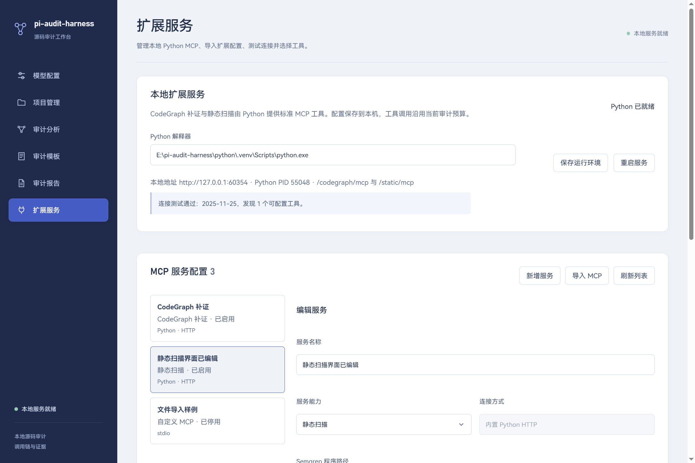
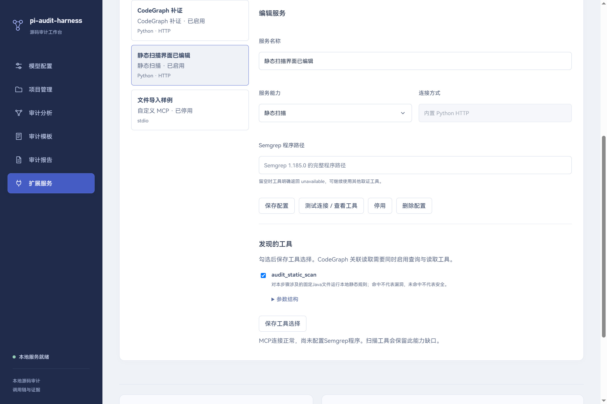
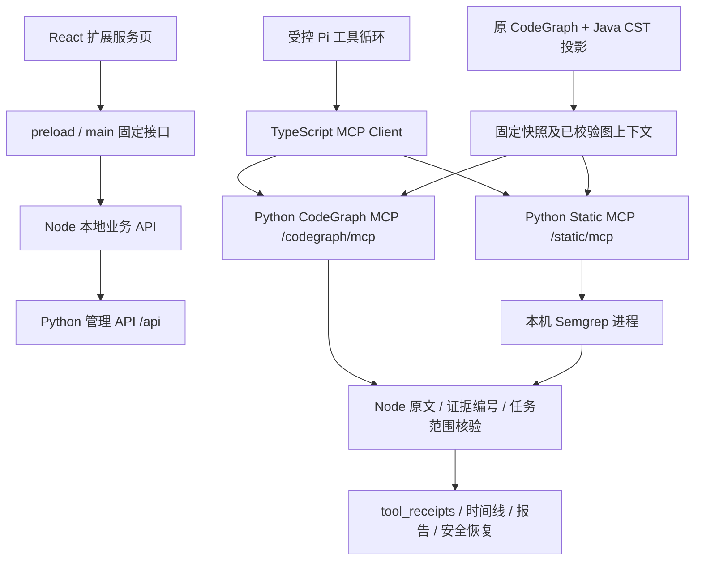

# 20 Python 本地 MCP 服务与客户端管理

更新：2026-11-12。CodeGraph 补证和静态扫描已改为 **Python MCP Server + 本地 Streamable HTTP**。桌面新增“扩展服务”页，提供配置 CRUD、JSON 文件/文本导入、连接测试、启停、工具选择和自定义工具手动调用。SQLite 仍为 v15/21 表，没有为管理配置新增业务表。

## 1. 交付行为

| 操作 | 实现 |
| --- | --- |
| 新增、编辑、删除 | Python Registry 持久化服务配置，revision 检查旧编辑 |
| 导入 MCP | 支持 mcpServers 或 servers JSON；先解析全部内容，再原子保存；导入默认停用 |
| 启用、停用 | 内置配置决定审计可用工具；自定义服务还管理实际 stdio/HTTP 连接 |
| 测试连接 | 实际 initialize + tools/list，返回协商协议与工具结构 |
| 查看、选择工具 | 展示可配置工具和参数结构；保存后影响新调查的模型工具清单 |
| 手动测试扩展 | 已启用自定义 MCP 的工具可填写 JSON 参数调用，输出经展示脱敏 |
| Python 运行环境 | 自动探测仓库虚拟环境，支持显式解释器路径和重新启动 |
| 独立后端 | Python 模块支持 --standalone，提供 MCP 与配置管理接口 |

标准 MCP 负责工具发现和调用；配置增删改查由本地管理 API 提供。客户端通过导入新的服务增加工具来源，不在界面上传或执行任意 Python 函数正文。





## 2. 进程与职责



两个逻辑 MCP Server 共用一个 Python 进程和本地监听端口，避免每个工具启动常驻进程。服务访问和审计取证时按需启动；退出客户端时关闭。内置“停用”控制能力，不关闭仍被另一个内置服务使用的整个进程。自定义 stdio 服务由 Python 连接宿主管理子进程。

Python 使用官方 mcp==1.30.0、Pydantic 2.12.5、Starlette 1.8.0、Uvicorn 0.54.0、HTTPX 0.28.1；Node 客户端继续使用锁定的 TypeScript SDK 1.32.2。协议由 SDK 协商，界面显示实际版本。

## 3. CodeGraph 适配方式

保留既有 CodeGraph 1.6.2 索引引擎和 Java CST 校验，不在 Python 重写索引器。CodeGraphEngine.mcpProjection 导出方法 QueryItem、调用位置、调用方、候选目标与缺口；Python 根据当前步骤的真实调用位置执行 definition/incoming/outgoing 的一层筛选。

Python 保存本上下文返回的 targetId；audit_read_related 只能读取先前返回且属于同一步骤的定位。源码来自宿主核验过的 SQLite 快照内容，读取上限仍是 80 行/12000 字节。证据卡采用相同 JSON 摘要、UTF-16 长度限制与 ev- 编号。返回后宿主再次验证快照原文、定位身份和证据编号，验证通过后才保存回执。

Python 不读取用户当前工程目录，不执行目标 Java 构建。图不可用时显式保留缺口；静态扫描可以独立使用。CodeGraph 一层候选仍不是跨语言语义或传播证明。

## 4. Python 静态扫描

audit_static_scan 的业务处理已在 Python：只接收本步骤涉及的固定 Java 内容，调用用户指定的 Semgrep 1.185.0。临时目录、固定项目规则、超时、取消与结果映射由 Python 管理。子进程使用独立环境，关闭指标上报和版本检查，不加载目标工程 YAML、插件或脚本。

扫描器未配置、路径/版本不符返回 unavailable；解析/超时/数量限制保留 partial 或 failed。finding- 是候选发现身份，不能直接当原文引用。实际结果仍通过原证据和污染传播校验。

## 5. 管理 API 与存储

Python 在 127.0.0.1 的动态端口提供以下接口。所有请求要求 Bearer；令牌由宿主生成，通过 stdin 传入，不放在进程参数或日志中。

| 方法 / 路径 | 请求内容 | 返回 |
| --- | --- | --- |
| POST /api/list | {} | 配置、状态、PID、端口 |
| POST /api/save | ServerConfig | 更新后的目录 |
| POST /api/delete | {id} | 更新后的目录 |
| POST /api/import | {mcpServers:{…}} 或 {servers:[…]} | 更新后的目录 |
| POST /api/start、/api/stop | {id} | 更新后的目录 |
| POST /api/test、/api/tools | {id} | 完整可配置工具、实际 advertisedTools、协议 |
| POST /api/configureTools | {id,tools:[名称]} | 更新后的目录 |
| POST /api/call | {id,name,arguments} | 自定义工具的 MCP 结果 |
| POST /contexts/{id} | 固定范围、源码、图、回执、所选配置 | 上下文登记 |
| DELETE /contexts/{id} | 无 | 释放上下文 |
| MCP /codegraph/mcp | initialize/tools/list/tools/call | CodeGraph 补证工具 |
| MCP /static/mcp | initialize/tools/list/tools/call | 静态扫描工具 |

桌面业务服务以固定 POST /mcp/{action} 转发管理操作；renderer 不获得 Python Bearer。runtime/configureRuntime/restartRuntime 由 Node 管理解释器与进程。

应用数据目录中的文件：

| 文件 | 内容 |
| --- | --- |
| mcp/servers.json | Python 管理的服务配置；临时文件 + replace，失败不修改内存已提交状态 |
| mcp/runtime.json | Node 管理的解释器选择 |
| mcp/local-token | 仅独立启动模式的本地认证令牌 |
| mcp/endpoint.json | 独立启动模式的实际端口、PID、tokenFile 路径 |

审计上下文只保存在内存，用完 DELETE。取消登记也执行清理；后端已退出时不会为清理而重新拉起。宿主退出/管道 EOF 会触发 Python 关闭，MCP SDK 的连接上下文在各自任务中结束，避免跨任务关闭 cancel scope。

## 6. 配置、导入与当前边界

ServerConfig 包含 id/name/kind/transport/enabled、command/args/url、tools、semgrepPath、revision。内置 kind 为 codegraph/static，连接方式固定为 Python HTTP；每种能力选择一个启用配置。自定义支持本地 stdio 或 localhost HTTP，使用独立参数数组，不拼 shell 命令。

```json
{
  "mcpServers": {
    "local-service": {
      "command": "python",
      "args": ["-m", "your_server"]
    }
  }
}
```

当前导入不接受 env/headers，不会悄悄忽略其中的连接凭据；远程公网 HTTP/HTTPS 不在本次本机服务范围。程序和脚本需要能在本机执行，建议配置完整路径；不会自动下载、安装 GitHub 项目。自定义服务可发现/手动调用，其任意工具不会自动进入模型审计工具集。

`desktop/scripts/mcp-import-example.mjs` 的标准输出使用 ASCII 兼容的 JSON：非 ASCII 字符写为 `\uXXXX`，导入后由 JSON 解析还原。这样不依赖 PowerShell 读取原生程序管道时的代码页，中文服务名和路径也不会因 UTF-8/GBK 解码差异而损坏；不要在错误解码后仅靠重新写入 UTF-8 文件补救。

工具管理展示“完整可配置清单”，MCP tools/list 展示“当前启用清单”，所以取消工具后仍可在管理页重新勾选。关联读取要求同时启用关联查询。配置被当前上下文使用时拒绝修改/停用；运行环境重启也会提示先停止调查。

## 7. 审计与恢复衔接

新请求使用 mcp/python-http 标记。模型只得到已选择的 audit_find_related、audit_read_related、audit_static_scan；关闭全部扩展时只保留 audit_read_step。仍共用原有工具/请求/证据预算，MCP 不获得另一份额度。

新恢复绑定增加 mcpSettingsHash，只包含实际启用的内置配置及版本、工具选择、扫描器位置，不包含端口/PID。正常重启不改变绑定；修改审计工具配置后不能静默续用原条件。旧绑定没有该字段时按原兼容方式检查。native/rebuild 的旧回执都会由宿主核验并传给新 Python 上下文，targetId 可恢复而不伪造工具调用。

## 8. 运行与验证

```powershell
Set-Location E:\pi-audit-harness
& .\python\.venv\Scripts\python.exe -m pip install -r .\python\requirements-runtime.txt
npm --prefix desktop run dev
```

客户端点击“扩展服务”。解释器默认优先仓库 python/.venv，安装版可以配置完整路径。启动失败时页面显示针对所选环境的安装命令。安装包配置已包含 Python 服务源码、契约 JSON 和运行依赖清单；Python 解释器和 pip 依赖需由运行环境提供，未内嵌解释器。

```powershell
npm --prefix desktop run test:mcp
npm --prefix desktop run test:mcp:ui
& .\python\.venv\Scripts\python.exe -m pytest .\python\tests -q
```

Python 测试使用开发依赖；新环境先执行 `& .\python\.venv\Scripts\python.exe -m pip install -e '.\python[dev]'`。仅运行客户端不需要 pytest。

Node 集成覆盖实际 Python HTTP、stdio 扩展、配置/工具 CRUD、鉴权、绑定和原 Pi 循环；Electron 覆盖真实 React、导入桥接、停用后重新启用、重启持久化与响应式布局。测试模型为本地协议替身，没有调用付费模型。JSON 文件导入的自动 UI 测试覆盖文件选择后的 IPC 桥接，不把它描述为完整原生文件对话框自动化。

独立服务、CLI 补证、扫描器配置与逐步预期见本地学习文稿 62。

## 9. 开源复用决定

- 基于[官方 Python SDK](https://github.com/modelcontextprotocol/python-sdk)实现协议和会话，不自造 MCP JSON-RPC。
- [CodeGraph 上游](https://github.com/colbymchenry/codegraph)已有 MCP；本应用保留锁定引擎，增加固定快照/步骤适配，避免普通工作树查询破坏历史取证含义。
- [Semgrep 原独立 MCP 仓库](https://github.com/semgrep/mcp)已归档并迁入主仓库。这里复用 Semgrep 扫描引擎，为审计上下文保留小型 Python 适配层，不直接运行已归档服务。

## 10. 实现入口

- [Python HTTP/管理宿主](../../python/src/pi_audit/audit_mcp/server.py)、[配置仓库](../../python/src/pi_audit/audit_mcp/registry.py)、[两个工具后端](../../python/src/pi_audit/audit_mcp/tools.py)
- [进程管理](../../desktop/src/service/mcp/manager.ts)、[HTTP MCP Client](../../desktop/src/service/mcp/gateway.ts)、[范围校验](../../desktop/src/service/mcp/backend.ts)
- [客户端页面](../../desktop/src/renderer/src/components/McpPage.tsx)、[主进程客户端](../../desktop/src/main/mcp-client.ts)
- [集成测试](../../desktop/tests/mcp-management.test.mjs)、[Electron 验证](../../desktop/tests/mcp-electron-main.ts)
- [独立契约生成](../../desktop/scripts/generate-mcp-contract.mjs)：修改工具元数据/规则后重新生成；测试检查两种启动方式契约一致。
