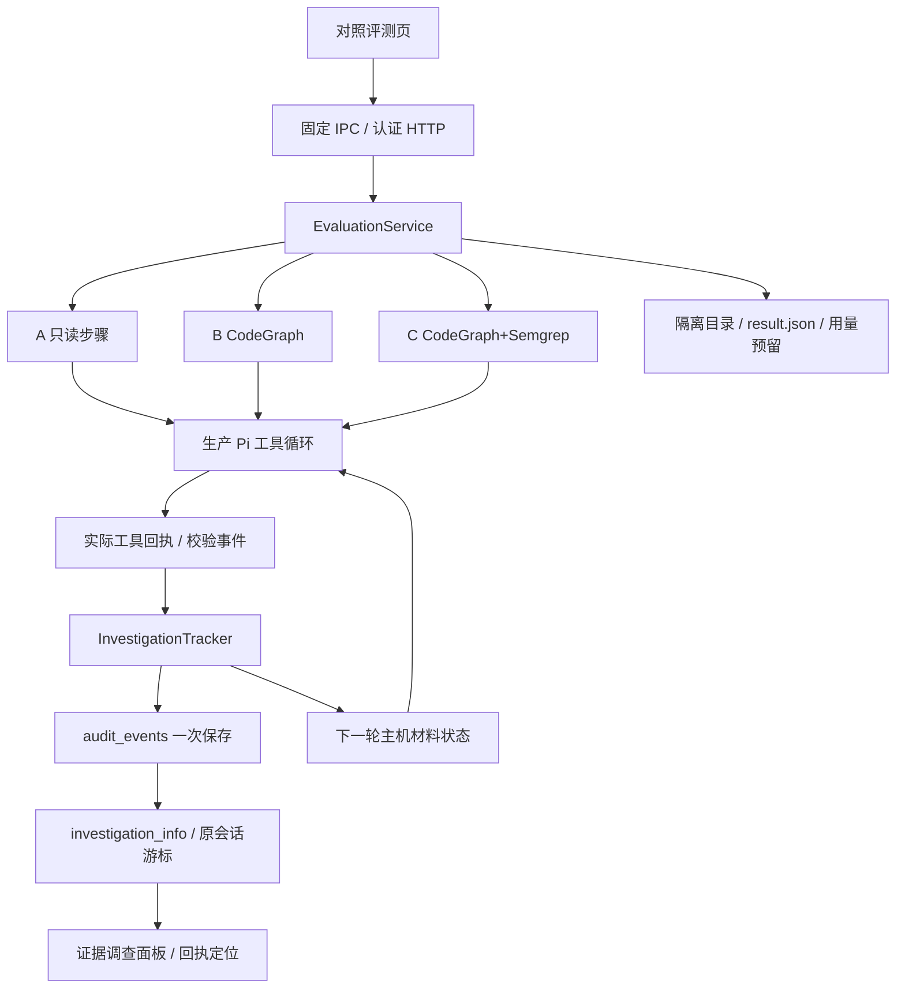
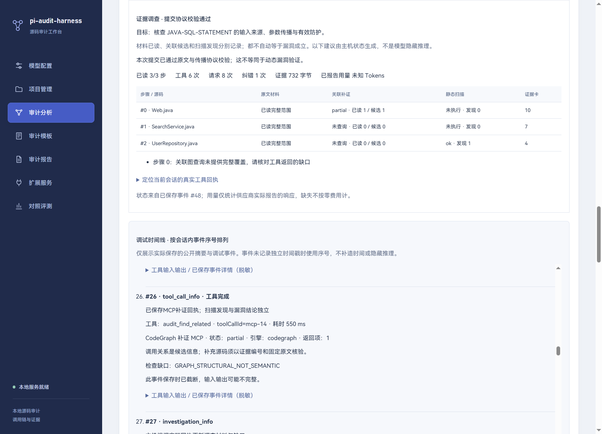
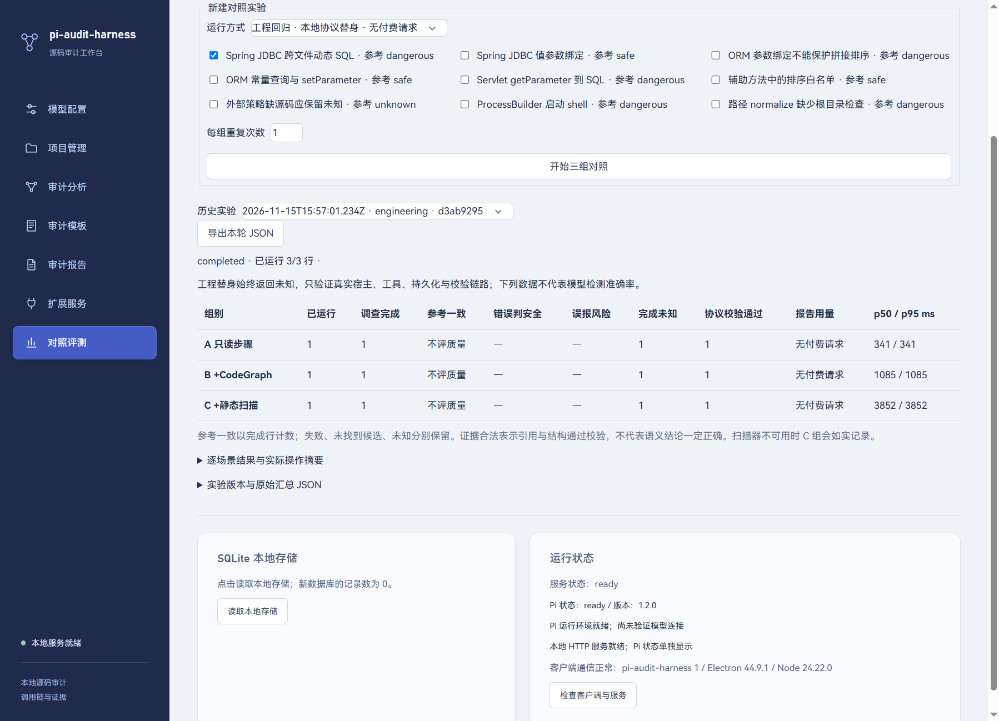

# 21 证据调查面板、对照评测与 Java 检测增强

更新：2026-11-15。本文对应当前源码实现；实际测试和付费用量另见 [本轮验证记录](assets/evaluation-2026-11-15.json)。不使用 skills 完成本轮开发。配色沿用原工作台。

## 1. 工程意义与交付范围

本轮把三件事连接起来：调查过程中明确材料缺口；在固定条件下比较工具配置；针对实际 Java 框架补充候选发现和取证。工具读成功、协议校验通过、语义判断正确、动态利用成立是不同事实。

| 能力 | 当前行为 | 用途 |
| --- | --- | --- |
| 证据调查面板 | 已读/部分读取、关联图状态、候选与补读数量、静态扫描状态、证据卡、请求/工具/纠错/用量、缺口建议、真实回执定位 | 解释当前材料到了哪一步，辅助排查失败 |
| 三组评测 | A只读步骤、B增加CodeGraph、C再增加静态扫描，按同场景顺序运行 | 测量工具收益和成本；允许结果没有提升 |
| 两种运行方式 | 工程协议替身与真实模型分开，前者不计算模型质量 | 分离运行时正确性与检测质量 |
| 历史与导出 | 刷新历史只读本地结果；原生另存JSON | 重现、汇报和追踪失败 |
| Java检测 | JDBC准备语句、Spring JDBC/接口/JdbcClient、ORM动态查询、Servlet入口、已知非SQL接收者排除 | 减少常见框架漏检及同名API噪声 |

没有新增应用数据库表。正式数据库仍为 SQLite v15/21表。评测每行使用独立运行数据库，表结构与应用相同，不把测试项目写进日常项目库。

## 2. 数据流



## 3. 调查状态与证据缺口

[InvestigationTracker](../../desktop/src/service/chains/investigation.ts)从宿主实际执行事件构建完整状态，不让模型自报百分比。`audit_read_step`完成只更新材料状态；`audit_find_related`返回定位只登记候选；`audit_read_related`实际返回原文才更新补读数量；扫描状态按真实回执登记。

阶段为 collecting/verifying/repairing/verified。最后一个阶段表示提交通过原文和传播协议检查，最终风险及落库状态仍读取正式结果；合法 unknown 可以到达 verified。路径截断、关联覆盖和扫描缺口不会因提交合法而被抹掉。

`SOURCE_READ`表示未读或部分读取；`GRAPH_GAP`表示图查询覆盖不完整；`RELATED_REVIEW`表示返回的候选还有未补读项，不强制断言所有候选都与结论有关；`STATIC_GAP`表示扫描能力/覆盖不足；`PATH_COVERAGE`保留截断；`RESULT_VALIDATION`包含具体字段反馈。

完整快照作为 `process/investigation_state` 保存，由原事件投影生成 `investigation_info`，沿原认证HTTP、preload和SSE解析器进入页面。一次事实没有重复事件表。页面使用最新完整快照，不依赖在最近200条视图里重新累计所有历史。旧会话缺快照时明确显示缺失。

恢复时，只用已经核验的原步骤与MCP回执填充状态，不伪造新的工具开始/完成事件。工具、请求计数延续宿主恢复预算；用量仅累计当前接续循环实际收到的usage，缺失显示未知，不能当成零费用。

下一步建议来自宿主材料状态；初始和继续提示也包含该状态。工具选择仍由模型作出，宿主检查先读原文、步骤范围、工具权限、调用/证据/时间预算。返回定位不会授予任意路径读取权限。

## 4. 评测接口

客户端入口为“对照评测”。主进程通过 `evaluations:action`，调用认证 Node API：

| 接口 | 输入 | 结果 |
| --- | --- | --- |
| POST /evaluations/catalog | {} | 固定样例目录及语料版本 |
| POST /evaluations/list | {} | 最近20轮元数据，不展开所有行 |
| POST /evaluations/start | mode、caseIds、trials；真实方式另需模型编号/版本、allowPaid和tokenBudget | 立即返回新任务；后台顺序执行 |
| POST /evaluations/detail | {id} | 状态、预算、逐行结果与操作摘要 |
| POST /evaluations/stop | {id} | 取消原任务并保留已完成记录 |

开始参数限定为固定场景、每组1—3轮；真实方式需要显式确认目标模型、固定样例发送范围和1000—500000 Tokens上限。模型配置变化会停止后续行。工程方式不读取供应商密钥，使用本机流式 Chat Completions 协议替身，仍通过真实 Pi SDK、CodeGraph、Python MCP 和正式校验流程。

`evaluations:save`由主进程读取该轮结果，打开原生另存对话框写JSON；渲染进程不提供任意写文件路径。状态读取和导出不启动模型。

## 5. 固定条件与样例

[原创固定场景](../../desktop/src/service/evaluation/corpus.ts)版本为 java-realistic-2026.11.15.1：Spring JDBC拼接/绑定、ORM排序拼接/绑定、Servlet来源、辅助白名单、外部策略缺源码、shell命令、normalize缺根目录检查，共9例。

每个场景只评估预处理返回的第一条固定候选；记录路径数、路径摘要，存在多路径时标记 `MULTIPLE_CANDIDATES_FIRST_PATH_ONLY`。不能把这项指标解释成全仓库检出率。参考标签仅用于事后计分，不放入模型提示。

一轮中固定源码字节及sourceDigest、模型配置版本/地址/ID、提示版本、内置规则版本、静态规则摘要、单路径LoopLimits。只改变可用工具。工具是可选能力，C组不强制调用Semgrep；要从真实操作摘要确认采用了什么。恢复绑定加入提示策略版本，新绑定不能静默更换策略，旧无此字段的记录保留原兼容路径。

语料主要是独立编写的典型模式，数量小、标签为工程参考；不能给出一般Java漏洞准确率。既有18例验收集与本轮9例场景保留各自版本。真实开源复核只使用本地已有的固定WebGoat单文件，不将其GPL源码发布为本项目MIT样例。

## 6. 指标的实际定义

| 指标 | 定义 |
| --- | --- |
| total | 该组已经产生结果的行数，不包括尚未运行 |
| completed | 正常完成提交，包含合法unknown |
| agreement | 真实模型方式中，completed且结论等于参考标签的行数；工程方式为null |
| falseSafe | 参考dangerous却判safe |
| falseRisk | 参考safe却判dangerous |
| unknown | 正常完成且结论unknown；不包含异常失败 |
| failed | 执行失败行；no-candidate在逐行状态中单列 |
| evidenceValid | 通过正式提交校验；不能代替语义正确性 |
| usage | 供应商报告的实际usage总量；未报告部分另记上界 |
| p50/p95 | 已运行行端到端耗时的最近秩分位数，包含失败行耗时 |

存在不同数量、失败或提前停止时须同时读分母和逐行记录。不要把多个开发阶段的数据混成同条件对照，不把小样本单轮百分比当总体性能。

## 7. 预算与生命周期

结果放在 `<dataRoot>/evaluations/<id>/result.json`。每行目录用短名称保存隔离源码、数据库、Pi会话和图缓存，避免Windows长路径导致图建库失败；人类可读身份保存在JSON。

请求进入传输前同步预留 `inputBytes + maxOutputTokens + 8192`。预算不够时不发出请求；收到有效usage后改记报告用量；失败或缺失usage的预留按上界保留。SDK隐藏重试关闭，仍使用原生产循环的有限纠错与瞬态重试。

本次代测命令另由CLI独占锁和所有本轮历史结果限制累计500000 Tokens，包含初始失败和不确定用量。客户端以后新建的每轮实验由用户另行明确确认预算。服务退出会取消正在执行的循环；重启发现running记录时标记interrupted，未确认预留转为不确定占用，不自动继续付费运行。

## 8. Java检测范围与实现

[builtin.ts](../../desktop/src/service/rules/builtin.ts)当前 java-framework-2026.11.15.2，三类漏洞共8条内置规则。新增Spring JDBC、ORM和JDBC准备语句规则。`findRiskCandidates`复用预处理已经得到的Java CST，按接收者的字段、形参、局部绑定及作用域识别框架类型；宽泛query/update等名称要求相应框架类型，已知Executor/普通业务类型的同名调用不当成SQL。

覆盖JdbcTemplate/JdbcOperations、NamedParameterJdbcTemplate/Operations、JdbcClient.sql、EntityManager和Hibernate Session的相应SQL/查询文本入口。prepareStatement/prepareCall定位的是待核查SQL构造，不意味着已经执行。已知CriteriaQuery及回调变量重载排除；缺少类型、反射、自定义包装或未支持重载仍有覆盖限制。

HTTP入口依据真实注解token识别，避免注解字符串冒充入口；增加带HttpServletRequest形参的Servlet doGet/doPost等入口。入口本身仍是候选，模型须以实际输入读取和传播为依据。

Java CST解析兼容开头的UTF-8 BOM：仅在解析输入中用等长空格替代，快照字节不变、行列偏移不变，避免Windows编辑器或PowerShell生成的样例无故落入语法降级。

固定Semgrep规则增加框架拼接、先赋值后查询及prepare调用拼接。Python仍只扫描当前步骤涉及的最多两个固定Java文件、每文件≤256KiB，使用Semgrep1.185.0。没有加载目标项目规则或构建脚本。扫描命中仍为候选，值绑定不能保护动态SQL结构，normalize不等于根目录包含，数组命令不自动证明无风险。

## 9. 本轮发现的集成问题

1. Semgrep继承Python宿主仍开放的stdin，在真实HTTP服务内等待输入而超时；独立脚本的stdin已EOF，因此单独运行不能复现。修复为子进程显式DEVNULL，并以真正的Python HTTP MCP扫描作回归。
2. 深层评测目录叠加64位图摘要目录、SQLite/WAL文件名超过Windows路径空间。行目录改短；完整caseId/group/trial仍保存在结果中，没有删除旧失败记录。
3. 评测包装复制ReviewInput后，Agent创建的MCP回执只留在副本；二次提交校验无法取得辅助方法原文。现在finally把回执交回原输入，并以真正引用辅助方法证据的工程替身回归，保留严格原文校验。

## 10. 运行与源码入口

本轮真实请求已停止，累计供应商报告475167/500000 Tokens，不确定占用0。6阶段共62行，其中56正常完成、6失败（包括预算拒绝）；保留修复前记录，不合并成“最终准确率”。修复后白名单案例A正常unknown、B/C正常safe；WebGoat固定单文件另验证3条候选路径及一次实际Python静态扫描，未调用模型，也不代表整个WebGoat已审计。

另对[Spring PetClinic固定提交的JDBC文件](https://github.com/spring-petclinic/spring-petclinic-rest/blob/0515ec8b57e7708d99d7a1315638d81d3f2c9ead/src/main/java/org/springframework/samples/petclinic/repository/jdbc/JdbcOwnerRepositoryImpl.java)验证：SHA256为37196c92118d3a76eb513af54e01d72ff3f4d8c5af329ebc41f33f10fb761215。与本轮修改前备份规则比较，框架SQL入口候选从0增加到13；实际预处理登记21条有界路径，状态partial。该文件含参数绑定等正常查询，候选数不是漏洞数；未发送模型、未审计整个项目。Apache-2.0原文仅存本地验证目录，公共结果只含来源、摘要与定位元数据。

Node全量240通过；Python30通过、1项原有Windows符号链接权限跳过；真实Electron覆盖调查面板、纠错历史和三组工程对照。原生导出对话框可亲手验证，自动UI实验不冒称覆盖了系统文件对话框操作。

```powershell
Set-Location E:\pi-audit-harness
npm --prefix desktop run dev
```

“审计分析”选择路径、确认发送并开始，新尝试展示调查快照。“对照评测”默认工程方式；真实方式显示发送目标与预算，用户确认后启动。完整免费/付费实验和预期见本地学习稿64。

```powershell
npm --prefix desktop run test:investigation
npm --prefix desktop run test:reliability
```

- [主机状态](../../desktop/src/service/chains/investigation.ts)、[调查页面](../../desktop/src/renderer/src/components/InvestigationPanel.tsx)
- [评测服务](../../desktop/src/service/evaluation/service.ts)、[评测页面](../../desktop/src/renderer/src/components/EvaluationsPage.tsx)、[CLI](../../desktop/scripts/eval-lab.mjs)
- [检测回归](../../desktop/tests/framework-detection.test.mjs)、[评测与预算回归](../../desktop/tests/evaluation.test.mjs)
- [Spring JDBC官方说明](https://docs.spring.io/spring-framework/reference/data-access/jdbc/core.html)：查询文本和绑定值是不同输入；本文规则是受限候选适配，不是完整框架语义引擎。




