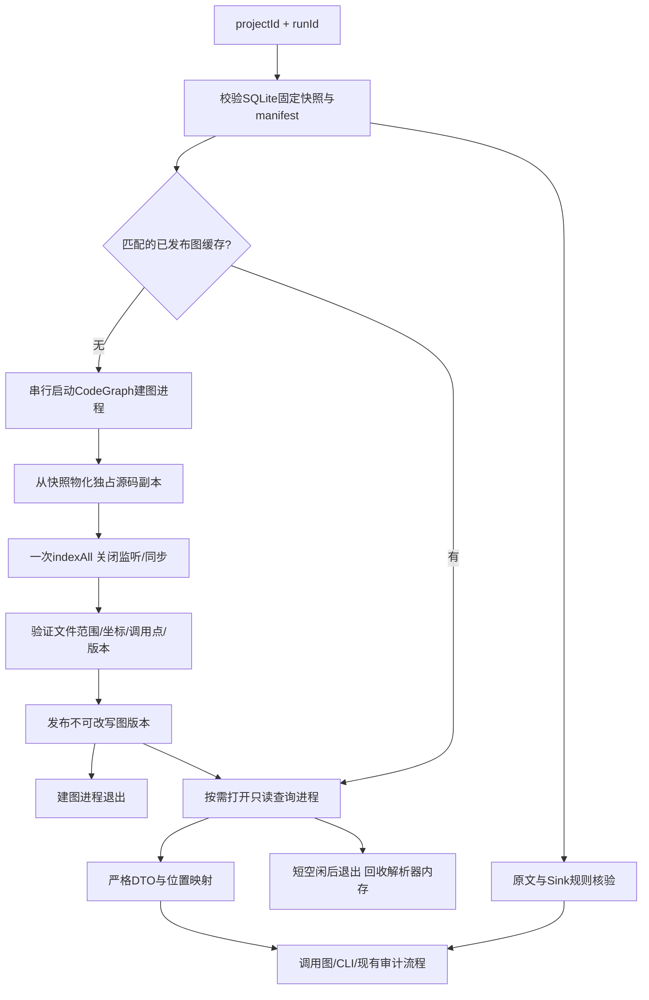

# CodeGraph 替代 JDT-LS 查询后端设计

实施更新：2026-11-05，用户追加要求删除旧JDT-LS，当前代码只保留CodeGraph/basic。采用一次建图、应用投影、进程退出；没有保留提案中的JDT兼容后端，也不常驻SDK查询进程。当前实现与实测见[技术文档13](../../technical/13.CodeGraph固定快照图与资源管理.md)。下文保留设计形成时的论证，不作为当前运行说明。

日期：2026-11-05。状态：**原始提案，已实施版本以上述更新为准**。适用范围：pi-audit-harness 的 QRY-02～QRY-05、候选调用图构建及其与 RUN-02 的衔接。

## 1. 结论与目标

建议采用 **CodeGraph 默认结构查询 + 固定快照建图 + 按需短生命周期进程 + 原有审计证据核验**。正常路径取消对 JDK/JDT-LS 的安装和启动要求。迁移期间 JDT-LS 作为显式选择的兼容/对照后端，默认关闭；CodeGraph 出错时只降级到现有 basic，不自动启动 JVM。完成兼容验收后，可从标准发行包移除 JDT-LS 入口，旧结果照常可读。

替代目标是代码导航、跨文件候选关系、上游/下游查询及预处理性能。Java 编译器级类型绑定、完整依赖分析、反射和运行时依赖注入不在 CodeGraph 首版承诺中。审计结论继续由固定原文、传播核查和现有验证器产生。

JDT-LS 不是已停止维护的旧项目，其官方 changelog 有 2026-10-19 的 1.63.0 更新。[JDT-LS 更新记录](https://github.com/eclipse-jdtls/eclipse.jdt.ls/blob/main/CHANGELOG.md)。本项目迁移的依据是工作负载适配：当前分析的是只读、有限 Java 源文件快照，没有导入完整业务依赖，却需要承担语言服务器及工作区的生命周期。

## 2. 调研依据与不能预先承诺的事情

本次代码核查固定到 CodeGraph 提交 `f72c9d2efb14454ff4f9fd7b8460abd82f19a287`。该提交 package.json 标注 1.6.2；这个标记不等于已经核验 npm 某个发布包包含所有已读源码。正式实施先核对发布制品、commit、integrity 和平台资源，再锁定依赖。

| 已核对事实 | 对设计的影响 | 一手依据 |
| --- | --- | --- |
| Java 提取器存在，支持方法/构造器、字段、注解、调用等；含部分 Lombok/record 合成节点 | 可承接结构图，但合成节点必须单独标注，不能冒充实际源码声明 | [Java 提取器](https://github.com/colbymchenry/codegraph/blob/f72c9d2efb14454ff4f9fd7b8460abd82f19a287/src/extraction/languages/java.ts) |
| API 提供 init/open、indexAll、符号搜索及入/出调用；open 支持 readOnly、sync 选项 | 用库 API 和结构化 DTO，避免解析面向人的 CLI/MCP 文本 | [CodeGraph API](https://github.com/colbymchenry/codegraph/blob/f72c9d2efb14454ff4f9fd7b8460abd82f19a287/src/index.ts) |
| 边有 tree-sitter/scip/heuristic provenance；解析策略含 exact-match/import/framework/fuzzy 等及 confidence | 保存来源、方法和不确定性；score 高不能直接视为语义确认 | [图类型](https://github.com/colbymchenry/codegraph/blob/f72c9d2efb14454ff4f9fd7b8460abd82f19a287/src/types.ts)、[解析类型](https://github.com/colbymchenry/codegraph/blob/f72c9d2efb14454ff4f9fd7b8460abd82f19a287/src/resolution/types.ts) |
| getCallSites 返回同一对符号之间的全部调用位置 | 审计不能只按调用者/被调用者去重；同方法里的两个调用点必须分别定位 | [调用位置遍历](https://github.com/colbymchenry/codegraph/blob/f72c9d2efb14454ff4f9fd7b8460abd82f19a287/src/graph/traversal.ts) |
| Node 行号从1开始，列从0开始；helper说明WASM与kernel列使用UTF-16 | 本项目继续输出从1开始的UTF-16坐标，必须校验名称token与结束范围 | [坐标辅助](https://github.com/colbymchenry/codegraph/blob/f72c9d2efb14454ff4f9fd7b8460abd82f19a287/src/extraction/tree-sitter-helpers.ts) |
| parse/resolve存在worker池，WASM内存不会自动缩回；多resolver可能占用大量内存 | Rust/免JVM不等于低内存保证，实施时限制池并退出进程回收 | [解析池](https://github.com/colbymchenry/codegraph/blob/f72c9d2efb14454ff4f9fd7b8460abd82f19a287/src/extraction/parse-pool.ts)、[解析关系池](https://github.com/colbymchenry/codegraph/blob/f72c9d2efb14454ff4f9fd7b8460abd82f19a287/src/resolution/resolver-pool.ts) |
| 遥测默认开启，MCP还有独立版本检查 | 所有嵌入进程在导入前显式关闭；验收时检查无外联 | [遥测说明](https://github.com/colbymchenry/codegraph/blob/f72c9d2efb14454ff4f9fd7b8460abd82f19a287/TELEMETRY.md) |
| package engines为>=20且<25，README对嵌入另要求node:sqlite；含WASM/可选原生实现 | 校验实际Electron内置Node与发布包，不把Node CLI成功当桌面打包成功 | [package.json](https://github.com/colbymchenry/codegraph/blob/f72c9d2efb14454ff4f9fd7b8460abd82f19a287/package.json)、[项目说明](https://github.com/colbymchenry/codegraph) |

上游 README 的性能数字针对其检索工作负载，不是本项目与 JDT-LS 的同机 Java 精度/内存对照。本提案不把它们当成已经实现的节省比例。是否替代成功，要以第10节实验为准。

## 3. 当前实现的实际接入点

| 现有文件 | 现状 | 拟议改动 |
| --- | --- | --- |
| desktop/src/service/query/java-runtime.ts | Java进程、工作区、最多2个版本会话、空闲120秒回收；每JVM为-Xmx512m | 保留为迁移期可选后端，默认不实例化；新增受控CodeGraph worker |
| desktop/src/service/query/language-registry.ts | 已有adapter/provider，但QueryAdapterContext仍包含LSP的request(method,params) | 抽出与LSP无关的QueryEngine接口，LSP桥接留在JDT内部 |
| desktop/src/service/query/unified-service.ts | 外层统一HTTP；enrichJavaCalls直接访问this.pool及semanticJava | 同时改普通查询和预处理增强，避免“查询替换了，预处理仍偷偷启动Java” |
| desktop/src/service/query/basic-adapter.ts | 文本/CST候选 | 保留，作为明确标注的轻量降级 |
| desktop/src/service/scanning/java-index.ts | Java CST、方法key、实参、调用点、receiver | 首版保留，核对CodeGraph关系与本项目规则需要的精确原文 |
| desktop/src/service/storage/snapshot-repository.ts | 固定Java字节、SHA-256、任务归属 | 作为唯一材料源；CodeGraph图只是可重建缓存 |
| desktop/src/service/chains/recovery.ts | 绑定快照、路径、规则、模型、协议，核验Pi检查点与证据 | 新任务增加图绑定，旧任务走原版本恢复，不重新推导旧路径 |

512MiB是单JVM最大堆配置，不是当前RSS实测值；两个会话也不是已测得“占用1GiB”。实际RSS还包含运行时、线程栈、映射与缓存，基准要单独测。

## 4. 架构：可卸载、可核验的快照图



应用保留轻量索引元信息。一个项目的图已建成后，不需要一直保留解析器、所有AST和大解析缓存。查询可打开图数据库；高频相邻查询复用同一个短生命周期进程，避免每条CLI请求冷启一遍。

区分三种材料：

1. **源码图**：CodeGraph的符号与关系，用于发现结构和定位候选。
2. **审计图**：保留本项目Sink规则、入口候选、实参、调用点和原文映射，是当次任务固定的事实。
3. **取证材料**：Pi工具实际读取的原文与回执、传播检查和最终提交结果。

三者分别保存身份和来源。结构关系不会因为进入审计图就自动成为漏洞证据。这一设计可概括为“可卸载的证据图”：重型索引进程可退出，任务仍能说明图从哪份源码、哪个引擎和哪些核验规则生成。

## 5. 快照与索引的构建、发布和复用

### 5.1 缓存身份

建议图缓存键为以下规范化材料的摘要：

```text
projectId
+ snapshotId / manifestHash
+ CodeGraph制品commit与integrity
+ extractionVersion
+ adapterVersion
+ 受控提取配置hash
```

相同项目、相同快照、相同引擎与适配配置的多个run可复用。首版不跨项目共享，避免归属和泄露边界复杂化。审计规则版本另外进入auditGraphHash，不要求每次规则变化都重新解析纯源码图。

候选目录：`<dataRoot>/query-index/<key>/<generation>/source`，CodeGraph的`.codegraph`位于此受控副本内。调用方不能传任意projectPath、索引目录、shell、SQL或配置文件。源码以manifest校验约束，构建后停止写入；Windows只读属性不是安全沙箱，不将它当成防恶意本地进程的隔离保证。

只从SQLite按manifest写入Java文件，不复制原目录的.gitignore、.codegraph、项目脚本、pom或Gradle文件，不调用用户构建。CodeGraph自己的忽略策略可能再排除快照内文件，因此必须比较“快照manifest”和“实际索引文件集合”，缺失记录进入gaps，不能悄悄缩小范围。

### 5.2 构建与发布顺序

1. 验证任务归属和快照摘要，串行取得同key的建图权；多个等待者共享一个构建任务。
2. 新建generation暂存目录，从快照写材料，使用库API一次建图。不调用install、watch、MCP serve或daemon。
3. 核验索引成功文件/失败文件、符号范围、调用点、图schema与提取版本，计算规范化图摘要。
4. 完成SQLite checkpoint、关闭所有连接和worker，确认不依赖未拷贝WAL/SHM。
5. 发布已关闭的图文件与manifest，再在应用DB登记ready；读者只认登记成功的generation。
6. 进程退出。构建失败、取消或超内存不发布半成品；保留明确错误，允许basic降级。

文件发布和应用数据库登记仍然不是跨资源事务。崩溃时只接受完整已登记的产物，孤立临时目录可随后按受控归属清理。损坏索引按缓存处理；原快照和已提交结果不能删除。

针对已读源码API，worker逻辑可按以下伪代码组织；生命周期和打包还需实施验证：

```typescript
// 环境变量应由父进程在fork时注入；此处在隔离worker内执行。
const graph = await CodeGraph.init(controlledRoot, { index: false })
try {
  await graph.indexAll({ signal, onProgress: boundedProgress })
  await verifyAndDescribeArtifact(graph, snapshotManifest)
} finally {
  graph.close()
}
// 父进程等子进程退出后发布产物；close()不替代进程退出确认。
// 查询worker按ready记录打开：
// CodeGraph.open(controlledRoot, { readOnly: true, sync: false })
```

### 5.3 增量策略

首版对每个新快照全量建图，对相同快照直接复用，优先验证简单可靠的路径。以后可从上一代缓存复制出新generation，对manifest差异调用增量同步；旧generation保持不变。方法删除/移动、重载和跨文件依赖变化必须触发足够的关系重解析，不能仅更新被改文件节点就宣称全图已新鲜。

## 6. 查询契约与精度分层

### 6.1 首版保持外部contractVersion=1

保留当前 `/code/query`、CLI JSON和身份字段，read/search继续使用SQLite快照。CodeGraph结构结果在v1中保持`resolution=candidate`；backend可以是codegraph，gaps明确说明结构推断和未解析范围。

当前capabilities里的semantic不能再按“存在provider”计算。CodeGraph应报告semantic=false；JDT后端按原含义报告，避免只因注册成功就承诺类型语义。内部增加独立精度字段，暂不突破严格v1输出校验；需要对外公开更多来源信息时，再增加明确的v2协议和版本协商。

| 操作 | CodeGraph替代策略 | 完整性限制 |
| --- | --- | --- |
| capabilities/status | 报告已交付能力、artifact状态、当前短进程；不启动建图 | 不把语言清单变成所有语言均可审计 |
| prepare | 验证/生成受控快照图 | 文件过滤、解析失败、预算中止均要有缺口 |
| read/search | 保留现有快照原文/字面量逻辑 | CodeGraph符号FTS不能直接替换字面量搜索语义 |
| symbols | 枚举文件节点，映射到真实方法/类范围 | 合成成员标识generated，不能伪造源码声明 |
| definition | 先找准确调用token，再找关联关系和候选目标 | 不是searchNodes(name)取第一条；同参数数量重载仍可能有歧义 |
| references | 分类型读取真实references/uses等引用位置 | callers不能冒充全部引用；无完整引用类型就partial或unsupported |
| incomingCalls/outgoingCalls | 优先使用完整call sites API或受控底层edge查询 | 每个调用位置独立，区分调用位置和声明位置；只返回直接调用 |

外部输出仍为快照相对文件与UTF-16坐标。固定提交的helper说明其列为0起始UTF-16；适配时转成1起始，并核验token。针对CRLF、中文、emoji、原生kernel和WASM分别测试，不根据Tree-sitter名称就擅自当成UTF-8字节列。

### 6.2 内部关系强度

建议内部保存：`engine`、`provenance`、`resolvedBy`、`upstreamConfidence`、`verification`、`callSite`、`targetSymbolKey`、`gaps`。

| verification | 含义 | 审计使用 |
| --- | --- | --- |
| candidate | 名称/近似匹配或无法消歧 | 可以辅助发现，但标明歧义，不宣称唯一目标 |
| verified-structural | 文件范围、准确调用点、owner/import、签名等受支持规则均与固定源码一致 | 支持当前有限静态模型中的关系；不等于Java编译器绑定 |
| semantic | 真实类型后端确认，且映射回唯一受控声明 | 兼容保留JDT的既有语义结果 |
| synthesized | 框架/Lombok/其他规则推导 | 辅助线索，单独展示推导来源，不能伪造原文 |

不得设置“confidence>=0.9就confirmed”。v1现有`confirmed`和`JavaCall.semantic`只保留原语义含义；不能把CodeGraph唯一候选直接赋给semantic=true。UI内部可显示“结构已核验”，同时保留原危险/安全/未知判断维度。

对于`search(String)`和`search(Integer)`同arity、泛型推导、装箱、null实参、继承、接口多实现、方法引用和动态代理，先写明确支持矩阵。不能证明唯一绑定时保留多个候选和`GRAPH_AMBIGUOUS_TARGET`，不任取一个。反向路径展开有界，候选组合过多时截断并记录，不能无限组合。

## 7. 进程与内存设计

### 7.1 不把CodeGraph装进主进程长期持有

建议在现有service监督下单独fork一个CodeGraph查询utilityProcess。索引、同步SQLite读和解析在子进程中进行，主业务服务仍能处理停止和心跳。通过消息传递结构化DTO，限制消息体和挂起请求数。

第一版最多一个建图进程；只读查询进程按短空闲退出，不同时维护多个项目的重型解析器。新任务不会把所有项目都预热。CLI仍由既有监督器复用同一查询后端。

拟议初始设置，须以锁定制品验证：

```text
CODEGRAPH_PARSE_WORKERS=1
CODEGRAPH_RESOLVE_WORKERS=0
CODEGRAPH_NO_PARALLEL_RESOLVE=1
CODEGRAPH_TELEMETRY=0
DO_NOT_TRACK=1
CODEGRAPH_NO_UPDATE_CHECK=1
```

这些变量只注入本应用创建的进程，在导入模块之前设置，不改用户全局环境。并行池关闭后仍可能有store/辅助worker，必须统计全部资源。没有原生内核时可按已验证WASM实现运行，但报告实际后端；不能宣称所有路径都由Rust执行。

### 7.2 第一轮预算建议

| 项目 | 初始设计值或目标 | 性质 |
| --- | --- | --- |
| 快照输入 | 沿用最多2000文件/总20MiB/单文件2MiB | 当前产品范围，初期不随迁移扩大 |
| 同时建图 | 1个generation | 确定调度限制 |
| 构建总时间 | 90秒起步，超时失败/显式降级 | 初始预算，压测后调整 |
| 单次图查询 | 3秒起步，最多100条、192KiB结果 | 初始预算；保留原公开结果上限 |
| 查询进程空闲 | 15秒退出，可在受控范围内调整 | 通过进程退出回收原生/WASM内存 |
| 冷建图增量RSS峰值 | 以<=512MiB作为第一轮验收目标 | 尚未实测，不是当前保证 |
| 热查询增量RSS | 以<=128MiB作为第一轮验收目标 | 尚未实测，按进程树口径 |
| 60秒无查询后 | 不应有CodeGraph/JVM工作进程残留 | 默认路径的可验证要求 |

可配合V8 old-space限制和RSS采样。**V8堆上限不等于RSS硬上限**，也不能约束所有WASM/native映射。RSS超预算由监督进程有界终止并返回`QUERY_MEMORY_LIMIT`；采样会有超调。若以后要求操作系统级严格上限，Windows另加Job Object等专门支持，不能把采样策略写成硬隔离。

取消单个等待者不应取消其他等待者共享的建图；最后一个等待者退出或服务关闭时才取消对应任务。同步重查询无法协作取消时，可终止独占worker；晚到的消息按requestId/generation丢弃。进程退出完成前仍占调度名额。

### 7.3 同时减少本应用自己的重复持有

现UnifiedQueryService会为查询读取整份快照并构造全量字符串。迁移时应把“验证材料”和“保留全部文本”拆开：分批校验摘要，查询只保存manifest及所需文件文本，建图物化也按文件流式完成。每次需要的原文和索引身份仍校验，不以缓存命中绕过SNAPSHOT_CORRUPT检查。

初期保留java-parser，存在双重解析；基准必须把两者都算入。以后是否从CodeGraph提取参数范围替代CST，应另做精度验收，不能先删掉规则依赖的调用点/实参功能再声称减内存。

## 8. 与固定审计图、报告及RUN-02恢复的结合

若实施，追加当前schema后的新迁移，不修改1—12迁移。初步建议：

- `query_index_artifacts`：受控缓存key/generation、源码/引擎/配置摘要、ready状态、文件摘要、大小与缺口；允许生命周期状态更新。
- `run_graph_bindings`：run固定的图身份、规范化关系摘要、adapter协议，追加式不可改写。
- `call_resolution_evidence`：调用边对应的定位来源、解析方法、核验强度与缺口。现有危险判断与机器/人工复核数据不挪作索引状态。

CodeGraph自带SQLite和业务SQLite保持分离。查询通过库API/本项目适配器；业务不依赖任意上游表结构SQL。缓存里的CodeGraph nodeId不作为稳定业务pathId，映射到本项目已有文件/owner/签名/位置身份，版本变化也不重写旧边。

新任务恢复绑定增加graphKey、engine制品身份、adapterVersion、auditGraphHash及取证协议版本。恢复原则：

1. 已固定路径与原文足以执行旧取证计划时，恢复不需要重新跑全库建图。
2. 需要额外图查询时，必须命中相同身份的缓存；丢失时可用原快照和原引擎重建，再比较规范化关系摘要。
3. 无法取得原版本或重建结果不同，则明确blocked/缺口，不能拿最新版图悄悄补进旧上下文。
4. 对历史任务保留协议v1执行分支：只沿原固定路径读原文的旧Pi会话可以按旧规则继续，不为了迁移强行补造CodeGraph来源。
5. 新旧模式的预算、工具说明或实际输入范围改变时使用版本化executor；不只修改一个全局protocol字符串导致所有旧恢复无差别失效。

报告增加构图引擎/版本、结构核验与语义确认的数量、合成关系、未解析/截断缺口。旧报告仍是原冻结产物，新索引不会改写旧统计。源码发送许可依旧依据真实输入范围核对；将来若新增图探索工具而扩大传输材料，须更新范围说明与许可摘要。

## 9. 分阶段落地与回退

| 阶段 | 交付 | 进入下一阶段的条件 |
| --- | --- | --- |
| A 制品与小型验证 | 固定commit/发布包，Windows/Electron加载；同arity重载、调用点、坐标、取消、遥测验证 | 能真实查询且输出精度分层，不依赖联网下载/用户构建 |
| B 后端适配 | 中性QueryEngine、CodeGraph worker、快照索引缓存，现有HTTP/CLI继续工作 | 严格契约、基础降级、归属/损坏/并发边界通过 |
| C 审计接入 | 同时迁移enrichJavaCalls；加入定位来源及图绑定，保留Sink/CST核查 | 原审计/手工点/报告/停止恢复回归通过，无错误semantic提升 |
| D 默认切换 | CodeGraph默认，JDT显式可选、默认关闭；文档及手动实验重写 | 第10节性能与人工标注质量门槛通过 |
| E 发行收敛 | 标准配置不要求JDK/JDT；按旧任务需要决定兼容后端保留方式 | 旧记录/报告/必要恢复路径有明确支持策略 |

建议配置`queryBackend=codegraph|jdtls|basic`，由应用可信设置选定，并在新run中冻结；不能作为每个公开请求里的任意命令或包地址。默认失败链为`codegraph → basic(partial)`；原后端对照切换创建新任务，不能重写正在恢复的任务。

本次只交付设计，没有修改默认后端、安装CodeGraph、删除Java环境或启动其daemon。依赖实施与制品验收在方案确认后执行。

## 10. 能否替代成功的实验与验收

### 10.1 精度样例

从现有query-jdtls、query-enhancements、call-chains、run-recovery样例扩展小型人工标注集：

- 两个HTTP入口共用SQL Sink，跨文件正确回溯。
- 不同参数数量重载、String/int等同参数数量重载、null、装箱、泛型、同名不同包。
- 单方法同一callee调用两次、递归、构造器、静态import、接口多实现。
- 赋值/返回/字段传播；调用关系正确不能替代污点传播成立。
- Lombok/record合成成员、Spring入口推导、动态代理和反射保留未知。
- 中文/emoji/CRLF，比较WASM与可选native实际输出位置。
- 缺文件、解析失败、内存超限、取消/崩溃、索引损坏、版本改变。

逐条记录关系precision/recall、歧义率、被错误标成唯一/语义确认的数量、调用点准确率。JDT-LS只作为对照，不作为绝对真值；以人工标注和源码事实裁定。确定性关键集不接受错误提升，歧义保留率必须100%。大型真实项目指标另设标注样本，不能拿README的跨文件覆盖率当成漏洞召回率。

### 10.2 性能对照

相同机器、相同快照、相同文件范围，比较当前JDT配置、CodeGraph默认配置和本方案单worker配置。小/中/上限规模分别做至少5次，报告中位数及范围；有足够查询样本后再报告p95。

分别测冷建图、持久缓存重开、同进程热查、10次项目/快照切换、空闲回收。记录wall time、CPU、进程树RSS峰值与空闲RSS、缓存大小、查询延迟、已定位/歧义/未覆盖数量。CodeGraph内部worker thread的RSS不能逐线程重复求和；独立进程要包含，应用其余部分用基线差值说明。

首轮目标：热查询增量<=128MiB、冷建图峰值<=512MiB、空闲60秒无重型进程；与JDT比较的内存至少下降40%作为初始切换门槛，**这些都是验收目标，不是已测成绩**。若质量或资源门槛未达，先限流/调缓存并公开取舍，不直接宣布等价替代。

### 10.3 集成回归

保留现有基础/统一查询、真实Pi、本地HTTP认证、不同PID、快照不漂移、手工风险点、人工复核、JSON/HTML、停止与恢复用例。默认CodeGraph模式中断言没有Java进程被创建。Electron打包要检查schema/WASM/native资源在asar内外的实际位置及离线启动。

验收后再把技术文档10、查询使用说明、手动实验与学习文档改成CodeGraph默认流程。设计提案不写成已完成实现。
