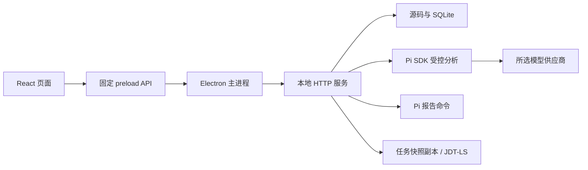

# 01 项目架构与运行

更新：2026-10-29。当前验证平台：Windows x64。

## 实现范围

桌面客户端已接通模型配置、源码输入、有界Java调用链预处理、受控Agent审阅、事件回放、交互路径图与固定源码定位、独立人工复核，以及同快照筛选预览和HTML/JSON报告。需求看板和交互原型描述目标范围，不能视为全部实现。

## 进程和信任边界

RUN-01/RUN-02增加任务停止、Pi原生会话与宿主状态恢复。检查点和取证回执由应用发布/登记，恢复先核对固定材料与预算，再主动续跑；已提交结果不重复执行，SSE补发继续独立。详见[12 停止与可验证恢复](12.任务停止与可验证会话恢复.md)。

| 层 | 入口 | 职责 |
| --- | --- | --- |
| 页面 | `desktop/src/renderer/src/App.tsx` | 项目、模型、审计、模板、报告五个入口；展示安全 DTO |
| 桥接 | `desktop/src/preload/index.ts` | 固定方法和事件订阅，不开放任意 IPC、SQL 或命令 |
| 主进程 | `desktop/src/main/index.ts`、`service-manager.ts` | 校验调用窗口/mainFrame、启动服务、认证HTTP、验证响应、原生另存和打开报告 |
| 业务服务 | `desktop/src/service/index.ts` | utilityProcess中组装源码、查询、数据库、分析、复核与报告服务 |
| 共享契约 | `desktop/src/shared/` | 参数白名单、响应 DTO、状态和事件结构校验 |

HTTP 仅绑定 `127.0.0.1` 随机端口，使用主进程持有的 bearer 令牌。渲染层启用 contextIsolation 和 sandbox，关闭 nodeIntegration。服务退出时先取消并等待活动工作，再释放 Pi、查询和数据库；心跳负责发现父进程失联。

人工复核保存追加版本与机器基线，不改机器证据；导出校验预览摘要后生成固定文件，主进程按登记与文件摘要再决定另存/打开。查看图、复核和生成报告都不调用模型，详见 [11 交互路径图人工复核与结果导出](11.交互路径图人工复核与结果导出.md)。

## 运行依赖

| 依赖 | 当前约束 |
| --- | --- |
| Node.js | 24，需包含内置 `node:sqlite` |
| Pi SDK | `@earendil-works/pi-coding-agent` 精确固定 1.2.0 |
| 前端/桌面 | React、TypeScript、Electron；版本以 `desktop/package-lock.json` 为准 |
| Java 解析 | `java-parser` 3.0.1，CST 候选解析，不是 Java LSP |
| Java语义查询 | 可选本机JDK + JDT-LS；实测Temurin25与固定1.64快照，缺失保留候选与覆盖告警 |
| Git | 仅公开 GitHub 下载需要，本地输入不依赖 |
| rg | 字面量搜索工具；源码登记与本地文件校验使用 Node 文件 API |

在 `desktop` 目录执行 `npm ci`、`npm run dev`。正式构建执行 `npm run build`，解包构建执行 `npm run build:unpack`。平台构建脚本存在不代表已验收 macOS/Linux；系统凭据适配当前面向 Windows。

Java语义增强通过PI_AUDIT_JAVA_HOME、PI_AUDIT_JDTLS_HOME指定兼容安装目录，按项目/语言/内容版本管理会话，不自动执行目标构建。Node常驻查询监督器与CLI复用认证契约。配置、预算及边界见 [10 统一查询与Java语义服务](10.统一代码查询与Java语义服务.md)。

## 模型配置

应用当前支持 OpenAI Chat Completions 兼容接口 `openai-completions`。Responses-only 服务尚不支持。Base URL、模型 ID 必须按所选供应商填写，不能用 Codex TOML 直接代替应用表单。

保存配置与应用选择是两步：保存不自动选择第一项。模型配置 revision 防止陈旧表单覆盖；分析使用实际读取的配置快照。ping 由用户明确触发，使用与正式审阅相同的配置解析和 Pi 工厂，但不附带项目源码。

API Key 存 Windows Credential Manager；SQLite 只保存非敏感配置与 secret_ref。更换凭据采用清理意图记录，失败时保留或清理本次引用，避免破坏已有可用配置。普通列表、错误和日志不返回 API Key/secret_ref。

## 运行数据与故障

数据根目录以服务启动日志为准，正式应用使用 userData 下 runtime：SQLite 位于 `storage/audit.sqlite3`，报告位于 `reports/`，Pi 资源使用应用独立目录。测试使用自己创建的隔离目录。

服务 ready、模型 ping 成功、路径分析完成、结论有充分证据是不同层次。模型超时或格式错误时保留失败/未知，不通过删除数据库或伪造结果收敛。任务取证现已绑定 SQLite 固定 Java 源码快照；它不是全仓库快照或操作系统级读取沙箱。模型请求前要求服务端发送许可，并在实际传输前再次检查配置，详见 [08 四项增强](08.配置授权快照与手工调查.md)。

## 代码与验证

配置与凭据：`service/storage/metadata-service.ts`、`credential-store.ts`、`service/model-config-resolver.ts`；运行时：`service/pi-runtime.ts`、`pi-session-factory.ts`、`pi-errors.ts`；服务通信：`service/http-server.ts`、主进程各固定 client。

构建、测试和完成范围见 [07 实现进度与验收](07.实现进度与验收.md)。原有 `agent/`、`python/`、`contracts/` 是早期取证原型；Python 不是当前桌面业务后端。
