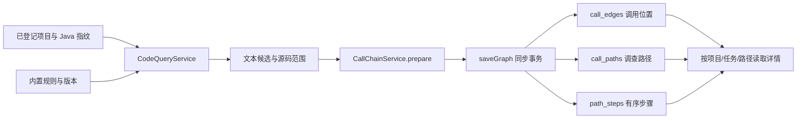

# TPL-01、QRY-01、DB-03：实现与学习指南

日期：2026-10-23。对应需求以 `docs/prd/requirements.json` 为准。

本文记录上一轮 schema v5 交付。后续已追加 schema v6、跨文件候选路径预处理与工作台，参见 [SCAN / UI 学习指南](04.SCAN-UI-调用链预处理与工作台学习指南.md)。下文的 Sink-only 范围和测试数量属于该轮历史记录。

本次完成三项后端基础能力：内置风险规则、受控源码查询，以及调用边 / 路径 / 有序步骤的 SQLite 存储。额外提供一个小型生产入口：从已登记的真实 Java 源码提取候选危险调用，保存为待调查路径，可以查询并在进程重启后读回。

`/chains/prepare` 返回 `scope: "sink-candidates-only"`。它目前登记候选 Sink，不自动解析出截图中的 HTTP → Controller → Service → Sink 全链路。上游未知时保存 `<unresolved-owner>`、`sourceRef: null`、`truncated: true`。通用存储与展开函数已经支持多步路径、分支、共享边和递归。完整预处理、Pi Loop、风险回写、SSE、交互图仍由对应后续需求接入。

## 1. 从哪里开始看代码

| 顺序 | 文件 | 职责 |
| --- | --- | --- |
| 1 | `desktop/src/service/rules/builtin.ts` | 版本化规则、审查说明、Java 文本候选匹配 |
| 2 | `desktop/src/service/query/service.ts` | 按 projectId 搜索、读取、查询候选风险 |
| 3 | `desktop/src/service/sources/scan.ts` | Java 范围、文件清单、内容哈希，复用已有源码输入校验 |
| 4 | `desktop/src/service/chains/service.ts` | 把真实候选位置转换为必要的待调查路径 |
| 5 | `desktop/src/service/chains/paths.ts` | 沿已有调用边反向展开，控制分支、递归与预算 |
| 6 | `desktop/src/service/storage/call-chain-repository.ts` | 标识、去重、事务保存、列表和详情读取 |
| 7 | `desktop/src/service/storage/call-chain-migration.ts` | schema v5：补齐图和路径上下文字段 |
| 8 | `desktop/src/service/http-server.ts`、`index.ts` | 认证 HTTP 路由、正式服务接线及退出清理 |
| 9 | `desktop/src/shared/code-query-contracts.ts`、`call-chain-contracts.ts` | 模块之间的数据契约 |



## 2. 先亲自跑通一次

在 PowerShell 中执行（兼容 Windows PowerShell 5.1 和 PowerShell 7）：

```powershell
Set-Location 'E:\pi-audit-harness\desktop'

# Node 输出 UTF-8；先指定 PowerShell 解码外部程序输出时使用的编码。
[Console]::OutputEncoding = [System.Text.UTF8Encoding]::new($false)

$prepareRun = node --disable-warning=MODULE_TYPELESS_PACKAGE_JSON `
  .\scripts\prepare-call-chains.mjs `
  .\tests\fixtures\call-chain-java `
  .\.chains-test-data\learning-demo | ConvertFrom-Json

$prepareRun | Select-Object database, projectId, runId, candidateCount, rulesVersion, scope

node --disable-warning=MODULE_TYPELESS_PACKAGE_JSON `
  .\scripts\inspect-call-chains.mjs $prepareRun.database
```

Windows PowerShell 5.1 可能按系统代码页（如 GBK/936）读取 Node 的 UTF-8 输出，导致 `limitation` 中的中文乱码，甚至破坏字符串的结束引号，使 `ConvertFrom-Json` 报“应为‘:’或‘}’”。上面的编码设置对当前 PowerShell 会话生效，必须在执行 Node 命令前设置；已经读成乱码的输出需要重新获取。

示例文件 `desktop/tests/fixtures/call-chain-java/Demo.java` 只被读取，不编译、不执行，其中包含 SQL、命令、路径三类候选：

```java
statement.executeQuery("SELECT * FROM users WHERE name=" + input);
Runtime.getRuntime().exec(input);
Files.readString(path);
```

空数据目录第一次运行后，应得到 3 条边、3 条路径、3 条步骤。每次执行脚本都会创建新项目记录和新任务，不覆盖已有历史；重复执行时总行数会增加。即使后续 `ConvertFrom-Json` 解析失败，脚本也可能已经完成数据库写入；该解析错误不会回滚已提交的数据。

已经生成的学习样例数据库位于：

```text
E:\pi-audit-harness\desktop\.chains-test-data\learning-demo\storage\audit.sqlite3
```

第一个脚本使用真实后端模块写入指定数据目录；第二个脚本通过 `readOnly: true` 打开数据库，只读取最近 20 条路径详情以及全库计数。两个脚本都不调用模型或网络。该数据目录与正式应用的数据目录分开。

观察实际输出中的这些字段：

```json
{
  "status": "pending",
  "verdict": "unknown",
  "dangerous": null,
  "truncated": true,
  "truncationReason": "unresolved-caller"
}
```

这里的含义是“已保存一个需要调查的调用位置，上游链路尚未补全”。它不表示漏洞成立，也不表示安全。外层 `prepare.truncated` 表示候选集合是否被数量上限截断；每条路径的 `truncated` 表示该路径是否存在展开限制或未补全部分，两者含义不同。

## 3. TPL-01：规则包含什么

内置目录的版本是 `java-basic-2026.10.23.1`，共 5 组规则、3 类风险。

| 规则 ID | 文本候选 API | 需核实的危险参数 |
| --- | --- | --- |
| `JAVA-SQL-STATEMENT` | `executeQuery`、`executeUpdate`、`execute`、`addBatch` | 第 0 个 SQL 参数 |
| `JAVA-CMD-RUNTIME` | `Runtime.exec` | 第 0 个命令参数 |
| `JAVA-CMD-PROCESS-BUILDER` | `new ProcessBuilder`、`command` | 全部命令参数 |
| `JAVA-PATH-FILES` | `Files.readAllBytes/readString/newInputStream/newOutputStream/write/writeString/delete` | 第 0 个 Path 参数 |
| `JAVA-PATH-STREAM` | `new FileInputStream/FileOutputStream/FileReader/FileWriter` | 第 0 个路径参数 |

每组规则同时保存 `category`、CWE、API 列表、危险参数位置和 `review` 审查说明。`review` 包括外部来源、传播核查、防护检查和覆盖限制。候选保存 `ruleId`，任务保存 `rulesVersion`；后续 Loop 可以按相同规则解释候选，避免扫描阶段和分析阶段使用不同口径。

关键代码摘录：

```typescript
export const builtinRules: RuleCatalog = freeze({
  version: 'java-basic-2026.10.23.1',
  language: 'java',
  rules
})
```

`freeze` 对目录递归冻结。它保护进程中的共享规则不被某个调用方意外修改。它不验证规则本身是否准确；调整规则时仍须更新版本并运行规则矩阵测试。

### 为什么先遮蔽注释与字符串

下面两行都含有 `executeQuery`，只有第二行是需要进一步核查的调用语法：

```java
String example = "statement.executeQuery(input)";
statement.executeQuery(input);
```

`maskJava` 用空格替换注释、普通字符串、字符字面量和文本块的内容，保留换行与字符位置。匹配在遮蔽后的文本上进行，参数原文再从原始文本中截取。

```typescript
return source.replace(pattern, (match) =>
  preserveLiterals && !match.startsWith('/')
    ? match
    : match.replace(/[^\r\n]/g, ' ')
)
```

这样既能减少注释 / 示例字符串造成的误命中，又不会因为删除文字而改变源码坐标。`preserveLiterals` 用于检查参数是否实际为空；`executeQuery(/* comment */)` 没有 SQL 参数，`executeQuery("literal")` 则有参数。

### 为什么参数不能直接用逗号 split

```java
statement.executeQuery(makeSql(input, join(a, b)));
new ProcessBuilder("sh", "-c", "x,y");
```

嵌套调用内部和字符串内部的逗号都不能当成外层实参分隔符。`argumentsAt` 在遮蔽文本上跟踪 `()`、`[]`、`{}` 的深度，只在当前调用最外层识别逗号。

```typescript
if ('([{'.includes(char)) depth++
if (')]}'.includes(char)) depth--
if (char === ',' && depth === 1) {
  spans.push([start, i])
  start = i + 1
}
```

这仍是轻量文本处理：不做 Java 类型绑定，不保证任意复杂泛型、Unicode 转义、损坏语法或反射调用都能识别。同名方法可能来自其他类，必须由后续语义证据确认。因此输出始终为 `resolutionStatus: "candidate"`，目录里的 API 名表示待核查的规则目标。

参数位置从 0 开始；文件行列从 1 开始，列使用 JavaScript 的 UTF-16 字符位置，结束列采用排他边界。

## 4. QRY-01：查询为什么从 projectId 开始

查询不接收任意绝对目录或任意命令。它先从数据库取得登记的项目，重新扫描 Java 文件，再比较当前指纹：

```typescript
const scan = await scanJava(project.path, signal)
if (scan.stamp !== project.sourceStamp)
  throw new ApiError('QUERY_SOURCE_CHANGED',
    'Java 源码已变化，请重新登记后查询，避免引用旧证据', 409)
```

这解决“数据库记录仍在，但磁盘内容已经改变”的问题。`sourceStamp` 是纳入范围的相对路径及文件内容哈希的组合，不是完整源码快照。当前实现没有冻结用户目录，也不能提供跨多个文件的原子读取。

`scanJava` 新增返回 `files` 清单，每项包含 `filePath`、SHA-256 和大小。文件清单只在查询过程中使用；`SourceRepository` 仍只持久化登记摘要。

### 搜索如何约束命令与范围

关键调用：

```typescript
await command('rg', [
  '--json', '--no-config', '--no-ignore', '--text',
  '--fixed-strings', '--case-sensitive',
  '--max-count', String(limit + 1),
  '--', text,
  ...batch.map((file) => file.filePath)
], { cwd: scan.path, signal, allowedExitCodes: [0, 1] })
```

需要理解以下设计：

- `command` 使用 `spawn(executable, args)`，不开 shell，查询内容不被解释为额外命令。
- `--fixed-strings` 使输入作为字面量，当前入口不接受任意正则或 rg 参数。
- `--` 结束选项解析，即使查询以 `-` 开头也作为文本处理。
- 只传扫描清单中的文件，不让 rg 再自由遍历整个目录。
- `--no-config` 避免用户的 rg 配置改变输出协议；`--no-ignore` 让实际查询范围与已经校验的文件清单一致。
- 使用 JSON 输出取得文件和行号，再读取并验证源码中的真实原文。
- rg 的退出码 1 表示没有命中，是正常空结果；退出码 2 等执行错误仍失败。
- Windows 上每批最多 32 个文件，并控制参数总长度，避免命令行太长。

搜索返回匹配行及匹配文本的起止列。同一行多次出现该文本时当前只定位第一处；它是引用候选查询，不负责枚举或确认每一个语义调用点。

### 读取为什么要再次校验

源码路径必须在扫描清单中。读取前逐级 `lstat` 检查目录 / 文件链接，使用 `realpath` 校验最终路径仍位于工程内，读取后重新计算内容哈希：

```typescript
const bytes = await readFile(current, { signal })
if (createHash('sha256').update(bytes).digest('hex') !== file.sha256)
  throw new ApiError('QUERY_SOURCE_CHANGED', '读取期间源码发生变化，请重试', 409)
```

它能发现常见路径替换与内容修改，但不是操作系统级的无竞态文件沙箱。读到证据之后，其他进程仍可能继续修改源码。

`/code/read` 返回 `fileSha256`、`sourceStamp`、文件路径、起止行和原文。源码可以按需读取，SQLite 无需保存整份项目文件。

### 当前限制

| 项目 | 上限或行为 |
| --- | --- |
| 源码范围 | Java；忽略 `.git`、`target`、`build` 等既有排除目录；不跟随树内链接 |
| 文件数量 / 大小 | 最多 2000 个 Java 文件；单文件 2MiB；总计 20MiB |
| 遍历规模 | 最多 20000 个目录项；深度最多 32 层 |
| 搜索文本 | 最多 200 个字符；拒绝控制字符 |
| 搜索 / 风险候选 | 默认 50 条；可设置 1～100 条；超出返回 `truncated: true` |
| 源码片段 | 最多 80 行且不超过 12000 字符；超过明确失败 |
| 同时查询 | 最多 2 个 |
| 外部命令 | 默认 4 秒；stdout + stderr 合计最多 1MiB |
| HTTP 请求体 | 最多 16KiB |

读取与风险候选提取使用 Node 文件 API，不依赖 LSP、CodeGraph 或 rg。字面量搜索使用 rg；缺少 rg 时搜索明确报错，本地登记和源码读取仍可用。

## 5. DB-03：为什么保存三张表

假设已有经过对应查询后端确认或标为候选的这些边：

```text
A.entry ──e1──> Shared.query ──e3──> Statement.executeQuery
B.entry ──e2──> Shared.query
```

数据库表示为：

```text
call_edges: e1, e2, e3                       共 3 行
call_paths: path-A, path-B                   共 2 行
path_steps:
  path-A, 0, e1
  path-A, 1, e3
  path-B, 0, e2
  path-B, 1, e3                              共 4 行
```

共享的 e3 只保存一次。两条路径仍有各自的步骤记录，可以保存不同的污染输入、传播输出、防护证据和危险判断。`is_sink` 是调用边的规则属性；当前上下文中的风险属于路径或路径步骤。

如果只给函数加 `parentId`，共享函数与递归就很难表达，通常会重复节点或覆盖上下文。

### 调用边身份与路径去重

实际代码：

```typescript
export function callEdgeUid(runId: string, edge: CallEdgeInput): string {
  return 'edge-' + hash([runId, edge.filePath, edge.callLine, edge.callColumn])
}
```

相同任务、文件和调用行列表示同一调用位置。同一行两次调用有不同的列，因此是两条边。被调用目标从未知变为某个猜测时，不应该通过创建另一个 UID 把同一位置复制出来；当前写入器遇到相同位置但内容不同会抛出 `CHAIN_EDGE_CONFLICT`，不静默覆盖。

当前稳定标识只在相同任务与源码范围内使用。源码内容变化后创建新任务，不能拿旧 UID 证明新文件位置仍相同。

路径哈希包含上下文与有序边：

```typescript
const pathHash = hash([
  path.sourceRef,
  path.ruleId,
  path.edgeUids,
  path.truncated,
  path.truncationReason
])
```

`UNIQUE(run_id, path_hash)` 保证同一任务内重复提交相同路径不会重复插入。边序列的顺序属于身份；同一批边换了顺序，不应被当成原来的路径。

### 一次事务保存什么

`saveGraph` 先校验输入规模、边标识、路径连通性、末尾 Sink 和规则对应关系，然后进入同一个同步事务：

1. 核对登记指纹，以及已有任务的项目、源码与规则版本。
2. 没有任务则创建 `audit_runs`，初始状态 `queued`。
3. 保存必要调用边；重复边核对内容后复用。
4. 保存路径，初始 `pending / unknown / NULL`。
5. 按 `stepIndex` 保存有序步骤。
6. 全部成功才提交，任一步骤失败回滚整个事务。

关键步骤写入：

```typescript
path.edgeUids.forEach((uid, stepIndex) =>
  tx.run(
    'INSERT INTO path_steps (path_id,step_index,edge_uid,run_id,project_id) VALUES (?,?,?,?,?)',
    path.pathId, stepIndex, uid, input.runId, input.projectId
  )
)
```

SQL 使用绑定参数，源码文字不会被拼接成 SQL。事务回调必须同步，不能在事务内 `await` 模型、网络或文件扫描，否则会长时间持锁并破坏当前事务封装的约定。

数据库已有复合外键：`path_steps` 引用边时同时绑定 `edge_uid + run_id + project_id`。它能阻止某项目的步骤引用另一任务或另一项目的边。

### 读取顺序必须显式声明

核心查询：

```sql
SELECT e.*, s.step_index, s.dangerous AS step_dangerous,
       s.taint_in_json, s.taint_out_json, s.evidence_json, s.defense_summary
FROM path_steps s
JOIN call_edges e
  ON e.uid = s.edge_uid
 AND e.run_id = s.run_id
 AND e.project_id = s.project_id
WHERE s.project_id = ? AND s.run_id = ? AND s.path_id = ?
ORDER BY s.step_index;
```

数据库没有默认业务顺序。插入顺序、当前索引或某次恰好稳定的查询结果，都不能替代 `ORDER BY step_index`。

详情入口要求同时提供 `projectId`、`runId`、`pathId`。只知道某个路径 ID，不意味着可以绕过其所属项目和任务的检查。

### 四组状态如何区分

| 字段 | 回答的问题 | 当前候选初始值 |
| --- | --- | --- |
| `resolution_status` | 调用关系是否已确认 | `candidate` |
| `status` | 调查工作进行到了哪一步 | `pending` |
| `verdict` | 当前路径风险结论是什么 | `unknown` |
| `dangerous` | 风险三值表达 | `NULL` |

`dangerous = NULL` 表示未确定，0 表示已阻断，1 表示证据支持风险。代码里不能写 `if (!dangerous) 就安全`，因为 `null` 和 0 都是假值。

本次为路径步骤增加独立的 `dangerous`、`taint_in_json`、`taint_out_json`、`evidence_json`、`defense_summary`，初始为空或 NULL。后续 AGT-03 才负责经过校验的污点结论写回，当前入口不生成这些结论。

## 6. 分支和递归怎么控制

`expandCandidatePaths(edges, sinkUid, limits)` 接收已有调用边，从 Sink 反向寻找 `calleeKey === 当前 callerKey` 的上游。

```typescript
if (path.some((edge) => edge.uid === parent.uid))
  emit([parent, ...path], 'recursion')
else
  walk([parent, ...path])
```

检测递归时保留重复的调用步骤，并记录 `recursion`，不会无限展开，也不会简单丢掉该分支。这个检查使用当前路径，不用全局 visited 集合，否则另一条分支复用的共享边可能被错误删除。

默认预算为 16 步深度、512 个遍历状态、100 条结果路径；可配置的硬上限分别为 32、2000、100。输入调用边最多 1000 条。这里的节点预算统计遍历状态，并不表示去重后的全仓库函数数。

深度、节点、路径数量到达上限时分别标记 `depth-limit`、`node-limit`、`path-limit`。上游按 UID 排序后再展开，在相同输入与预算下保持结果可复现。

展开器只遍历已有图。它不会把名称相同的两个函数自动认证为真实调用关系，图的候选 / 确认属性仍由提供边的查询后端负责。

## 7. 为什么追加 schema v5

v1～v4 已经有迁移校验和，不能修改历史 SQL。v5 使用追加字段保留原有数据：

| 表 | 主要新增字段 |
| --- | --- |
| `call_edges` | 函数显示名、被调用文件信息、调用列、解析状态、危险参数位置 JSON |
| `call_paths` | 来源引用、规则 ID、路径状态、截断标记与原因、更新时间 |
| `path_steps` | 独立危险值、污染输入 / 输出、证据、防护摘要 |

旧任务已经 completed 的路径迁移为 completed；其他旧路径迁移为 unresolved，不把历史未知状态伪装成 pending 或安全。原有证据、结果、引用关系保留。

新字段有默认值和 CHECK 约束。截断标记和原因必须一致，JSON 字段必须是有效数组。新增索引分别服务按任务和状态领取路径，以及按源码位置查询调用边。

还修改了旧 `AuditRepository` 的 INSERT：显式列出写入列。否则 `INSERT INTO call_edges VALUES (...)` 会在表增加列后因为值的数量不匹配而失败。后续迁移也应保持显式列名。

## 8. 正式后端接口

全部接口沿用现有回环地址随机端口及 Bearer 令牌认证，返回 `{ ok, requestId, data/error }`。端口和令牌由主进程持有，不写死在页面中。

| 方法与路径 | 请求字段 | 行为 |
| --- | --- | --- |
| `GET /rules` | 无 | 内置规则、版本与审查说明 |
| `POST /code/search` | `projectId, text, maxResults?` | 字面量文本候选查询 |
| `POST /code/read` | `projectId, filePath, startLine?, endLine?` | 受控范围源码读取 |
| `POST /code/risks` | `projectId, maxResults?` | 只读规则候选提取 |
| `POST /chains/prepare` | `projectId, maxResults?` | 创建新任务并保存必要候选边和路径 |
| `POST /chains/list` | `projectId, runId, limit?, offset?` | 从数据库分页读取路径与总数 |
| `POST /chains/detail` | `projectId, runId, pathId` | 读取有序步骤及上下文 |

示例请求体：

```json
{
  "projectId": "已登记项目的实际ID",
  "filePath": "src/main/java/example/UserService.java",
  "startLine": 20,
  "endLine": 45
}
```

没有开放任意 SQL、任意 shell 或任意图数据的 HTTP 写入口。后续正式预处理器使用服务内部的 `CallChainRepository.saveGraph(CandidateGraph)` 提交多步图结构。本次没有新增前端图组件，也没有把这些接口直接暴露到 renderer 的通用命令桥接中。

服务退出时会取消并等待活动查询 / 调用链准备结束，再关闭 SQLite 连接。这样可以避免后台查询结束后尝试访问已经关闭的数据库。

## 9. 验证与复现

2026-10-23 本机最终验证结果：全量 88 项 Node 测试全部通过（其中新增 10 项测试）；本次涉及代码的 ESLint 零错误、零警告；`npm run build` 的 Node / Web 类型检查与正式构建通过；Electron 正式服务进程的写入、换 PID 重启和读取验证通过。离线脚本与只读检查脚本也已实际运行。

在 `E:\pi-audit-harness\desktop` 下执行：

```powershell
# 新增规则 / 查询 / 图与 HTTP 集成测试
node --disable-warning=MODULE_TYPELESS_PACKAGE_JSON --test `
  tests/rules-query.test.mjs tests/call-chains.test.mjs tests/rules-chains-http.test.mjs

# 全量 Node 回归
node --disable-warning=MODULE_TYPELESS_PACKAGE_JSON --test tests/*.test.mjs

# 类型检查和正式构建
npm.cmd run build

# 实际 Electron utilityProcess 集成，不发送模型请求
.\node_modules\.bin\electron-vite.cmd build --config electron.chains-test.config.ts
node tests/run-chains-electron.mjs
```

新增测试覆盖：所有声明 API 的规则映射、多行与嵌套参数、字符串和注释、空参数、rg 无命中、缺少工具、路径越界、源码变化、输出限制、取消、共享边、步骤顺序、路径去重、事务中途失败回滚、跨任务外键、递归预算、v4 升级以及 HTTP 认证。

Electron 测试通过正式 `service/index.ts` 接线，实际启动 utilityProcess、执行 rg、写入 SQLite，再停止服务并以另一个 PID 重新启动，验证规则版本和路径详情仍然存在。它验证本地进程集成，不等于验证安装包分发或完整漏洞审计质量。

## 10. 学习时需要能够回答的问题

1. 为什么危险 API 命中不能直接写 `dangerous = 1`？因为还没证明外部可控数据到达该参数，也没核实防护。
2. 为什么相同文本不算真实引用？因为同名方法可能属于不同类、不同重载，文本不能提供类型绑定。
3. 为什么 path_steps 可以重复引用同一条边？因为共享调用和递归都需要复用事实，同时保留独立上下文。
4. 为什么路径必须有序？因为参数传播方向、防护位置与调用先后都会影响结论。
5. 为什么在事务中提交边、路径和步骤？因为页面和 Loop 不能看到只写入一半的调查工作项。
6. 为什么调用边主键不包含猜测的 callee？因为调用位置身份不应随解析猜测变化。
7. 为什么 `NULL` 不能用 0 代替？因为未知和已阻断会导致不同的后续调查行为。
8. 为什么查询后再次校验哈希？因为“目录存在”和“登记过”都不能保证此刻读取的还是原来内容。
9. 为什么保留截断原因？因为未展开、递归停止和证据不足都不能被统计成安全或完整覆盖。
10. 为什么没有直接重现截图的整条链？因为规则、文本查询和图存储分别提供基础能力；实际调用关系构建及污点判断必须有各自的证据和验收。

建议阅读顺序：先运行离线脚本，看懂数据库的三张表；再读 `call-chains.test.mjs` 的共享边样例；最后顺着 `CodeQueryService → CallChainService → CallChainRepository` 跟一遍真实数据流。

参考：[Node 子进程](https://nodejs.org/api/child_process.html)、[Node 文件系统](https://nodejs.org/api/fs.html)、[SQLite 原子提交](https://www.sqlite.org/atomiccommit.html)。
