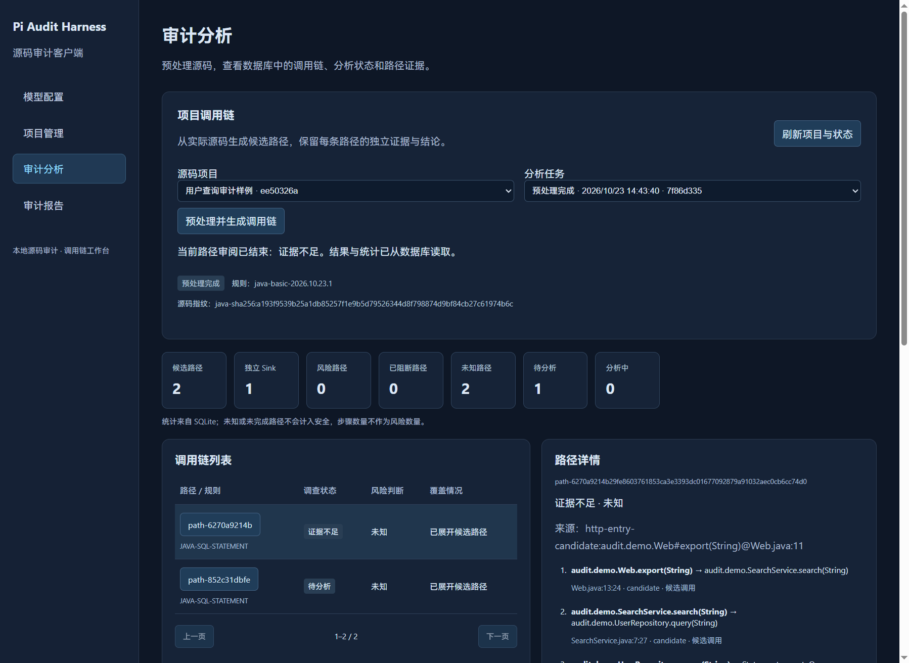
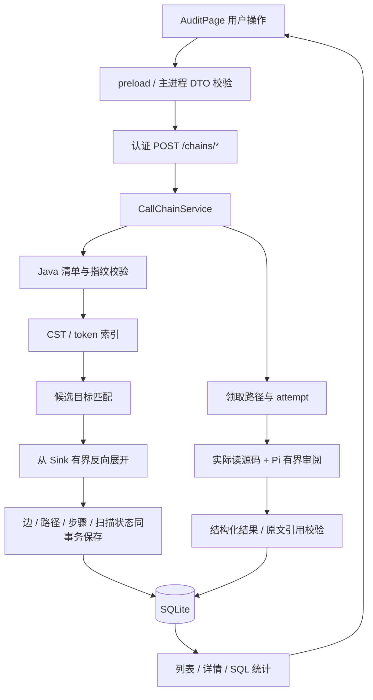

# SCAN-01、SCAN-03、UI-01：实现与学习指南

日期：2026-10-23。承接 TPL-01 / QRY-01 / DB-03，数据库追加 schema v6。

这一轮将真实 Java 源码的函数与调用位置组织为候选图，从 Sink 反向展开有序路径，并把列表、详情、统计和单路径分析接到正式本地服务与 SQLite。

关系仍按候选表达。语法解析提供结构与位置，不等于编译器类型绑定；危险 API 命中不等于漏洞成立。本次没有虚构截图式的 HTTP 调用边。

## 1. 需求与代码地图

| 需求 | 已实现行为 | 主要文件，相对 desktop/src |
| --- | --- | --- |
| SCAN-01 | 按 projectId 校验源码，提取函数与调用，以 Sink 为起点有界展开，事务写入 pending 路径，保留覆盖与失败状态 | `service/scanning/java-index.ts`、`preprocess.ts`、`chains/service.ts` |
| SCAN-03 | 共享边与路径上下文分开，独立步骤证据、危险值、状态和路径 / Sink 统计 | `service/storage/call-chain-repository.ts`、`scan-repository.ts` |
| UI-01 | 项目 / 任务选择、分页列表、详情、SQLite 统计、启动单路径分析与状态刷新 | `renderer/src/components/AuditPage.tsx`、`main/audit-client.ts`、preload / IPC |

为实现 UI 的启动入口，本轮补充了一次有界单路径模型审阅。完整 Goal/Loop、SSE、事件重放、交互图和完整分析日志仍有独立的后续需求，不能把这个入口描述成完整自动审计循环。

## 2. 在应用中操作

```powershell
Set-Location 'E:\pi-audit-harness\desktop'
npm.cmd run dev
```

1. 在“项目管理”导入 `E:\pi-audit-harness\desktop\tests\fixtures\scan-java`。
2. 打开“审计分析”，选择该项目，点击“预处理并生成调用链”。此动作只读源码，不调用模型。
3. 查看 2 条候选路径、1 个独立 Sink，选择路径查看三步调用顺序。
4. 如需模型审阅，先保存并明确选择模型配置，再在工作台选择模型、点击“开始分析当前路径”。这才会把声明的源码片段发送给所选服务。

没有配置模型，仍可使用预处理、列表、详情与统计；客户端不自动选择模型。



示例只被静态读取，不执行 Java。它的实际调用结构为：

```text
Web.search(keyword) ─┐
                    ├─> SearchService.search(input) -> UserRepository.query(input)
Web.export(filter) ─┘                                  -> Statement.executeQuery(sql)
```

数据库有 4 条调用边、2 条路径、6 条步骤。下游边共享，每条路径仍有独立的调查上下文。

## 3. 不启动界面也能复现

```powershell
Set-Location 'E:\pi-audit-harness\desktop'

$scanLearning = node --disable-warning=MODULE_TYPELESS_PACKAGE_JSON `
  .\scripts\prepare-call-chains.mjs `
  .\tests\fixtures\scan-java `
  .\.scan-test-data\learning-demo | ConvertFrom-Json

$scanLearning | Select-Object projectId, runId, state, candidateCount, scope
$scanLearning.statistics

node --disable-warning=MODULE_TYPELESS_PACKAGE_JSON `
  .\scripts\inspect-call-chains.mjs $scanLearning.database
```

空目录首次执行时：paths=2、sinks=1、edges=4、unknown=2、pending=2，safe / dangerous 都为 0。每次脚本会新建项目和任务，保留已有记录，因此重复执行时全库计数会增长，单个任务统计仍独立。学习数据目录与正式应用目录分开。脚本不调用模型或外部网络。

## 4. 数据如何流动



建议先读 Java 样例，然后依次看 `java-index.ts → preprocess.ts → paths.ts → scan-repository.ts → AuditPage.tsx`。最后读 `tests/scan-workflow.test.mjs`，把实现与具体断言对照起来。

## 5. 关键代码：Java 语法解析与候选调用

### 5.1 为什么增加解析器

上一轮能识别 `.executeQuery(...)` 文本，但文本不能可靠承担函数边界、参数列表、嵌套类与多行语法的识别。

现在使用固定版本 `java-parser@3.0.1`：

```typescript
const { cst, tokens } = lexAndParse(source)
```

CST 是具体语法树，提供类、方法、参数、字段和局部变量的范围；token 提供实际调用名与行列。程序读取这些结构，不编译、构建或执行目标项目，也不依赖 LSP / CodeGraph。

解析器与 lock 文件一起固定；Lodash 依赖指定了兼容修复版本。本次生产依赖检查无已知漏洞，这不代表审计准确率评估。

### 5.2 函数标识为何包含签名

内部键的结构是：

```text
audit.demo.SearchService#search(String)@SearchService.java:6
```

类、方法名、参数类型及声明位置共同区分函数。重载、不同类的同名方法或不同源码位置不能只因为名字相同就共用一个键。显示名与内部标识分开，调用边继续按任务、文件、调用行列生成 UID。

### 5.3 怎么寻找目标

对于 `SearchService service; service.search(q)`，索引记录绑定的类型及作用域，再按接收者类型、方法名与参数数量寻找候选：

```typescript
const targets = methods.filter((method) =>
  method.owner === owner &&
  method.name === call.name &&
  method.types.length === call.arity
)
if (targets.length === 1) call.target = targets[0]
```

局部变量需要满足声明位置和作用域边界；`this.service` 不能被同名局部变量替换。

这不是完整 Java 类型求解器。同参数数量重载、继承、接口运行时分派、对象返回链、反射和复杂泛型可能无法唯一匹配。此时保留 unresolved，不按搜索结果的第一项硬连。即使候选唯一，也标为 candidate，不冒充编译器 / LSP 的 confirmed 关系。

## 6. 关键代码：合并规则与调用位置

规则负责识别值得调查的 API / 参数，索引负责定位所属函数和源码坐标，两者合并成调用边。核心字段：

```typescript
callerKey: call?.caller.key ?? candidate.filePath + '#<unresolved-owner>',
calleeKey: call?.target?.key ?? 'text-candidate:' + candidate.api,
isSink: true,
ruleId: candidate.ruleId,
resolutionStatus: 'candidate',
arguments: candidate.arguments
```

能够定位函数时保存实际候选函数；语法解析失败时保留未知 owner；不能凭空补一个 Controller。已有被调用目标时保留其身份，不让危险规则标签覆盖源码事实。

`isSink=true` 表示匹配审查规则。新路径仍是 pending / unknown / NULL。

Spring Mapping 注解支持的入口记录为 `http-entry-candidate:` 来源引用。它是入口候选，不是额外创建一条已经确认的“HTTP Request 调用 Java 方法”的边。

## 7. 关键代码：只保存必要上游图

反向索引按被调用函数分组：

```typescript
incoming.set(edge.calleeKey, [
  ...(incoming.get(edge.calleeKey) ?? []), edge
])
```

现在位于 Repo 内的 Sink，就用当前边的 callerKey 查找“谁调用了 Repo”。索引项目中的调用不等于持久化整仓库图；最终只写入有界路径引用的边。

裁剪图的队列用 scheduled，避免相同边反复入队：

```typescript
if (!scheduled.has(parent.uid)) {
  scheduled.add(parent.uid)
  queue.push(parent.uid)
}
```

路径展开则检查当前路径中的重复边。不能使用全局 visited 代替，否则共享边在第二条路径中会被错误删除。递归保留重复步骤并记录 recursion，不无限扩展。

| 边界 | 当前实现 |
| --- | --- |
| 单文件 CST | 最多 256KiB；更大文件保留文本候选及部分覆盖记录 |
| 基础输入 | 延续 Java 清单：最多 2000 文件、单文件 2MiB、总计 20MiB |
| 候选 Sink / 必要边 | 默认最多 100 个 Sink、最多 1000 条必要边 |
| 默认路径预算 | 16 步、512 个遍历状态、100 条路径 |
| 配置硬上限 | 32 步、2000 个遍历状态、100 条路径 |
| 模型单路径审阅 | 最多 16 步；源码片段受 80 行 / 12000 字符限制 |

文件之间会让出事件循环；这里是资源和覆盖范围限制，不是操作系统级硬 CPU 隔离。超限、递归、未知上游等都有显式标记。部分路径可以入队继续调查，但不能据此判断安全。

## 8. schema v6 与扫描状态

v6 只追加迁移，不修改 v1～v5 的 SQL / 校验和。

| 新表 | 职责 |
| --- | --- |
| scan_runs | 预处理阶段、候选数、未知调用数、截断、警告、错误编号和时间 |
| path_attempts | 路径的当前尝试编号、模型配置、阶段、错误和时间 |

先创建 scanning 记录。成功时，边、路径、步骤与最终扫描摘要在同一个事务中提交。失败则保留 failed 和错误编号；正常提交不会出现“扫描已完成、路径只保存一半”。

| state | 页面含义 |
| --- | --- |
| scanning | 正在预处理 |
| ready | 当前声明范围内完成候选预处理 |
| partial | 存在未解析、语法限制或预算截断 |
| empty | 支持范围内零命中，不等于项目安全 |
| failed | 操作未能完成，可查看错误并明确重试 |

服务启动时把遗留扫描标为 SCAN_INTERRUPTED，把遗留 analyzing 路径改为 unresolved 并保留中断原因，不自动重新发送模型请求。

## 9. SCAN-03：事实和上下文分离

调用边保存位置、调用方、被调用方、规则及解析属性。路径 / 步骤保存当前来源、风险值、防护和证据。任务另存执行状态。

同一个 SQL 执行位置在路径 A、B 中可能接收不同来源，因此不能把 A 的风险写到共享边上。实际更新限定路径与步骤：

```sql
UPDATE path_steps
SET dangerous = ?, evidence_json = ?, defense_summary = ?
WHERE path_id = ? AND step_index = ?;
```

| 情况 | status | verdict | dangerous |
| --- | --- | --- | --- |
| 待调查 / 已领取 | pending / analyzing | unknown | NULL |
| 证据不足 | unresolved | unknown | NULL |
| 明确无效调用链 | invalid | unknown | NULL |
| 工具或模型失败 | failed | unknown | NULL |
| 当前路径已阻断 | completed | safe | 0 |
| 静态证据支持风险 | completed | dangerous | 1 |

部分覆盖由 truncated + truncation_reason 表达。当前审阅在路径不完整时会把 safe 降为 unknown；缺少入口候选支持时，也不会直接把危险 API 提升为外部可达风险。

## 10. SQL 统计：不数 SSE 帧，也不数步骤当风险

```sql
SELECT count(*) AS paths,
       count(DISTINCT sink_edge_id) AS sinks,
       COALESCE(sum(verdict='dangerous'),0) AS dangerous,
       COALESCE(sum(verdict='safe'),0) AS safe,
       COALESCE(sum(verdict='unknown'),0) AS unknown,
       COALESCE(sum(status='pending'),0) AS pending,
       COALESCE(sum(status='analyzing'),0) AS analyzing
FROM call_paths
WHERE project_id=? AND run_id=?;
```

样例有 6 个步骤，但只有 2 条路径、1 个独立 Sink。页面明确命名不同口径。unknown 计入路径总数，不计入 safe。刷新和进程重启后重新读取 SQLite，不依赖浏览器累计事件。

## 11. 启动分析：领取、attempt、模型与证据

`ScanRepository.claim` 在 BEGIN IMMEDIATE 事务中校验路径，只允许 pending / failed / unresolved 被领取，随后增加 attempt、绑定模型并写 analyzing。重复点击的第二次请求会被拒绝。

结果提交还要匹配尝试编号：

```sql
SELECT run_id FROM path_attempts
WHERE path_id=? AND attempt=? AND phase='analyzing';
```

旧请求即使迟到，也不能覆盖重试后的新结果。最终结论、逐步骤证据和尝试终态在事务中一起保存。

模型输出要逐步引用本次读取到的源码：

```typescript
if (step.quotes.some((quote) => !evidence.text.includes(quote)))
  throw new ApiError('ANALYSIS_EVIDENCE_INVALID',
    '模型证据必须逐步骤引用本次实际读取的原文', 502)
```

还会检查步骤数量、索引不重复、字段类型和长度。dangerous 需要各步骤的风险证据，safe 需要明确防护步骤。无效、失败或证据不足都不会自动成为安全。

该校验可以拒绝原文中不存在的引用，但不能证明模型语义判断必然正确。工程契约、真实供应商兼容性与审计准确率需要分别评估。本轮测试使用实际 Pi SDK 连接本机模型替身，未请求外部付费模型。

## 12. UI-01：固定桥接、异步一致性和轮询

```text
React -> window.audit.audit(action, DTO)
      -> preload audit:action IPC
      -> 主进程 auditRequest
      -> 带 Bearer 的本地 HTTP -> 后端 / SQLite
```

renderer 不持有数据库连接、SQL、令牌或 Key。主进程限定 action，校验响应字段、状态、数组上限及项目 / 任务 / 路径归属。夹带 apiKey 等不应公开的字段会在进入 renderer 前被拒绝。

统计 DTO 还检查：

```text
paths = dangerous + safe + unknown
paths = pending + analyzing + completed + failed + unresolved + invalid
sinks <= paths
```

项目切换时忽略旧副作用结果。selectionEpoch 防止更早的历史查询把刚生成的新任务切回旧任务；切换任务、路径或页码时清除旧详情。

同一轮轮询不并发重入，卸载时清理定时器。操作锁使用 useRef 拦住同一事件周期的第二次点击，后端领取事务再做持久化保护。

当前每 2 秒读取数据库状态。轮询不是 SSE 重放或 Agent 会话恢复，后续 API-02 / UI-05 可以接事件通知，并继续以数据库事实为准。

## 13. 固定后端接口

以下均为认证 POST：

| 路径 | 作用 |
| --- | --- |
| /chains/prepare | 新建预处理并保存候选路径 |
| /chains/runs | 读取项目最近 50 个任务 |
| /chains/list | 分页读取路径，界面每页 20 条 |
| /chains/detail | 有序步骤和路径结果 |
| /chains/statistics | SQLite 聚合统计 |
| /chains/analyze | 明确选择模型后启动一条路径的审阅 |

prepare 支持受限的 maxResults / maxDepth / maxNodes / maxPaths。没有开放任意 SQL、任意命令或任意模型提示词入口。

## 14. 验证与学习顺序

2026-10-23 本机最终结果：95 项 Node 测试全部通过；本次涉及代码的 ESLint 零错误、零警告；Node / Web 类型检查与正式构建通过；生产依赖 audit 为 0 个已知漏洞。实际 Electron 页面、Pi SDK / 本机模型替身、双击去重、结果写回、转义显示及换 PID 重启读取均验证通过。

```powershell
Set-Location 'E:\pi-audit-harness\desktop'
node --disable-warning=MODULE_TYPELESS_PACKAGE_JSON --test `
  tests/scan-workflow.test.mjs tests/audit-client.test.mjs
node --disable-warning=MODULE_TYPELESS_PACKAGE_JSON --test tests/*.test.mjs
npm.cmd run build
.\node_modules\.bin\electron-vite.cmd build --config electron.scan-test.config.ts
node tests/run-scan-electron.mjs
npm.cmd audit --omit=dev
```

新增测试覆盖跨文件路径、共享边、重载歧义、零命中、语法失败回退、源码变化、重复点击、深度 / 递归限制、路径级独立结果、已阻断 / 无效 / 中断状态、旧 attempt 与伪造引用。

Electron 测试操作实际 React 页面，通过正式 utilityProcess、主进程 DTO、preload、实际 Pi SDK 与本机替身完成分析，验证双击只发送一次请求、文本转义和换 PID 重启持久化。测试用系统凭据只按隔离数据库中的随机引用清理。

建议先跑离线脚本看懂 4 边 / 2 路径 / 6 步，再读共享边和 stale attempt 测试，最后追踪界面的点击事件到事务提交。

最值得掌握的知识是：语法与语义的区别、图与路径的区别、事实与上下文分离、流程状态与结论正交、SQL 统计口径、事务领取、attempt 幂等边界、前端过期响应，以及证据校验与审计质量的区别。

参考：[java-parser 官方源码与说明](https://github.com/jhipster/prettier-java/tree/main/packages/java-parser)。固定版本以本地 package-lock.json 为准。
