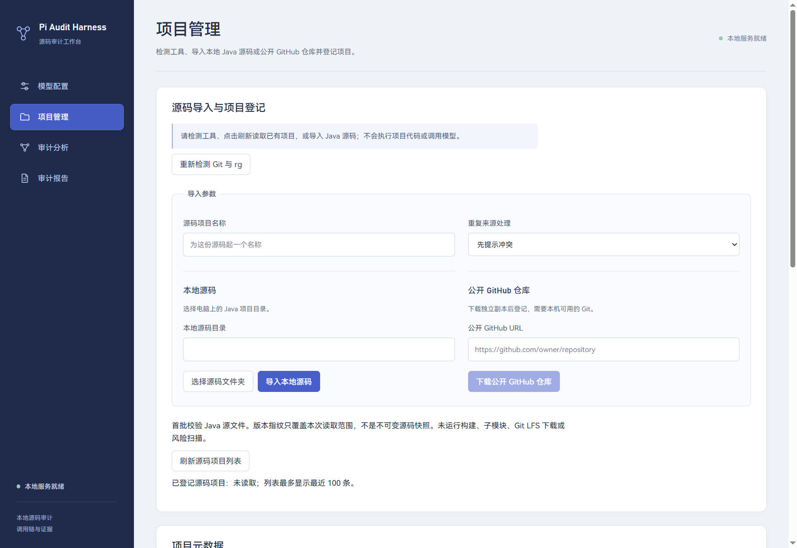

# 05 审计工作台

更新：2026-10-29。实现 UI-01～UI-05，以及固定导航、教程、发送确认、手工点和独立人工复核。UI-04按用户要求保留现有配色。

## 页面与数据来源

| 页面 | 核心能力 | 数据来源 |
| --- | --- | --- |
| 项目管理 | 工具检测、本地/远程导入、登记列表与重新打开 | source 固定接口 |
| 模型配置 | 配置新增/编辑、显式选择、草稿保护、主动 ping | metadata/models/test 接口 |
| 审计分析 | 预处理、任务/路径列表、数据库统计、分析操作与四个详情标签 | chains、SSE 和 SQLite |
| 审计模板 | 表单编辑、安全预览、文档导入、版本与未验证标签 | templates 固定接口 |
| 审计报告 | 三维筛选预览、HTML/JSON、阶段原因、另存与打开 | reports 固定接口和主进程原生对话框 |

页面不持有 bearer 令牌、数据库连接或通用文件执行入口。刷新列表、切标签或恢复历史不会调用模型；开始分析会将受控源码片段发送到用户选定供应商。

模型页首次配置默认展开 OpenRouter 教程，并保留设置页入口；外链通过固定 ID 交给主进程。审计页显示快照清单与摘要，允许按快照补充手工风险点；分析过程区展示完整发送目标、模型、文件范围与类别，明确确认后才启用开始操作。具体契约与错误语义见 [08 四项增强](08.配置授权快照与手工调查.md)。

新任务配置区选择模板并保存项目要求；任务材料区显示创建时固定的版本。模板页与三种尺寸联调见 [09 模板与审查配置](09.审计知识模板与项目审查配置.md)。原有截图保留用于主流程示意。

## 路径详情

| 标签 | 内容 |
| --- | --- |
| 调用路径 | 可交互节点/关系/防护、固定快照源码与参数映射、同Sink已加载分支，以及可展开有序步骤 |
| 传播证据 | 每步污染输入输出、原文引用和文件取证范围 |
| 防护分析 | 六项检查中的防护结论、阻断证据和未知项 |
| 分析过程 | 指定尝试的模型公开摘要、工具输入输出、耗时、错误和最终事件 |

项目、任务、路径和标签选择可在刷新后恢复，但仍重新查询数据库。不同链路和尝试有独立作用域；工具轨迹按实际会话事件顺序显示。没有记录、数据被截断或历史已过期时明确提示，不补造过程。

UI-02图从真实步骤构建N+1节点；confirmed用实线，其余候选用虚线且保留文字。节点/关系定位必须绑定project/run/path/step/target，再读任务快照；防护仅来自已保存核查。上下键、Home/End移动焦点，按钮原生激活。同Sink分支限当前已加载列表。选中详情后全宽显示，图与源码检查区宽屏并排、窄屏堆叠。

人工复核区保存未复核/人工确认/人工误报/待补充和备注，使用独立追加版本，不改机器证据。基线变化、并发保存和未保存草稿有明确提示。调用链与接口详见 [11 交互与复核导出](11.交互路径图人工复核与结果导出.md)。

## 三段式分析流

任务控制面板支持停止受理/等待/完成，以及原材料核对后的主动恢复。清单列出已提交、未开始、中断数量、native/rebuild/restart模式、已取证步骤、累计次数、未确认请求和最近恢复来源；按两秒只读刷新，不会因打开页面调用模型。按钮与接口说明见[12 停止与恢复](12.任务停止与可验证会话恢复.md)。原有配色继续保持。

思考区显示规则、来源、目标 Sink 与模型公开摘要；过程区显示预处理信息、源码指纹、工具取证和已处理路径；结果区显示会话终态、本次结论以及最新数据库路径和任务统计。

按 projectId/runId/chainId/sessionId 限定帧，并按会话内 ID 去重。旧异步响应不能覆盖新选择。历史会话列表最多 20 次，事件每页 50 条，页面保留最近 200 条；更长记录可继续读取。

连接状态与调查状态分开。服务或写库异常时，旧数据显示为上次成功读取的快照，不假称仍在运行或已完成。失败原因关联实际标识，unknown 与 safe 使用不同文案。

## 固定导航与视觉

根页面、root 和工作台约束为视口高度；两列 grid 的右侧 main 独立滚动，侧栏不随正文移动。两侧使用 min-height:0，正文列使用 minmax(0,1fr)，避免长路径和表格撑破页面。

导航使用靛墨背景，工作区雾灰和白色主面板，钴蓝主操作；未知、错误与阻断使用独立语义颜色并保留文字。使用本机 Bahnschrift、Microsoft YaHei UI、Cascadia Code/Consolas 回退，不请求远程字体。

UI-04保留ink #233047、canvas #eff2f7、surface #ffffff、accent #475ecb等既有token。模型页选择/测试与完整编辑双栏，工具检测使用全宽grid；窄屏堆叠。主按钮hover保持浅色文字，下拉箭头右侧14px、文字留白42px。展示名统一pi-audit-harness，应用数据路径不随展示文案改变。

窄屏转为图标导航，保留目的地名称、title 和可访问标签；支持可见键盘焦点、跳到正文、减少动画。表格和代码块在自身容器滚动，页面不产生整体横向溢出。

## 验证与入口

Electron 联调测量 1450×1000、1024×768、480×850、1280×420：正文发生实际滚动，导航顶部不变，根滚动为 0；检查四页横向范围、原生 Tab、切页回顶及已有业务动作。

代码：`renderer/src/App.tsx`、`assets/main.css`、`components/AuditPage.tsx`、`CallChainDetail.tsx`、`AnalysisStreamPanel.tsx`、`AnalysisTimeline.tsx`、`shared/path-detail-view.ts`。自动验收入口：`tests/scan-electron-main.ts`，见 [07 实现进度与验收](07.实现进度与验收.md)。

其他界面：[窄屏项目管理](assets/ui11-projects-narrow.png)、[模型配置](assets/ui11-models-desktop.png)、[审计分析](assets/ui11-analysis-desktop.png)、[审计报告](assets/ui11-reports-desktop.png)。截图来自隔离测试数据，不含真实 API Key。

本次交互增强截图：[调用图](assets/review-path.png)、[原配色模型页](assets/review-models.png)、[筛选与导出](assets/review-export.png)。新增tests/review-electron-main.ts验证图、复核、导出及1450/920/480布局、hover和键盘；旧截图用于保留主流程背景。
