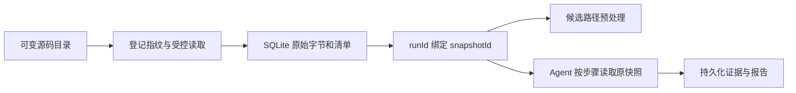

# 08 配置授权、固定快照与手工调查

更新：2026-10-29。实现 MOD-02、MOD-04、SRC-03、SCAN-02，沿用现有 Electron / React / TypeScript / SQLite 架构。

## 需求与交付

| 需求 | 交付行为 | 验收重点 |
| --- | --- | --- |
| MOD-02 | 首次配置展开 OpenRouter 教程，配置页常驻教程入口与固定官方链接 | 账号、Key、地址、占位模型 ID、额度；不自动发现或切换模型 |
| MOD-04 | 展示并持久化发送范围授权，在路径启动和实际传输前检查 | 未确认零发送；相同范围复用；配置/快照变化重新确认；记录实际调用配置 |
| SRC-03 | SQLite 保存原始 Java 字节、文件摘要、忽略范围和任务绑定 | 源目录修改或删除不改变旧任务取证；历史任务缺快照明确失败 |
| SCAN-02 | 从快照选择文件和位置，增加手工来源的 pending 路径 | 位置校验、独立来源记录、统一 Agent/SSE/证据/报告流程 |

## 固定快照的建立与读取



`CallChainService.prepare` 先创建任务，再通过 `CodeQueryService.sourceSnapshot` 校验登记指纹并读取实际字节，调用 `SnapshotRepository.save`。清单按相对路径排序，每项包含 filePath、sha256、size；聚合内容指纹必须与任务 sourceStamp 一致。

`source_snapshots`、`snapshot_files`、`run_snapshots` 在一个 SQLite 事务中保存。相同项目和内容指纹复用同一个 snapshotId，新任务仍有独立 runId。保存字节后再进行候选图解析；解析失败可保留已保存快照和失败任务，不将其误报为成功扫描。

快照仅覆盖当前支持的 Java 输入范围，包含忽略说明：非 Java 文件、配置/资源/二进制、符号链接和目录联接，以及 `.git`、`.svn`、`node_modules`、`target`、`build`、`dist`、`.idea`、`.gradle`、`vendor` 目录不纳入。继续使用 2000 个文件、单文件 2MiB、总计 20MiB 等登记边界；超限失败。这里没有声称保存了全仓库、Git 完整历史、LFS 或子模块实体。

`SnapshotRepository.read` 先确认项目和任务绑定，再匹配清单，读取 BLOB，检查长度、保存摘要和重新计算的 SHA-256，最后解码为 UTF-8。预处理之后的路径取证和 `methodContext` 都携带 runId，读取该绑定快照。公开 `/code/read` 携带 runId 时同样读取快照；不带 runId 的原有查询仍对可变目录执行登记版本检查。

快照、文件、任务绑定和手工来源记录没有修改接口，并由 UPDATE/DELETE 触发器拒绝覆盖。只读指应用和数据库约束，不是对持有数据库管理权限的本机用户提供防篡改隔离。检测到损坏返回 SNAPSHOT_CORRUPT，不从当前源码目录补数据。历史任务没有快照时返回 SNAPSHOT_MISSING，需要重新登记并创建新任务，不能回填成旧版本。

## 发送范围与许可边界

范围由服务端计算，核心字段如下：

| 字段 | 含义 |
| --- | --- |
| projectId / snapshotId | 项目及本次可读取的固定文件集合 |
| configId / revision | 明确选择的配置身份与版本 |
| baseUrl / modelId | 实际目标服务地址和指定模型 |
| fileCount / totalBytes | 快照整体范围，不是宣称每次全量发送 |
| categories | Java 函数片段、相对路径/调用参数/标识、规则/手工说明/工具证据/对话 |
| scopeKey | 上述范围的 SHA-256；仅用于标识与变更检测，不是密码或登录令牌 |
| reviewContextHash | 2026-10-29 增加：固定模板与项目要求的材料摘要，变化后重新确认 |
| runId | 本次操作任务；不进入范围哈希，允许同项目同快照的新任务复用授权 |

确认时客户端只回传 projectId、runId、modelConfigId、scopeKey。后端重新计算当前范围；陈旧 scopeKey 返回 DISCLOSURE_SCOPE_CHANGED，不能替用户确认新模型。修改配置名称或轮换 Key 也会增加 revision，因此采用更严格的重新确认策略。

第一道检查位于 `PathAnalysisService.start/startPending`，领取之前拒绝未授权请求，覆盖单路径、批量和 `/analyze` SSE 新会话；拒绝时路径仍为 pending。历史会话重连只读已保存事件，不创建新模型请求。

第二道检查位于 `runAgentLoop` 的 `session.agent.streamFunction` 包装器。读取真实配置快照后，实际 SDK model 的 ID/Base URL 必须与之相同；`DisclosureRepository.beforeSend` 再比较已授权配置并先保存发送记录，成功后才调用原 streamFunction。记录写入失败或配置变化都会停止传输。

Pi 1.2.0 的 `before_provider_request` 扩展分发会捕获处理器异常，因此不能仅依赖其中抛错实现禁止发送。传输函数包装的行为通过真实 SDK 和本机 HTTP 替身验证，拒绝场景收到 0 次模型请求。

`source_transmissions` 保存每次请求尝试的路径/attempt、scopeKey、配置版本、Base URL 和 modelId。响应结束时保存 SDK 消息上的 observed_model_id；它不等于能够识别 OpenRouter 最终选择的物理上游节点，无法取得的信息不补造。记录是在请求前写入，不能据其存在断言远端已经收到全部内容。响应标识写库失败收敛为 failed/unknown。

前端取消确认不会创建授权；确认本身不会调用模型。已保存授权不是单次弹窗状态，“暂不发送”用于尚未授权的范围，不承担撤销既有授权的功能。ping 只发送固定测试文本，不含项目源码。

## 手工位置进入统一调查

1. `ManualRiskForm` 获取当前任务快照，显示文件清单、摘要和忽略范围。
2. 用户填写相对文件、必填行号、可选列号/函数 key、内置规则和调查说明。
3. 后端按快照清单定位文件，验证行列、非空行和可选函数 key。没有列号且同一行有多个调用时明确要求补列号。
4. Java CST 能定位真实调用时，复用其位置、调用方和目标候选；已有规则参数可复用。普通位置或语法不完整时保留未解析身份，不能捏造调用关系。
5. 使用同一 `preprocessJava` 上游展开和预算。手工路径的 sourceRef 增加手工位置标记，独立于原自动路径；底层同一调用边仍可共享。
6. 图、路径、步骤、`manual_risk_points` 来源和登记事件在同一事务保存。新增路径为 pending/unknown；同请求重复提交返回同一组 pathId，不重置已有结果。
7. 后续调用现有 Agent 取证、污染检查、SSE、结果提交和报告生成；manualPoint 调查说明作为待分析数据进入模型输入。

当前任务分析中不允许追加；总路径数上限为 1000。已完成任务增加新的手工路径后回到 queued/prepared，旧路径和已生成报告保持原有内容。同一位置不同规则与原调用事实冲突时明确拒绝，不覆盖原边。没有可靠入口、完整传播或有效原文引用时，继续保持 unknown。

## 固定接口

所有接口复用本地 bearer 认证、统一 `{ok,requestId,data/error}` 响应和主进程严格 DTO 校验。

| POST 路径 | 请求 | 响应/行为 |
| --- | --- | --- |
| `/chains/snapshot` | projectId, runId | snapshotId、sourceStamp、commit、创建时间、ignored、文件摘要清单；不返回全部源码 |
| `/chains/disclosure` | projectId, runId, modelConfigId | 发送范围和 authorized |
| `/chains/authorize` | 上述标识 + scopeKey | 服务端重算范围，记录明确授权 |
| `/chains/manualRisk` | projectId, runId, filePath, line, column?, functionKey?, ruleId, note | projectId、runId、snapshotId、pathIds |

手工登记示例，使用 `tests/fixtures/scan-java/UserRepository.java` 第 9 行、第 9 列：

```json
{
  "projectId": "替换为项目ID",
  "runId": "替换为任务ID",
  "filePath": "UserRepository.java",
  "line": 9,
  "column": 9,
  "ruleId": "JAVA-SQL-STATEMENT",
  "note": "检查查询参数是否存在注入风险"
}
```

函数 key 必须是 CST 中与位置一致的完整标识，不是任意函数名；初次使用可留空。行列从 1 开始。

## schema v9

追加第 9 次迁移，保留 v1—v8 的 SQL 和校验和。

| 新表 | 关键约束 |
| --- | --- |
| source_snapshots | UNIQUE(project_id,source_stamp)，保存清单及忽略范围 |
| snapshot_files | PRIMARY KEY(snapshot_id,file_path)，BLOB 字节与摘要 |
| run_snapshots | runId 主键；项目/快照及项目/任务复合外键 |
| disclosure_grants | scopeKey 主键，保存确认内容和时间 |
| source_transmissions | 关联许可与路径作用域；每次尝试保留实际配置 |
| manual_risk_points | 保存快照、文件、行列、函数、规则、说明与 pathId |

没有从旧任务的 sourceStamp 推造文件内容。升级之后旧结果、历史事件和旧报告仍可查看，只有需要新取证的操作要求固定快照。

## 教程与外链

`OpenRouterGuide.tsx` 覆盖首次配置和设置页帮助。示例模型固定写作 `provider/model-name` 占位，用户从官方目录自行复制。Base URL 为 `https://openrouter.ai/api/v1`，由 SDK 补兼容接口路径。额度与价格不硬编码，指向官方当前说明。

`help-links.ts` 只定义固定官网链接；preload 暴露 `openHelpLink(id)`。主进程校验当前窗口/mainFrame 及链接 ID 后调用 `shell.openExternal`，不向页面开放任意外部 URL 或命令入口。

官方依据（核对日期 2026-10-28）：[快速入门](https://openrouter.ai/docs/quickstart)、[认证与 Base URL](https://openrouter.ai/docs/api-reference/authentication)、[额度和速率限制](https://openrouter.ai/docs/api-reference/limits)。

## 错误与验证入口

| 错误码 | 处理方式 |
| --- | --- |
| SNAPSHOT_MISSING | 历史任务缺快照，重新登记后创建新任务 |
| SNAPSHOT_CORRUPT | 停止取证，不回退到可变目录；检查存储并创建新任务 |
| SOURCE_DISCLOSURE_REQUIRED | 查看并明确确认当前范围 |
| DISCLOSURE_SCOPE_CHANGED | 重新读取目标和范围后再确认 |
| DISCLOSURE_RECORD_FAILED | 响应标识保存失败；当前路径失败且风险未知 |
| MANUAL_LOCATION_INVALID / AMBIGUOUS | 修正行列；多调用时补列号 |
| MANUAL_FUNCTION_INVALID | 使用与该位置一致的函数 key 或留空 |
| MANUAL_RUN_BUSY / POINT_CONFLICT | 等待当前分析结束，或查看已有点/创建新任务 |

测试入口：`tests/input-enhancements.test.mjs`；教程 Electron 验收纳入 `tests/mod01-electron-main.ts`；授权、快照清单、手工表单、真实 Pi/SSE/报告联调纳入 `tests/scan-electron-main.ts`。本次结果及复现命令见 [07 实现进度与验收](07.实现进度与验收.md)。
