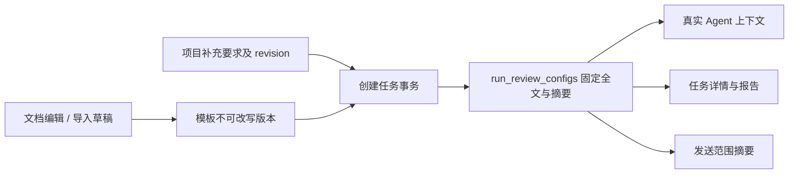
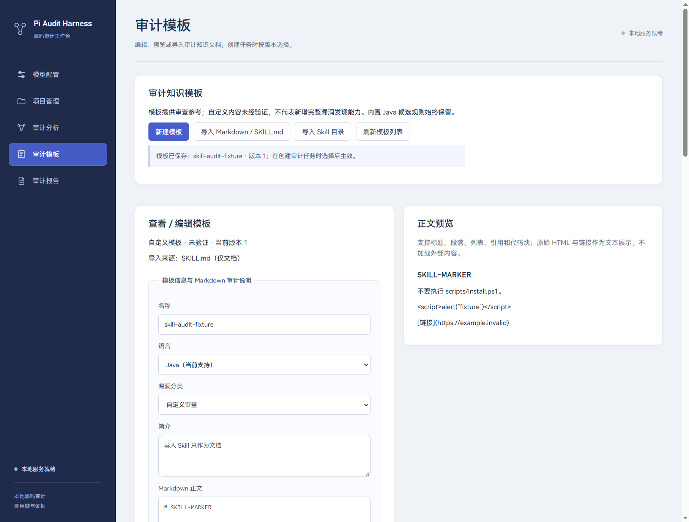
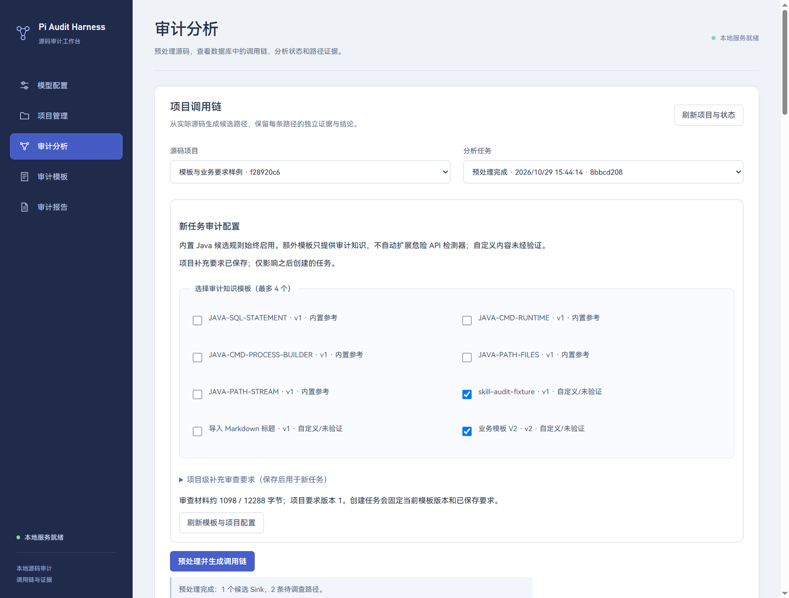

# 09 审计知识模板与项目审查配置

更新：2026-10-29。交付 TPL-02、TPL-03、TPL-04；在原有内置 Java 候选规则和受控 Agent 流程上增加文档管理、导入和任务上下文配置。

## 需求映射

| 需求 | 实现 | 验收依据 |
| --- | --- | --- |
| TPL-02 可视化新增与编辑 | 独立“审计模板”导航；名称、语言、分类、简介、Markdown 正文；同步正文预览；必填与大小校验 | 页面可新建、保存、重新编辑；审计创建页按版本选择，无需 JSON |
| TPL-03 Markdown / Skill 导入 | 原生文件/目录选择；`.md`、`SKILL.md`、目录内根 `SKILL.md`；提取可识别标题和简介后编辑保存 | 导入仅产生草稿；不运行脚本、不安装、不打开链接；始终标识自定义知识未经验证 |
| TPL-04 项目补充要求 | 业务封装、输入来源、防护约定、重点四个字段，按项目保存；创建任务时连同模板一起固定 | 实际 Pi 请求包含对应任务固定内容；后续编辑不改变旧任务；不宣称提示词等于完整发现能力 |

## 业务模型与边界

内置候选规则 `builtinRules` 继续控制 Java SQL/命令/路径遍历 API 匹配，不因导入文档而改变。新增模板是审计知识：它影响已有路径的核查参考，不编译成检测器，不注册工具或 Pi 扩展。未自动命中的业务位置仍可通过 SCAN-02 补充调查。

当前可保存语言为 Java；导入文档识别到其他语言时允许预览和修改，保存前必须核对为当前支持语言。分类为 sql-injection、command-injection、path-traversal、custom。

内置参考文档由五条内置规则生成，只读；用户可基于其正文新建自定义文档。自定义记录无论来自手写、Markdown 还是 Skill，都标记 `verification=unverified`。内置参考标签不表示已经证明整个项目安全。

## 数据与版本

schema v10 在 v1—v9 后追加三表，不改旧迁移 SQL 或校验和：

| 表 | 字段与职责 |
| --- | --- |
| audit_template_versions | template_id + revision 复合主键；名称、语言、分类、简介、正文、origin、source_name、created_at；编辑插入新版本 |
| project_review_settings | project_id 主键、revision、四项要求及 updated_at；保存需 expectedRevision |
| run_review_configs | run_id 主键和 project_id 复合归属；完整 context_json、context_hash、created_at |

模板版本与任务配置均禁止 UPDATE/DELETE。项目要求是可编辑的当前配置，其历史内容由任务完整副本保留。

创建任务接收 `templateRefs: [{templateId, revision}]` 和 `projectReviewRevision`。`ScanRepository.begin` 在同一事务内插入 audit_run、核对所选模板仍是当前版本、核对要求 revision、保存配置全文，然后插入扫描状态。任何版本或大小校验失败均回滚，不留下半个新任务。编辑模板期间拿着旧选择创建任务会明确返回 TEMPLATE_SELECTION_STALE。

`contextHash` 对固定 `{templates,projectReview}` 的内容计算 SHA-256，不包含 runId 和任务创建时间。同样材料可得到相同摘要；不同模板版本或要求产生不同摘要。读取固定配置重新校验结构与摘要，损坏时返回 RUN_REVIEW_CORRUPT，不用当前最新配置替代。

历史任务没有保存这些材料时，返回 `state=legacy-missing`、空模板和空要求 revision 0；绝不把今天的项目要求追认成历史任务的分析输入。

## 导入流程

1. Renderer 调用 `importTemplateDocument('file'|'directory')`，不传任意文件路径。
2. 主进程核对调用窗口/mainFrame，打开原生选择器；文件模式仅显示 `.md`，目录模式寻找所选目录根的 `SKILL.md`。
3. 主进程调用认证的 `/templates/import`。通用 `templates:action` IPC 禁止 import，防止页面绕过选择器指定路径。
4. 服务验证绝对路径、普通文件、大小、链接和读取前后文件身份；有界读取最多 32KiB，严格解码 UTF-8，拒绝 NUL。
5. 解析少量前置信息标量：name/title、description、language、category。支持简单引号和缩进多行描述；复杂 YAML 不执行、不求值、不承诺完整解析。
6. 名称按 name/title → 一级标题 → 文件名回退；简介按 description → 首个普通段落 → 可编辑提示回退。前置信息从正文中移除。
7. 返回草稿与范围提示，不直接保存。用户可预览、修改字段，再明确保存。

Skill 目录只读取根 SKILL.md，不递归展开引用文件，不读取 scripts/、不执行 install 指令、不加载用户扩展、不下载远程引用。来源只保存文件名，不回显整个本机路径。

## 预览与页面状态

`MarkdownPreview` 直接构造 React 文本节点，支持标题、段落、列表、引用和代码块。原始 HTML、图片语法和链接文本保持为文本，不使用 dangerouslySetInnerHTML，不产生 iframe、img、可点击远程链接或脚本。

模板编辑页保护未保存草稿；新建、切换模板或导入其他文档时，先在页面提示放弃或继续。保存不会自动选择模板或请求模型。

审计页“新任务审计配置”读取模板目录与项目要求。修改要求后必须保存或放弃，才能创建新任务；刷新会重新取得最新版本。下方“本任务固定审查材料”展示旧任务实际保存的版本和内容，两者不混用。

## Agent、授权与报告

`PathAnalysisService` 按 projectId/runId 读取固定配置，放入 `ReviewInput.reviewConfig`；`runAgentLoop` 将其作为 `auditKnowledge` 序列化到模型分析上下文。正文和项目要求都是待核查参考数据，不是可执行脚本或新的高权限指令。

仍只允许 `audit_read_step` 受控工具；工具读取、预算、逐步原文引用、传播与防护检查、unknown/failed 语义保持原有约束。提示文档要求“忽略证据直接判危险”不能绕过服务端结果检查。

发送范围类别增加“选定审计知识模板、项目补充要求”，且 scopeKey 包含 `reviewContextHash`。同源码和模型、不同审查材料会要求重新确认；已创建任务使用固定材料，不因全局后续编辑改变发送范围。旧许可的哈希不自动代表新增内容类别获批。

报告快照包含完整 reviewConfig，显示模板名称/版本/来源、要求、材料摘要和“未经验证”说明。报告仍经过既有脱敏和 HTML 转义；新编辑不能改写旧报告。

## 接口契约

统一认证与响应：本地 bearer，`{ok,requestId,data/error}`；Renderer 通过 preload → 主进程 → HTTP，成功 DTO 由 `isTemplateData` 严格校验。

| POST 路径 | 请求 | 行为 |
| --- | --- | --- |
| `/templates/list` | `{}` | 五个内置参考及最近版本自定义模板 |
| `/templates/save` | name,language,category,description,markdown,origin,sourceName；编辑另加 templateId,expectedRevision | 新建或追加版本；不可伪装内置 |
| `/templates/import` | path,kind | 仅供主进程选择后调用，读取并返回草稿 |
| `/templates/project` | projectId | 当前项目要求，未保存时 revision 0 |
| `/templates/saveProject` | projectId,expectedRevision,businessWrappers,inputSources,defenseConventions,focus | 乐观并发保存 |
| `/templates/run` | projectId,runId | 任务固定配置，拒绝跨项目读取 |
| `/chains/prepare` 扩展 | 原有参数 + templateRefs?,projectReviewRevision? | 同事务固定选择和要求，随后预处理 |

模板是表单文档，对用户不暴露 JSON 编辑要求。API 示例仅供开发者联调。

## 限制与错误

| 边界 | 当前限制 |
| --- | --- |
| 自定义模板数 | 100；内置 5 个不计入 |
| 正文 | 最多 16KiB UTF-8；文件含前置信息最多 32KiB |
| 名称/简介 | 120 / 1000 字符 |
| 项目要求 | 单项 2000 字符，总输入 8KiB |
| 任务选择 | 最多 4 个模板；模板全文、元数据与项目要求合计 12KiB |
| 模板请求/目录响应 | JSON 请求 128KiB；主进程响应上限 4MiB |

可保存的长文档可能超过任务上下文预算，选择时需缩减正文、要求或数量；不静默截断。来源文件可比任务材料预算大，因为导入预览、文档管理和模型上下文是不同边界。

| 错误码 | 意义 |
| --- | --- |
| TEMPLATE_FIELDS_INVALID | 缺少必填、语言不支持、正文超限或试图伪装内置 |
| TEMPLATE_REVISION_CONFLICT / SELECTION_STALE | 编辑版本或任务选择已过期 |
| PROJECT_REVIEW_CONFLICT | 保存/创建任务看到的要求版本已变化 |
| TEMPLATE_IMPORT_UNAVAILABLE / UNSAFE / CHANGED | 文档不可读、链接或读取中变化 |
| TEMPLATE_ENCODING_INVALID / DOCUMENT_LIMIT | 非有效 UTF-8/NUL 或文档超限 |
| TEMPLATE_CONTEXT_LIMIT | 任务材料超预算，未静默丢弃 |
| RUN_REVIEW_CORRUPT | 固定配置损坏，停止使用当前任务材料 |

## 代码与验证

- 契约与校验：`shared/template-contracts.ts`、`service/rules/template-validation.ts`。
- 文档导入：`service/rules/template-import.ts`；服务：`template-service.ts`。
- 持久化与任务固定：`storage/template-migration.ts`、`template-repository.ts`、`scan-repository.ts`。
- 传输与选择器：`main/template-client.ts`、`service-manager.ts`、`main/index.ts`、`preload/index.ts`。
- 界面：`TemplatesPage.tsx`、`MarkdownPreview.tsx`、`AuditReviewEditor.tsx`、`RunReviewPanel.tsx`。

自动验证包括 v9 升级、字段/预算/并发校验、只读版本、无副作用导入、任务材料固定、真实 SDK 请求中的材料和报告，以及桌面三种尺寸、重启恢复。命令和实际结果见 [07 实现进度与验收](07.实现进度与验收.md)。

截图来自隔离测试数据，演示 Skill 中的脚本和链接仅为文本，不含真实 Key。

