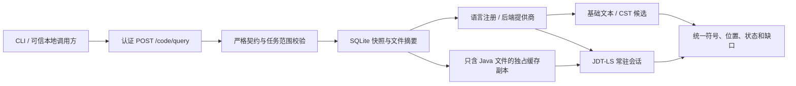

# 10 统一代码查询与 Java 语义服务

更新：2026-10-29。对应 QRY-02、QRY-03、QRY-04、QRY-05。首版交付Java；新接口与原QRY-01基础查询兼容，查询增强交付时数据库为schema v10。本篇保留该阶段验收记录；后续人工复核/导出升级到v11，见 [11 交互与复核导出](11.交互路径图人工复核与结果导出.md)。

## 需求与实现对应

| 需求 | 当前交付 | 验收证据 |
| --- | --- | --- |
| QRY-02 | 认证 HTTP、单行 JSON CLI、常驻监督服务、接口使用文档；统一能力/读取/搜索/符号/定义/引用/调用契约 | 独立 CLI 子进程、独立监督进程、真实 HTTP 与严格输入测试 |
| QRY-03 | JDT-LS stdio 查询；重载、跨文件定义、引用、调用层次适配；语义关系进入风险图与实际 Pi 上下文 | 真实 JDT-LS + 三文件样例 + 本机模型替身/真实 Pi SDK |
| QRY-04 | 项目、语言、内容版本对应的进程池；共享初始化、状态、预算、取消、回收、关闭与基础降级 | 进程复用、超时/退出/迟到响应、池容量/回收、降级缺口测试 |
| QRY-05 | LanguageRegistry、QueryRuntimeProvider、位置编码转换、QueryAdapterOutput | 语言协商、UTF-8/16/32、未知语言拒绝、统一适配测试 |

QRY-02 要求的 [接口使用说明](../../desktop/query-skill/SKILL.md) 是交付文件；本次开发未调用 skills，也未自动把该文件注册为 Pi 扩展或工具。

## 服务与证据路径



公开输入不接受项目根替换、任意 URI、shell、SQL、JVM 参数或服务器命令。`projectId + runId` 必须已有绑定快照。每次查询重新验证快照文件摘要，语义缓存不代替原文校验。修改、移动或删除原始源码目录，不改变已有任务的查询结果。

缓存只包含快照内 Java 文件和应用生成的 `.project`、`.classpath`、编译偏好。按包路径推导 Java source roots，支持 `src/main/java/demo/Foo.java` 等布局；包路径不匹配时返回 `JAVA_PACKAGE_PATH_MISMATCH`。原工程的 pom、Gradle、wrapper、用户 `.project`、脚本与资源不复制。

## 统一契约

新入口是 `POST /code/query`，复用本地 bearer 认证及 `{ok,requestId,data/error}` 外层协议。原 `/code/search`、`/code/read`、`/code/risks` 保持兼容；新接口的 search 直接搜索 SQLite 快照文本，旧 search 仍使用 rg 查询已登记目录。

请求示例中的项目与任务 ID 必须替换成已有任务：

```json
{
  "operation": "definition",
  "language": "java",
  "projectId": "project-id",
  "runId": "run-id",
  "filePath": "src/main/java/demo/Web.java",
  "line": 1,
  "column": 123,
  "maxResults": 20,
  "fallback": true
}
```

| operation | 附加字段 | 行为 |
| --- | --- | --- |
| capabilities | 无 | 语言注册能力与当前会话实际协商能力；不启动服务器 |
| status | 无 | 读取准备/索引/错误/待响应状态；不启动服务器 |
| prepare | 无 | 启动或复用该版本的语言会话 |
| read | filePath、line、endLine | 任务快照原文 |
| search | text | 字面量候选 |
| symbols | filePath | 文件内符号、容器限定名和重载签名 |
| definition、references | filePath、line、column | 定义、引用 |
| incomingCalls、outgoingCalls | filePath、line、column | 服务器声明支持时请求标准调用层次 |

所有操作要求 language、projectId、runId；每种操作有自己的字段白名单。公开位置从 1 开始，列按 UTF-16 计数，end 为不包含末尾字符的边界。适配层处理服务器选择的 UTF-8、UTF-16 或 UTF-32，拒绝跨越 Unicode 字符中间的位置。

`data` 固定包含 contractVersion=1、operation、status、language、backend、projectId、runId、snapshotId、sourceStamp、positionEncoding、items、truncated、gaps、runtime、errorCode。首版 backend 为 jdtls、basic 或 none；后端标签由适配器提供。

每个 item 包含位置、证据片段、resolution，以及可取得的完整 symbol：name、qualifiedName、signature、kind、声明 location 与 resolution。`resolution=semantic` 表示语言服务器定位，candidate 表示文本/CST 候选，source 表示原文。调用层次另有 `callSite`，不能把调用位置当成方法声明。JDT-LS incomingCalls 可能重写 selectionRange，适配器用文档 outline 还原声明位置。

## 状态与完整性

| status | 解释 |
| --- | --- |
| ok | 本次操作成功；运行时准备程度仍看 runtime |
| no-match | 本次查询范围没有匹配项，不代表代码安全 |
| partial | 截断、受限依赖或降级；必须同时保留 gaps |
| not-ready | 运行时缺失、退出或会话池达到容量 |
| timeout | 时间预算耗尽；fallback=false 时直接观察 |
| unsupported | 语言、操作或实际服务器能力未支持 |
| cancelled | 调用方或服务取消 |
| failed | 其他协议/后端失败 |

默认 fallback=true。语义能力失败时，适配器可返回基础候选，但 status 为 partial，保留原 errorCode 和 `BASIC_CANDIDATES_NOT_SEMANTIC`。降级后即使 items 为空，也不会变成“安全”或完整无命中。无基础适配器的未来语言不能错误复用 Java CST。

JDT-LS 只分析源文件与 JRE，不导入目标项目依赖，正常语义结果也携带 `JAVA_SOURCE_ONLY_NO_BUILD_CLASSPATH`，因此通常是 partial。快照外 file URI、jdt URI、库和反编译源码不作为本任务证据，记录 `EXTERNAL_LOCATION_OMITTED`。缺少可定位的外部关系不补造目标。

`runtime.state` 有 disabled、preparing、initializing、indexing、ready、failed、stopped。`index` 的 unknown/working/quiescent 仅描述收到的进度信息；ready 表示可处理请求，quiescent 仅表示观察到的进度结束。`wholeWorkspaceIndexed` 始终为 false。publishDiagnostics 通知不参与“全工作区完成”推断。

## 生命周期与预算

每个 CodeQueryService 持有语言后端提供商，而非唯一全局 Java 进程。Java 池按项目身份、java、sourceStamp 复用；同项目同内容的多个 run 共用会话，项目或内容不同则隔离。运行目录与 Eclipse workspace 均按实例新建。

| 资源 | 当前限制 |
| --- | --- |
| CodeQueryService 同时执行 | 2 个请求 |
| Java 会话池 | 最多 2 个版本会话 |
| 默认空闲回收 | 120 秒；最多间隔 30 秒检查 |
| JVM 堆 | 512MiB / 会话 |
| 启动 / 单次 LSP 请求 / 单次统一语义操作 | 默认 60秒 / 10秒 / 90秒 |
| 风险预处理语义确认 | 最多 64 个调用、90 秒总预算 |
| 输入 / 返回条数 | 16KiB / 默认50、最多100 |
| 结果 items 总量 / 单个片段 | 192KiB / 2000字符；read 允许12000字符 |
| 原文 read | 最多80行 |
| LSP header / message / pending | 8KiB / 8MiB / 32 |

同会话共享一个初始化 Promise；取消某个等待者不会杀掉其他调用正在使用的启动过程。请求超时发送 `$/cancelRequest`，清除 pending，迟到响应按 request id 丢弃。进程退出/协议破损会结算全部 pending，原始 stderr 不回显到业务日志。关闭先 shutdown、再 exit，异常时有界强制终止；释放缓存只针对该实例创建的目录。回收退出完成前仍计入池容量。

初始化失败不会对每个请求无限重启。等待空闲回收后重试，或重新启动服务。状态和缺口让调用方能看见这一点。

## 接入风险路径


正式服务在 CodeQueryService 中传入 dataRoot，预处理自动尝试语义增强。唯一语义定义可映射到已索引的方法时，设置 confirmed；否则保留候选/未解析关系。64调用预算、依赖缺失、外部位置、失败和超时都进入扫描 warnings。confirmed 只确认静态定位，不证明污染传播、有效防护或漏洞。Pi 仍需读源码并通过原有结构、引用与传播校验。

本次真实样例：`Web.query(String)` 调用重载的 `Service.search(String)`，再到 `Repo.query(String)` 与 Statement Sink。JDT-LS 正确区分 search(String)/search(int)，保存两条 confirmed 关系；定义、引用、入/出调用查询通过，同版本 starts=1。源码目录随后修改，查询仍读取旧快照。真实 Pi SDK 向本机替身请求2次、读取各步骤原文，最终保留 unknown。该结果没有被包装成“已确认漏洞”。

## CLI 与运行配置

服务启动前设置可信本机安装目录，不自动下载：

```powershell
$env:PI_AUDIT_JAVA_HOME = 'C:\tools\jdk-25'
$env:PI_AUDIT_JDTLS_HOME = 'C:\tools\jdtls'
npm run dev
```

Java HOME 也可从 JAVA_HOME 读取。应用最低检查 Java21，但选用的 JDT-LS 发行包可能要求更高版本。本次实际验证是 **Temurin 25.0.5+8 + JDT-LS 1.64.0-202610262040**；这个快照包在 Java21 下因 Eclipse 依赖要求 Java25 而不能启动，不将 README 的通用最低版本当成该包已验证兼容性。

| 已验证下载 | SHA-256 |
| --- | --- |
| [JDT-LS 固定快照](https://download.eclipse.org/jdtls/snapshots/jdt-language-server-1.64.0-202610262040.tar.gz) | `3e3fd3254bef2abc3af73db3b6c59b6b6d93554c7b69a0016e10dce395127ca9` |
| [Temurin25 Windows x64 包](https://github.com/adoptium/temurin25-binaries/releases/download/jdk-25.0.5%2B8/OpenJDK25U-jdk_x64_windows_hotspot_25.0.5_8.zip) | `636bdc13dc649ddc7d5921c5c7d23cca6e44fd19d662b45cc9c02135a6c96c42` |

CLI 需要 Node24+。`npm run query:serve` 用 PI_AUDIT_DATA_ROOT 打开已有任务数据库，由监督器通过 PI_AUDIT_QUERY_TOKEN 注入本次随机令牌。它只向 stdout 输出 ready/port；不会打印令牌。CLI 继承相同令牌与返回的 PI_AUDIT_QUERY_PORT，再从 stdin 读一个 JSON 请求。退出码见接口说明。

同一监督进程服务多次 CLI 调用；不要每次查询重新启动监督器。桌面内部直接使用同一 HTTP 契约，不把连接令牌交给渲染器。两个独立终端不会自动共享临时环境变量，自动化调用应由同一可信父进程把连接信息传给子进程，示例见本地学习文档26。

Maven/Gradle 导入、自动构建、wrapper、Lombok、注解处理和依赖源码下载关闭；JVM 注入环境选项不继承。`workspace/applyEdit` 返回 applied=false；没有公开 executeCommand、文件写入或运行目标业务接口。这是应用层约束，不是 OS 沙箱，也不是对未来任意 JDT-LS 插件的安全认证。

## 代码入口与扩展边界

| 文件 | 职责 |
| --- | --- |
| desktop/src/shared/query-contracts.ts | 请求、结果、位置、符号与运行时状态 |
| service/query/unified-service.ts | 校验、快照、语言分派、降级、预处理确认 |
| service/query/language-registry.ts | 注册描述、运行时提供商与适配输出接口 |
| service/query/java-runtime.ts | Java准备、受控工程、协商、进程池与回收 |
| service/query/lsp-rpc.ts | stdio JSON-RPC、取消、超时、关闭与消息限额 |
| service/query/semantic-java.ts、positions.ts | 语义 DTO、作用域与编码归一化 |
| service/query/basic-adapter.ts | 文本/CST 候选降级 |
| service/scanning/preprocess.ts、chains/service.ts | confirmed 关系进入原风险路径 |
| scripts/query-cli.mjs、query-service.mjs | 命令行调用与常驻本地监督器 |

后续语言需增加已验证的快照输入范围、LanguageAdapter、QueryRuntimeProvider、编码/位置/符号适配与独立测试。多注册一个服务器只解决路由与协议适配，不能证明 Java→其他语言的数据传播。首版默认注册仅 java；Python、TypeScript、CodeGraph、跨语言传播与完整依赖解析均未作为交付能力。

## 验证

在 desktop 执行：

```powershell
node --disable-warning=MODULE_TYPELESS_PACKAGE_JSON --test tests/query-enhancements.test.mjs
$env:PI_AUDIT_TEST_JDTLS = '1'
# 先设置 PI_AUDIT_JAVA_HOME 和 PI_AUDIT_JDTLS_HOME
node --disable-warning=MODULE_TYPELESS_PACKAGE_JSON --test tests/query-jdtls.test.mjs
node --disable-warning=MODULE_TYPELESS_PACKAGE_JSON --test tests/*.test.mjs
npm run build
npm run lint -- --max-warnings=0
```

本次154项测试全部通过、0跳过；其中新增10项确定性查询测试和1项真实 JDT-LS/Pi 联调。未设置 PI_AUDIT_TEST_JDTLS 时，真实服务器测试会明确 skipped，不能据此声称真实语义链路已通过。没有使用真实付费模型，也未重复模板/Electron、公网克隆和打包签名专项。

上游协议和行为核对依据：[LSP 3.17](https://microsoft.github.io/language-server-protocol/specifications/lsp/3.17/specification/)、[JDT-LS 启动说明](https://github.com/eclipse-jdtls/eclipse.jdt.ls)、[配置键实现](https://github.com/eclipse-jdtls/eclipse.jdt.ls/blob/main/org.eclipse.jdt.ls.core/src/org/eclipse/jdt/ls/core/internal/preferences/Preferences.java)、[调用层次实现](https://github.com/eclipse-jdtls/eclipse.jdt.ls/blob/main/org.eclipse.jdt.ls.core/src/org/eclipse/jdt/ls/core/internal/handlers/CallHierarchyHandler.java)。上游可变内容不能代替本项目固定版本的实测记录。
