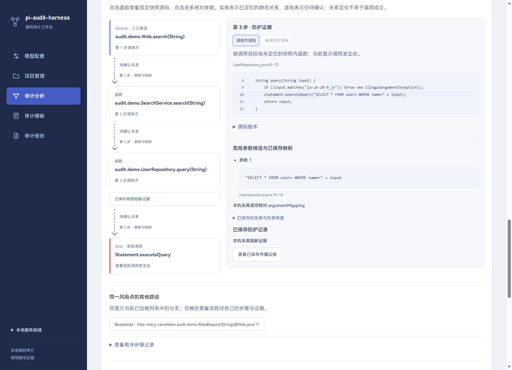
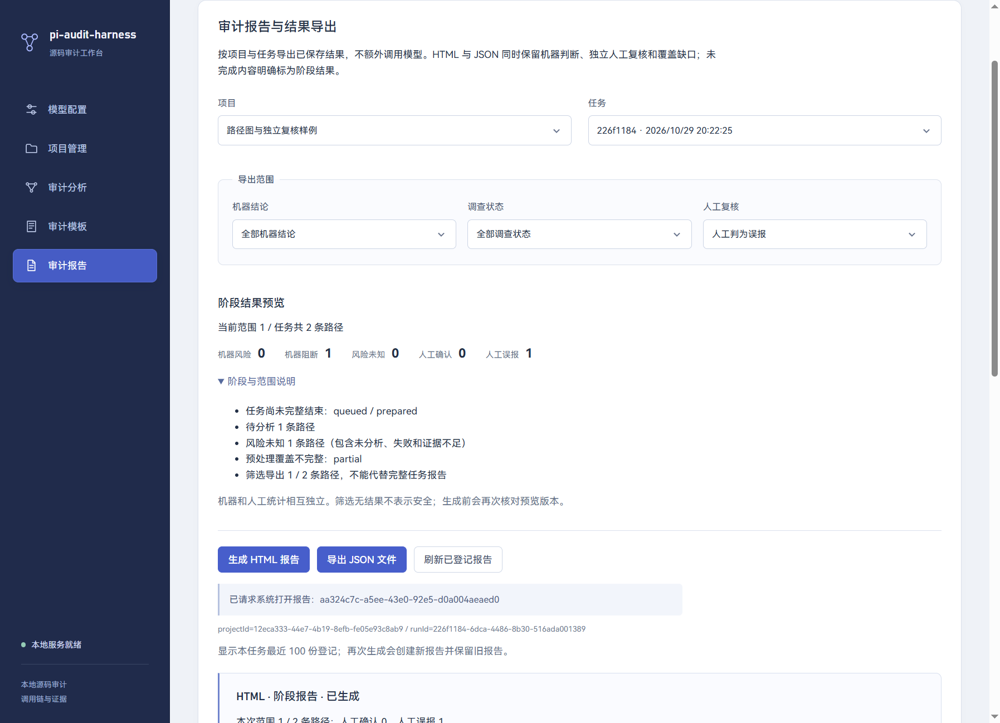
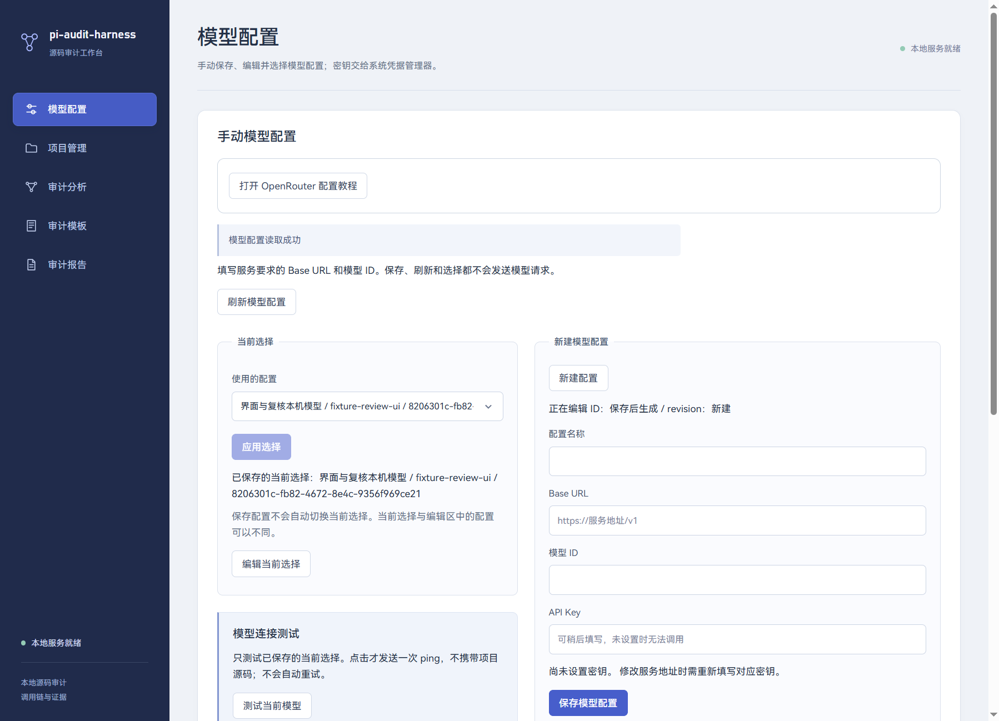

# 11 交互路径图、人工复核与结果导出

更新：2026-10-29。完成 UI-02、UI-04、REP-01、REP-03。按用户要求保留原有配色；参考 [Anthropic frontend-design](https://github.com/anthropics/skills/blob/main/skills/frontend-design/SKILL.md) 的信息层级、可访问交互与视觉复查方法，不引入其他开发 skills。本篇记录实现、接口、数据和验收边界。

## 1. 交付与入口

| 需求 | 实现 | 主要入口（相对 desktop/src） |
| --- | --- | --- |
| UI-02 | 单路径有向图，Source/函数/Sink、关系状态、防护与同 Sink 分支；点击定位固定快照源码和已保存映射 | shared/call-path-view.ts、renderer/src/components/CallPathGraph.tsx、service/reviews/service.ts |
| UI-04 | 产品展示名统一；模型选择/编辑双栏、工具检测全宽；浅色 hover 文字与内缩箭头；沿用配色 | main/index.ts、renderer/src/App.tsx、components/ModelsPage.tsx、assets/main.css |
| REP-01 | 四种独立人工状态、备注、追加版本、机器结果基线与并发保护 | shared/review-contracts.ts、storage/review-repository.ts、components/HumanReviewPanel.tsx |
| REP-03 | 同快照预览、三维筛选、HTML/JSON、阶段原因、登记后原生另存 | shared/report-contracts.ts、reports/snapshot.ts、reports/service.ts、main/report-export.ts、components/ReportsPage.tsx |

页面在现有四标签详情中加入调用图，人工复核区在标签下方；原传播、防护、过程和有序步骤仍可查看。点击、保存备注、预览、导出和历史恢复均不增加供应商模型请求。

## 2. 调用图与源码身份

图由已保存的有序 path_steps 生成：N 条调用关系对应 N+1 个节点。入口确实具有 HTTP 来源候选标识才显示 Source；Sink 由边的真实 isSink 决定。实线/“静态已确认”表示 confirmed 调用定位；虚线与文字表示 candidate/unresolved，均不等于已证明漏洞。防护标记只来自已保存 propagation.defense.blocked，不能从函数名推断。

节点、关系和防护都是原生 button，可 Tab 到达、Enter 激活；上下方向键及 Home/End 在路径元素间移动焦点。状态同时使用文字与线型，不单靠颜色。侧栏显示调用方/被调用方、调用位置、危险参数、输入输出映射和防护依据；传播引用可继续到原证据标签核对。

分支是**当前已加载列表中同项目、任务、Sink 与规则的其他路径**，明确标注范围，不声称列出了全仓库所有分支。切换会重新请求对应详情。详情选中后使用全宽布局，图与检查区并排；窄屏纵向堆叠，代码局部滚动。

源码动作只接受 projectId/runId/pathId/stepIndex/target。服务从当前路径取边，再解析任务固定快照中的方法范围，返回 snapshotId/sourceStamp。不能由页面任意指定文件路径。调用方方法无法完整定位时仅返回调用行并标记 complete=false；被调用方无法验证方法范围时明确失败，不以磁盘当前文件或猜测范围替代。范围和文本沿用查询服务的 80 行/12000 字符限制。



## 3. 人工复核的数据隔离

机器有调查状态 status 和风险 verdict；人工记录另有四种状态：

| 值 | 展示 | 含义 |
| --- | --- | --- |
| unreviewed | 未复核 | 默认无人工判断；revision=0 表示尚未保存 |
| confirmed | 人工确认 | 审阅者确认，具体依据写在备注中 |
| false_positive | 人工判为误报 | 保留机器原结论，另记误报依据 |
| needs_more_info | 待补充 | 人工认为仍缺少材料 |

schema v11 追加 STRICT 表 path_review_versions，联合主键为 project_id/run_id/path_id/revision，复合外键约束路径归属；UPDATE/DELETE 触发器拒绝改写历史。每次保存追加一条，包含 status、脱敏 note、baseline_json、saved_at。备注最多 6000 字符，拒绝无意义控制字符。没有添加登录用户/多人身份字段，也不将版本记录称为带身份签名的团队审计日志。

机器基线摘要取当前路径状态、结论、摘要、更新时间、路径哈希及最近尝试信息，SHA-256 得到 version。保存必须同时满足 expectedRevision 与 baselineVersion；校验和插入在同一事务中。前者阻止旧窗口覆盖新人工记录，后者阻止把针对旧机器结果的判断保存为当前结果的复核。机器重试后旧人工记录保留，并以 stale=true 提醒重新核对。

刷新基线保留当前草稿，但需要用户重新检查后保存；切换路径会丢弃未保存草稿，界面有明确说明。复核不更新 call_paths、path_steps、源文件字节或取证引用；报表中的机器风险数不受人工状态影响。

## 4. 严格接口与进程边界

所有本地 HTTP 接口沿用 bearer 认证。preload 只公开固定动作，主进程检查发送窗口/主 frame；客户端校验 DTO 及项目、任务、路径/步骤身份，服务再次校验。页面无数据库、通用 SQL、任意路径或自由文件写入入口。

| 动作/接口 | 允许输入 | 结果 |
| --- | --- | --- |
| reviews get / POST /reviews/get | projectId/runId/pathId | 当前人工版本、原基线、当前基线、stale |
| reviews save / POST /reviews/save | 上述身份、expectedRevision、baselineVersion、status、note | 新的完整人工记录 |
| reviews source / POST /reviews/source | 路径身份、stepIndex、target=caller/callee | 固定快照源码范围及完整性 |
| reports preview / POST /reports/preview | projectId/runId/filter | 统计、阶段原因、snapshotKey |
| reports export / POST /reports/export | 上述身份、format、filter、expectedSnapshotKey | 已登记报告状态 |
| reports generate / POST /reports/generate | projectId/runId | 兼容旧的全量 HTML 生成 |
| reports list/file | 任务身份，file 另带 reportId | 登记列表/验证后的文件元数据 |
| preload saveReport / reports:save | projectId/runId/reportId | cancelled、savedPath；路径来自主进程原生对话框 |
| preload openReport | projectId/runId/reportId | 仅 HTML，校验后交给系统打开 |

输入额外字段、错误枚举、跨作用域路径都拒绝。复核请求体有 32KiB 限制。关键错误：REVIEW_CONFLICT、REVIEW_MACHINE_CHANGED、REVIEW_SCOPE_NOT_FOUND、PATH_SOURCE_UNAVAILABLE、REPORT_SNAPSHOT_CHANGED、REPORT_LIMIT。报告生成失败会返回 status=failed 的登记记录及错误码，调用方须检查业务状态，不能只看 HTTP 成功。

## 5. 筛选、统计与一致性

filter 三个字段都必填：verdict=all/dangerous/safe/unknown；pathStatus=all 或合法调查状态；reviewStatus=all 或四种人工状态。三个条件取交集。默认全部为 all。

同一数据库事务读取全任务路径、各路径最新人工版本、固定配置和快照，计算：

- statistics：所选路径的机器统计；allStatistics：任务整体机器统计。
- reviewCounts：所选路径四种人工状态计数；stale 是额外重叠计数，不能再次相加。
- riskPoints：所选危险路径按 sinkEdgeUid/ruleId 组合去重；不同于危险路径条数。
- stageReasons：任务尚未结束、故障码、待办/分析中/失败/未知、覆盖截断、筛选子集、过期人工基线等原因。

即使筛选掉待分析路径，任务整体未完成原因也保留；空筛选得到 0 条，不能宣称整个项目安全。任何非全量筛选均注明阶段/筛选报告。任务 finishedAt/errorCode 同时进入文件，未知与失败不转成 safe。

先脱敏，再对完整快照计算 SHA-256 snapshotKey；计算时排除 generatedAt 的变化。页面预览和导出都走 savedReportSnapshot，导出重新读事务快照并校验预览摘要。如果机器结果或人工记录已变化，生成登记为失败并提示刷新，避免按过时预览静默生成另一组内容。文件中的 generatedAt 是实际生成时间。

当前上限是每任务 1000 条路径、快照 15MiB、产物 20MiB；超限明确拒绝，不静默截断。预览每两秒刷新，属于本机数据库汇总，不调用模型。

## 6. 文件格式、版本和发布

JSON 根字段含 schema="pi-audit-harness.report"、version=1、reportId，及 filter/snapshotKey/project/run/sourceSnapshot/reviewConfig/transmissions/scan/statistics/allStatistics/reviewCounts/stageReport/stageReasons/paths/humanReviews/generatedAt。paths 保留机器详情，humanReviews 用路径身份关联独立人工记录与基线。仅导出被筛选路径的人工记录和传输记录。JSON version 与数据库 schema 版本互不替代。

JSON 由固定序列化器生成，转义 `<`、`>`、`&`、U+2028/U+2029；JSON.parse 后仍是原来的文本语义。HTML 沿用真实 Pi `/report` 固定模板命令，增加人工结论、筛选和阶段信息；不发送模型请求。HTML 文本转义、CSP 与禁外部资源策略继续生效。报告不查询 API Key；备注/证据再次经过既有凭据脱敏，测试覆盖 Key、Bearer 和典型凭据文本。自动识别无法保证识别任意无标识秘密，界面明确提醒勿把密钥写入备注。

schema v11 给 reports 追加 format 与 filter_json。summary_json 保存本次统计、snapshotKey、阶段原因、人工计数、总路径数和文件 SHA-256。旧报告默认 html/all，新元数据缺失保持未知；迁移 v1—v10 SQL 和校验和不变。

登记文件在应用目录以固定 reportId 命名，pending → 临时独占写入 → rename → 摘要验证 → ready；失败保留 failed。另存是第二步：先按 ID 验证登记文件，再弹原生保存框，扩展名必须匹配；解析目标父目录真实路径，拒绝应用运行目录、目录联接绕回、链接或特殊目标，独占临时文件后发布副本。取消只取消副本保存，已登记报告仍可稍后另存。原生覆盖确认由系统对话框处理；页面不能提交保存路径。

文件系统与数据库仍不构成跨资源事务，不能宣称任意崩溃都无孤立文件。这里防护普通链接、损坏和范围越界，不提供操作系统级恶意本地进程沙箱。



## 7. UI-04 的颜色约束

保持原 root token：ink #233047、muted #65718a、canvas #eff2f7、surface #ffffff、line #dbe1ec、accent #475ecb，风险/阻断沿用已有语义色。字体继续使用本机字体，不新增字体请求。只调整布局、留白、文字状态和选择控件。

模型页宽屏左侧选择/测试、右侧完整编辑表单，已保存列表两栏；窄屏堆叠。项目工具检测占完整面板宽度。主按钮 hover 显式保留浅色文字，select 箭头距右侧 14px、文本右侧留白 42px。展示名、窗口标题和页面标题为 pi-audit-harness；应用数据目录/安装身份未迁移，避免历史数据路径漂移。



## 8. 验证与边界

新增 tests/review-export.test.mjs 共 9 项，覆盖 v10→v11 历史、追加版本/并发、源码身份、认证与 DTO、过滤统计、真实 Pi HTML/JSON、阶段原因、篡改拒绝和原生副本边界。完整 Node 回归 163 项通过、0失败、0跳过，包含真实 JDT-LS/Pi 集成。

tests/review-electron-main.ts 在真实 Electron、React、utilityProcess 与 Pi SDK 上验证：节点/边/防护/分支、原生方向键、固定源码、人工状态保存、机器证据完全不变、脱敏与文本显示、筛选一致、JSON 取消/另存、HTML 生成/打开、不同 PID 恢复。模型、调用图和报告在 1450/920/480 宽度检查；模型主按钮 hover、箭头和原主题 token 也有实际检查。截图均来自隔离的测试数据。

复现命令在 desktop 目录执行：

```powershell
node --disable-warning=MODULE_TYPELESS_PACKAGE_JSON --test tests/review-export.test.mjs
.\node_modules\.bin\electron-vite.cmd build --config electron.review-test.config.ts
node tests/run-review-electron.mjs
npm run build
npm run lint -- --max-warnings=0
```

本次使用本机协议替身与测试假 Key，只有初始分析触发模型替身；不代表真实付费供应商的审计准确率评估。UI 图是路径审阅器，不是自由编辑或全仓库关系画布；人工复核不代替自动重新取证；旧任务缺快照时无法补造源码。个人学习教程 27—31 保留在本地 .local/learning，不发布至技术目录索引。
