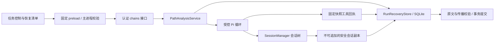
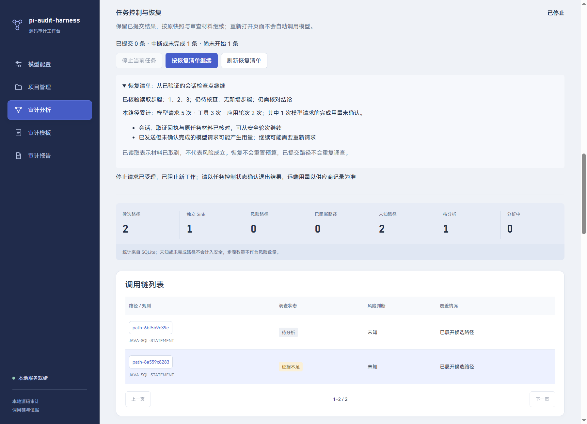
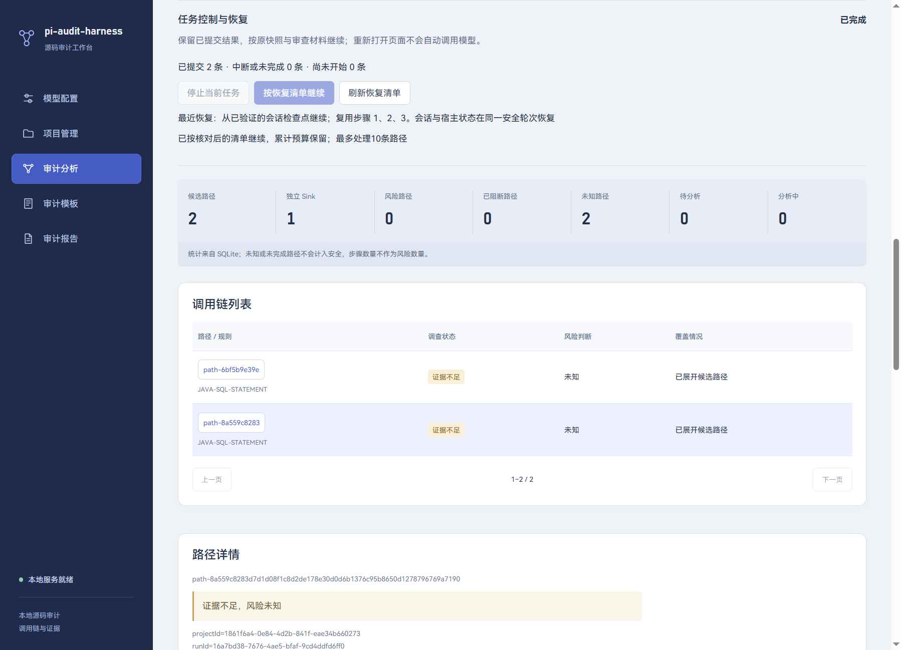

# 12 任务停止与可验证会话恢复

更新：2026-10-29。对应 RUN-01、RUN-02，采用用户确认的“证据驱动的可验证会话恢复”。实现限于本地单服务管理的审计路径和待办队列；Pi 固定版本为 1.2.0，SQLite 升级至 v12。恢复不会自动启动模型请求。

## 1. 交付范围与架构

| 需求 | 已实现行为 |
| --- | --- |
| RUN-01 | 用户主动停止；停止受理、等待本地在途操作、停止完成分别展示；阻止新请求/领取与迟到结果提交；保留已提交结果与阶段报告 |
| RUN-02 任务边界 | 路径领取与恢复身份同事务；已提交路径跳过；中断路径按原快照、审查材料和模型配置恢复；累计预算、用量不确定性与恢复清单 |
| RUN-02 会话边界 | 完整应用轮次保存 Pi 原生会话和宿主状态；跨进程重开；工具回执核验；会话损坏明确降级；已校验 finish 可在无新模型请求下重新验证并提交 |



Pi负责对话树与模型上下文语义；Harness负责身份、进度、证据、预算和提交。SSE继续负责已保存事件的传输。没有引入LevelDB、Redis/ZSet、通用SQL接口或额外模型摘要请求。

## 2. Pi原生能力及本项目的接入方式

依据精确安装包源码、[官方SDK](https://pi.dev/docs/latest/sdk)及[会话格式](https://pi.dev/docs/latest/session-format)核查。SessionManager支持消息树、按文件重开、上下文重建及自定义条目；custom entry可保留宿主元数据，但不自动进入模型上下文。

新调查在受控内存manager上运行，只有完整安全轮次才由Harness发布原生JSONL格式的检查点，避免把半个模型回复误认为可续跑状态。恢复先验证原生文件和宿主记录，再复制为新的活动文件，用SessionManager.open打开副本并传入createManagedSession；SDK不向不可变检查点追加。模型、资源加载器、白名单工具和禁用自动重试/压缩的设置都由应用重新注入，不能落回SDK默认全局工具与配置。

这实现的是已输出上下文和业务进度恢复，不恢复模型内部计算、KV缓存、未输出内容或某个供应商请求的精确执行位置。Native CLI的“继续最近会话”也不用于业务恢复；这里始终使用数据库登记的指定文件和作用域。

## 3. 数据模型：v12追加五表

迁移文件为desktop/src/service/storage/run-recovery-migration.ts；旧v1—v11 SQL及校验和保持不变。当前31表、16个显式命名索引。

| 表 | 核心字段和职责 |
| --- | --- |
| run_controls | run/project、state、revision、updated_at、首次执行的非敏感model_json；独立控制状态，不改旧stage CHECK |
| path_recovery | path/run/project、journey_id、epoch、attempt、binding_json/hash、limits_json、state、requests/tools/rounds、receipt_json、Pi会话关联 |
| recovery_checkpoints | checkpoint_id、完整作用域、journey/epoch/attempt、binding_hash、Pi session/leaf、受控文件名/摘要/大小、host_json、时间 |
| recovery_tools | journey/step主键、路径作用域、binding_hash、evidence_json/hash、epoch与保存时间；成功取证回执 |
| recovery_requests | 请求ID、journey/path/run/project/epoch、started/received/uncertain、SDK usage_json与时间 |

检查点和工具回执拒绝UPDATE/DELETE，版本通过追加保留。path_recovery是当前调查/最近执行的索引；显式重新审阅创建新的journey，旧检查点、请求记录仍保留。恢复沿用原journey、增加epoch和attempt。

任务原有status仍使用cancelled等合法值，主动停止的audit_runs.stage为interrupted、errorCode为RUN_USER_STOP；细分的“等待/已停止”由run_controls表达。这样无需重建有外键关联的旧任务表，也不改历史迁移。

## 4. 停止状态和提交屏障

```text
running → stop_requested → waiting_external → stopped
进程意外退出 → interrupted → 用户核对清单 → running
队列本段结束 → idle / completed
```

停止先保存控制状态和任务结束原因，阻止下一路径和下一模型请求，再发送取消信号。接口返回受理；当本地执行实际结算后才显示stopped。不能取消或忽略取消的工作仍显示waiting_external；此时恢复不可用。没有超时后偷偷并行启动第二个执行。

应用会尽力中止Pi并等待其本地会话空闲，但不能证明供应商已停止计算或收费。模型意图已保存、未收到完整确认的请求记为uncertain，报告和恢复清单如实提示。

每次执行的epoch和attempt参与存活校验，工具读取、回执、模型请求、过程回写和结果提交前都检查。最终complete还在数据库事务中检查当前attempt、恢复状态和控制屏障。停止先提交，则迟到结果不能改成成功；完整结果先提交，则保留该结果。失败回写也不能覆盖新attempt。

未提交路径保持unknown，通常收敛为unresolved；主动停止不被包装成safe。重复停止请求不会重新启动工作。服务关闭按中断处理，启动时只整理遗留状态，不自动调用模型。

## 5. 两层检查点与原子领取

任务层以每条pathId的结果事务为边界。结果、步骤证据、attempt终态、恢复completed状态和SSE终态在同一事务中提交。共享Sink的不同入口仍分别调查，风险点统计继续按Sink/规则去重。

路径层在一次session.prompt完整结束、结构化continue/finish合法、工具调用与结果配对后保存。host包含version、readSteps、fingerprints、noProgress、evidenceBytes、next、action及可选finish结果。finish结果保存前先经过现有结构/原文/传播校验，恢复后仍重新校验，再由外层应用覆盖限制与来源约束后提交。

claim/claimNext增加内部同步onClaim回调：领取attempt、创建SSE会话、写入恢复身份/配置绑定、冻结首次模型元数据都在同一SQLite事务。强制结束于领取刚完成的位置，也能恢复为当前未提交路径；不会出现“任务已领取而恢复关联未保存”的窗口。

## 6. 原材料、证据与预算核验

binding包含项目/任务/路径、原pathHash及必要调用位置、snapshotId/sourceStamp/文件清单摘要、任务固定知识与项目要求摘要、规则摘要、非敏感模型ID/版本/目标/协议，以及恢复/工具/验证器/Pi协议标识。

恢复会验证原快照文件的字节摘要，使用runId固定材料。当前磁盘源码或项目当前要求改变不会替换旧任务。首次执行的模型元数据固定到任务；配置revision或目标改变时阻止原条件续跑，凭据重新由系统安全解析，实际发送仍执行原有授权检查。API Key不作为检查点绑定字段。

工具回执按journey与step保存，与原path、binding绑定。复用前检查摘要、步骤文件范围、行号、原快照原文以及组合文本；支持实际查询返回的CRLF和有界片段。会话核验还检查消息父子链、toolCall/toolResult配对、工具名称/参数和实际输出是否匹配回执。单有模型“我已读过”的文字不算证据。

请求数、工具数和应用轮次在执行前持久计数，恢复不清零；同一路径累计受原limits约束。noProgress及证据指纹从安全轮次恢复。重建会话首次重新附着已核验证据，不被当成重复查询无进展；后续无进展仍受原限制。

默认上限沿用4应用轮、24工具调用、28模型请求、64KiB唯一证据、单段110秒。单段超时重新计时，暂停期间不计运行时间；模型/工具/轮次总量仍跨恢复累计。当前不提供静默扩充预算或自动上下文摘要，检查点单文件最多4MiB；超限保留前一安全边界并明确失败。

## 7. 三种恢复与清单一致性

| 模式 | 条件与行为 |
| --- | --- |
| native | 文件、leaf、宿主状态和证据均可验；在副本上重开原生上下文，继续下一轮；finish检查点可无新模型请求重新验证并提交 |
| rebuild | 没有可用完整会话，但成功工具回执可验；新会话带入证据和待核查材料，工具层复用回执，明确说明模型工作可能重做 |
| restart | 尚无安全检查点/证据，或处于已提交路径后的待办边界；从当前未提交路径开始，已提交路径跳过 |

原快照损坏、规则或模型绑定变化、预算耗尽等返回blocked，不能静默换条件。最新检查点损坏时可选择较早完整检查点；没有可用检查点则明确降级。只写了toolCall或只完成部分输出不补造成功toolResult。当前工具仅只读固定快照；将来的外部写操作不能直接套用自动重放规则。

recovery接口返回作用域、revision、控制状态、已提交/待办/中断数量、候选路径、模式、检查点ID、已取证/剩余步骤、累计用量、未确认请求、说明和最近恢复来源。恢复清单摘要recoveryKey由这些事实计算；resume必须带expectedRecoveryKey。读取后状态发生变化则RUN_PLAN_CHANGED，要求刷新。哈希用于一致性检测，不是身份签名或正确性证明。

恢复清单显示“已读取”而不是“传播已证明”。最终结论依然通过validateResult、validateTaint、reconcileTaint以及原始引用校验。



## 8. 文件发布与故障窗口

安全会话使用应用recovery目录中的内部随机文件名，不接受前端路径。普通目录/文件、链接和大小检查通过后，独占临时文件写入、fsync、rename，计算摘要，再登记不可变检查点。恢复只使用登记且可验证的文件，活动副本与检查点分开。

| 故障点 | 恢复结果 |
| --- | --- |
| 领取事务未完成 | 全部回滚，仍为未领取 |
| 领取已提交、首个请求前中断 | 原关联与配置仍在，可明确重跑 |
| 模型请求在途 | started转uncertain，保留次数和可能用量 |
| 工具回执已保存、尚未返回给模型 | 不宣称模型已消费；新会话可按证据重建并合法附着 |
| 文件已发布、检查点登记前 | 孤立文件不作为恢复依据，使用回执或较早检查点 |
| finish已校验保存、结果事务前 | 重开、重新验证，再提交；该路径无需再请求模型 |
| 结果事务后、界面收到事件前 | 结果已提交，跳过路径；SSE读取原终态 |

SQLite与文件系统不是跨资源事务。普通进程强制结束已实测；文件同步与摘要检查不等于所有硬件掉电场景的证明。当前保留孤立诊断产物，不提供自动清理UI；没有新增对恶意本地进程/数据库修改的操作系统级隔离保证。

## 9. 接口和页面

| 固定动作 | 输入 | 行为 |
| --- | --- | --- |
| POST /chains/recovery | projectId/runId | 只读校验与恢复清单，不请求模型 |
| POST /chains/stop | projectId/runId | 持久受理、取消信号和当前控制清单 |
| POST /chains/resume | projectId/runId/expectedRecoveryKey/maxPaths | 核对后启动，最多1—100条；桌面默认10条 |

动作沿用DesktopApi.audit、固定preload、主进程窗口/mainFrame和动作白名单、bearer认证、输入/输出严格DTO及作用域校验。多余字段、任意sessionFile、非法哈希/数量或错误归属均拒绝。页面不传会话内容、SQL、模型Key或文件路径。

RunControlPanel在审计页显示，按2秒只读刷新；只有实际运行时可停止，只有满足清单条件才可恢复。旧SSE重连按钮仍仅补发事件，不启动恢复；新恢复使用新attempt和新的SSE会话，保留旧历史。

## 10. 报告和人工复核

HTML/JSON增加recovery段：controlState、所选路径范围的recordedRequests/uncertainRequests，以及每条路径epoch/state/lastRecovery。不会导出原生会话全文、活动路径、API Key或未筛选路径的记录。已保存的旧报告不改变。

停止后的阶段报告保留RUN_USER_STOP、任务未完成、unknown及覆盖原因。请求记录次数包含实际发送边界前的持久意图，不等于供应商收费次数；usage_json记录SDK返回内容，未返回时保持不确定，不估算真实账单。原机器/人工统计口径不变。

人工备注和版本不被恢复重写；机器新尝试更新后，现有基线机制会提示旧人工记录过期。



## 11. 验证与复现

新增tests/run-recovery.test.mjs共14项，涵盖真实Pi重开与宿主恢复、停止/不可取消等待、损坏会话回退、配置/预算/严格DTO、停止阶段报告、v11迁移历史、跨PID强制结束，以及领取、工具回执、文件发布、finish检查点、结果提交和在途请求六类窗口。使用真实Pi SDK和本机模型协议替身，不调用真实付费供应商。

tests/run-recovery-worker.mjs只在隔离测试中注入SIGKILL；生产代码没有故障注入分支。tests/run-electron-main.ts验证真实React/utilityProcess/Pi、按钮受理/停止/恢复、不同PID恢复前不自动请求模型、CRLF原快照、磁盘变化后续跑、恢复来源JSON及1450/920/480布局。代码入口为shared/run-contracts.ts、chains/recovery.ts、agent-loop.ts、path-analysis.ts、storage/scan-repository.ts和RunControlPanel.tsx。

在desktop目录执行：

```powershell
node --disable-warning=MODULE_TYPELESS_PACKAGE_JSON --test tests/run-recovery.test.mjs
.\node_modules\.bin\electron-vite.cmd build --config electron.run-test.config.ts
node tests/run-run-electron.mjs
npm run build
npm run lint -- --max-warnings=0
```

真实Java全量回归另需PI_AUDIT_TEST_JDTLS=1及兼容运行时，见[10 查询服务](10.统一代码查询与Java语义服务.md)。完整当前验收见[07 实现进度与验收](07.实现进度与验收.md)。学习教程32—36在本地.local/learning，包含原理、代码链路、故障实验和排查，不进入线上技术索引。
